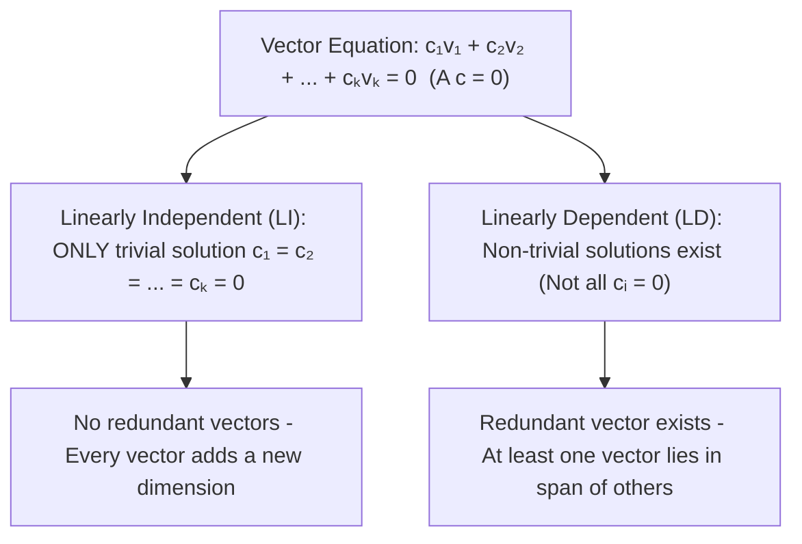
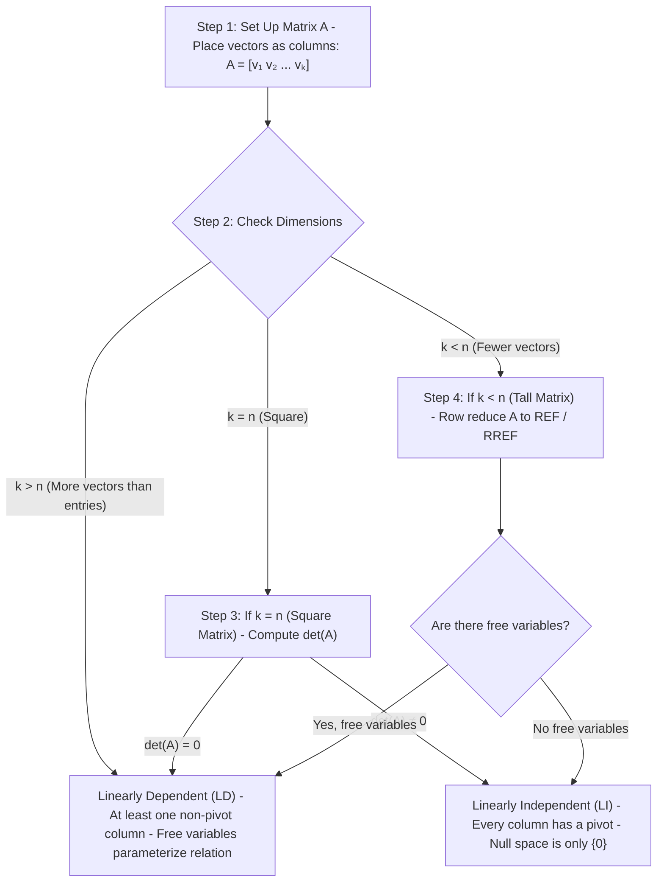

## 1. Linear Combinations

Given a set of vectors $S = \{\mathbf{v}_1, \mathbf{v}_2, \dots, \mathbf{v}_k\}$ in a vector space $V$, a **linear combination** is any vector $\mathbf{w} \in V$ obtained by multiplying each vector $\mathbf{v}_i$ by a scalar $c_i$ and adding them together:

$$
\Huge
\mathbf{w} = c_1 \mathbf{v}_1 + c_2 \mathbf{v}_2 + \dots + c_k \mathbf{v}_k = \sum_{i=1}^{k} c_i \mathbf{v}_i
$$

Where $c_1, c_2, \dots, c_k \in \mathbb{R}$ are scalars known as **weights** or **coefficients**.

### Matrix Formulation

Any linear combination of vectors in $\mathbb{R}^n$ can be expressed compactly as a matrix-vector product:

$$
\Large
A \mathbf{c} = \begin{bmatrix} \mathbf{v}_1 & \mathbf{v}_2 & \dots & \mathbf{v}_k \end{bmatrix} \begin{bmatrix} c_1 \\ c_2 \\ \vdots \\ c_k \end{bmatrix} = \mathbf{w}
$$

Determining whether a given vector $\mathbf{w}$ is a linear combination of $\{\mathbf{v}_1, \dots, \mathbf{v}_k\}$ is equivalent to testing whether the linear system $[A \mid \mathbf{w}]$ is **consistent** (has at least one solution).

---

## 2. Span of a Set of Vectors

The **Span** of a set of vectors $S = \{\mathbf{v}_1, \mathbf{v}_2, \dots, \mathbf{v}_k\}$, denoted $\operatorname{Span}(S)$ or $\operatorname{Span}\{\mathbf{v}_1, \dots, \mathbf{v}_k\}$, is the set of **all possible linear combinations** of those vectors:

$$
\Large
\operatorname{Span}\{\mathbf{v}_1, \mathbf{v}_2, \dots, \mathbf{v}_k\} = \left\{ \sum_{i=1}^{k} c_i \mathbf{v}_i \;\middle|\; c_i \in \mathbb{R} \right\}
$$

### Geometric Interpretation in $\mathbb{R}^3$

| Vectors in $S$ | Condition | $\operatorname{Span}(S)$ | Geometric Shape |
| :--- | :--- | :--- | :--- |
| Single vector $\{\mathbf{v}_1\}$ | $\mathbf{v}_1 \ne \mathbf{0}$ | $\mathbf{x} = c_1 \mathbf{v}_1$ | **Line** through the origin |
| Two vectors $\{\mathbf{v}_1, \mathbf{v}_2\}$ | Non-collinear ($\mathbf{v}_1 \ne k\mathbf{v}_2$) | $\mathbf{x} = c_1 \mathbf{v}_1 + c_2 \mathbf{v}_2$ | **Plane** through the origin |
| Three vectors $\{\mathbf{v}_1, \mathbf{v}_2, \mathbf{v}_3\}$ | Non-coplanar | All combinations | **Entire 3D space** ($\mathbb{R}^3$) |
| Any set containing only $\mathbf{0}$ | $\mathbf{v} = \mathbf{0}$ | $\{ \mathbf{0} \}$ | **Origin point** only |

> [!NOTE]
> $\operatorname{Span}(S)$ is guaranteed to be a valid subspace of $V$ because it always contains the zero vector ($c_i = 0$) and is closed under both vector addition and scalar multiplication.

---

## 3. Linear Independence vs. Linear Dependence

A set of vectors is linearly independent if no vector in the set can be created from a linear combination of the remaining vectors (no redundant vectors).

### The Fundamental Vector Equation

Consider the homogeneous vector equation:

$$
\Huge
c_1 \mathbf{v}_1 + c_2 \mathbf{v}_2 + \dots + c_k \mathbf{v}_k = \mathbf{0}
$$

In matrix form: $A\mathbf{c} = \mathbf{0}$, where $A = \begin{bmatrix} \mathbf{v}_1 & \mathbf{v}_2 & \dots & \mathbf{v}_k \end{bmatrix}$.



---

## 4. Immediate Inspection Rules (Before Doing Row Operations)

You can often determine dependence immediately by inspection without performing row reduction:

1. **The Zero Vector Rule**: Any set containing the zero vector $\mathbf{0}$ is **always Linearly Dependent**.
   $$\text{Proof: } 1 \cdot \mathbf{0} + 0 \cdot \mathbf{v}_1 + \dots = \mathbf{0} \quad (\text{a non-trivial weight } c = 1 \ne 0 \text{ exists}).$$
2. **Two-Vector Proportionality**: A set of two vectors $\{\mathbf{v}_1, \mathbf{v}_2\}$ is linearly dependent if and only if one is a scalar multiple of the other:
   $$\mathbf{v}_1 = k \mathbf{v}_2$$
3. **Too Many Vectors ($k > n$)**: Any set of $k$ vectors in $\mathbb{R}^n$ with **more vectors than dimensions ($k > n$)** is **always Linearly Dependent**.
   - The matrix $A$ has dimensions $n \times k$.
   - Since $k > n$, there can be at most $n$ pivots, meaning at least $k - n$ free variables must exist in $A\mathbf{c} = \mathbf{0}$.
4. **Too Few Vectors to Span ($k < n$)**: A set of $k$ vectors in $\mathbb{R}^n$ with $k < n$ **cannot span $\mathbb{R}^n$** (it has at most $k$ pivot rows, failing the requirement of $n$ pivot rows).

---

## 5. Universal Step-by-Step Testing Procedure

To determine whether an arbitrary set $S = \{\mathbf{v}_1, \dots, \mathbf{v}_k\} \subset \mathbb{R}^n$ is Linearly Independent:



---

## 6. Worked Examples

### Example 1: Square Set in $\mathbb{R}^3$ ($k = n = 3$) — Linearly Dependent

Determine if the following vectors are linearly independent:
$$
\mathbf{v}_1 = \begin{bmatrix} 1 \\ 2 \\ 3 \end{bmatrix}, \quad \mathbf{v}_2 = \begin{bmatrix} 2 \\ 5 \\ 7 \end{bmatrix}, \quad \mathbf{v}_3 = \begin{bmatrix} 3 \\ 7 \\ 10 \end{bmatrix}
$$

#### Method A: Determinant Approach (Fastest for Square Sets)
Construct matrix $A = \begin{bmatrix} \mathbf{v}_1 & \mathbf{v}_2 & \mathbf{v}_3 \end{bmatrix}$:
$$
\det(A) = \begin{vmatrix} 1 & 2 & 3 \\ 2 & 5 & 7 \\ 3 & 7 & 10 \end{vmatrix}
$$

Expand along the first row:
$$
\begin{align*}
\det(A) &= 1 \begin{vmatrix} 5 & 7 \\ 7 & 10 \end{vmatrix} - 2 \begin{vmatrix} 2 & 7 \\ 3 & 10 \end{vmatrix} + 3 \begin{vmatrix} 2 & 5 \\ 3 & 7 \end{vmatrix} \\
&= 1(50 - 49) - 2(20 - 21) + 3(14 - 15) \\
&= 1(1) - 2(-1) + 3(-1) = 1 + 2 - 3 = 0
\end{align*}
$$
Since $\det(A) = 0$, the vectors are **Linearly Dependent**.

---

#### Method B: Row Reduction to Extract the Dependence Relation
Solve the homogeneous system $[A \mid \mathbf{0}]$:
$$
\left[\begin{array}{ccc|c}
1 & 2 & 3 & 0 \\
2 & 5 & 7 & 0 \\
3 & 7 & 10 & 0
\end{array}\right]
\xrightarrow{R_2 \leftarrow R_2 - 2R_1,\; R_3 \leftarrow R_3 - 3R_1}
\left[\begin{array}{ccc|c}
1 & 2 & 3 & 0 \\
0 & 1 & 1 & 0 \\
0 & 1 & 1 & 0
\end{array}\right]
\xrightarrow{R_3 \leftarrow R_3 - R_2,\; R_1 \leftarrow R_1 - 2R_2}
\left[\begin{array}{ccc|c}
1 & 0 & 1 & 0 \\
0 & 1 & 1 & 0 \\
0 & 0 & 0 & 0
\end{array}\right]
$$

- Pivot columns: Column 1 ($c_1$) and Column 2 ($c_2$).
- Free variable: Column 3 ($c_3$).

Write the equations:
$$
c_1 + c_3 = 0 \implies c_1 = -c_3
$$
$$
c_2 + c_3 = 0 \implies c_2 = -c_3
$$

Choose $c_3 = 1 \implies c_1 = -1, \; c_2 = -1$.
Substituting into $c_1\mathbf{v}_1 + c_2\mathbf{v}_2 + c_3\mathbf{v}_3 = \mathbf{0}$:
$$
-\mathbf{v}_1 - \mathbf{v}_2 + \mathbf{v}_3 = \mathbf{0} \iff \mathbf{v}_3 = \mathbf{v}_1 + \mathbf{v}_2
$$
The third vector is simply the sum of the first two, confirming redundancy.

---

### Example 2: Square Set in $\mathbb{R}^3$ — Linearly Independent

Test whether the set is linearly independent:
$$
\mathbf{u}_1 = \begin{bmatrix} 1 \\ 0 \\ 1 \end{bmatrix}, \quad \mathbf{u}_2 = \begin{bmatrix} 1 \\ 2 \\ 0 \end{bmatrix}, \quad \mathbf{u}_3 = \begin{bmatrix} 0 \\ 1 \\ 1 \end{bmatrix}
$$

1. Form matrix $U = \begin{bmatrix} 1 & 1 & 0 \\ 0 & 2 & 1 \\ 1 & 0 & 1 \end{bmatrix}$.
2. Evaluate determinant:
   $$
   \det(U) = 1(2 - 0) - 1(0 - 1) + 0 = 2 + 1 = 3 \ne 0
   $$
3. Because $\det(U) \ne 0$:
   - The matrix is invertible ($\operatorname{rank}(U) = 3$).
   - The homogeneous system $U\mathbf{c} = \mathbf{0}$ has **only the trivial solution** $c_1 = c_2 = c_3 = 0$.
   - The vectors are **Linearly Independent** and form a **basis** for $\mathbb{R}^3$.

---

### Example 3: Non-Square Set ($k < n$, 3 Vectors in $\mathbb{R}^4$)

Test if the following vectors in $\mathbb{R}^4$ are linearly independent:
$$
\mathbf{w}_1 = \begin{bmatrix} 1 \\ 0 \\ 2 \\ 1 \end{bmatrix}, \quad \mathbf{w}_2 = \begin{bmatrix} 0 \\ 1 \\ -1 \\ 2 \end{bmatrix}, \quad \mathbf{w}_3 = \begin{bmatrix} 2 \\ 1 \\ 3 \\ 4 \end{bmatrix}
$$

Because $A$ is $4 \times 3$, $\det(A)$ is not defined. We must row-reduce $A$:
$$
A = \begin{bmatrix}
1 & 0 & 2 \\
0 & 1 & 1 \\
2 & -1 & 3 \\
1 & 2 & 4
\end{bmatrix}
\xrightarrow{R_3 \leftarrow R_3 - 2R_1,\; R_4 \leftarrow R_4 - R_1}
\begin{bmatrix}
1 & 0 & 2 \\
0 & 1 & 1 \\
0 & -1 & -1 \\
0 & 2 & 2
\end{bmatrix}
\xrightarrow{R_3 \leftarrow R_3 + R_2,\; R_4 \leftarrow R_4 - 2R_2}
\begin{bmatrix}
1 & 0 & 2 \\
0 & 1 & 1 \\
0 & 0 & 0 \\
0 & 0 & 0
\end{bmatrix}
$$

- There are pivots in Columns 1 and 2, but **Column 3 has no pivot**.
- $c_3$ is a free variable: $c_1 = -2c_3$ and $c_2 = -c_3$.
- Choosing $c_3 = 1$ yields the non-trivial relation:
  $$
  -2\mathbf{w}_1 - \mathbf{w}_2 + \mathbf{w}_3 = \mathbf{0} \iff \mathbf{w}_3 = 2\mathbf{w}_1 + \mathbf{w}_2
  $$
- The set is **Linearly Dependent**.

---

### Example 4: Testing Span Membership ($\mathbf{b} \in \operatorname{Span}(S)$)

Is the target vector $\mathbf{b} = \begin{bmatrix} 5 \\ 7 \\ 9 \end{bmatrix}$ in the span of $S = \left\{ \begin{bmatrix} 1 \\ 2 \\ 1 \end{bmatrix}, \begin{bmatrix} 2 \\ 1 \\ 3 \end{bmatrix} \right\}$?

Set up the augmented system $[A \mid \mathbf{b}]$:
$$
\left[\begin{array}{cc|c}
1 & 2 & 5 \\
2 & 1 & 7 \\
1 & 3 & 9
\end{array}\right]
\xrightarrow{R_2 \leftarrow R_2 - 2R_1,\; R_3 \leftarrow R_3 - R_1}
\left[\begin{array}{cc|c}
1 & 2 & 5 \\
0 & -3 & -3 \\
0 & 1 & 4
\end{array}\right]
\xrightarrow{R_2 \leftarrow -\frac{1}{3}R_2}
\left[\begin{array}{cc|c}
1 & 2 & 5 \\
0 & 1 & 1 \\
0 & 1 & 4
\end{array}\right]
\xrightarrow{R_3 \leftarrow R_3 - R_2}
\left[\begin{array}{cc|c}
1 & 2 & 5 \\
0 & 1 & 1 \\
0 & 0 & 3
\end{array}\right]
$$

Row 3 states $0c_1 + 0c_2 = 3$, which is a contradiction ($0 = 3$).
- The system is **inconsistent**.
- Therefore, $\mathbf{b} \notin \operatorname{Span}(S)$.

---

## 7. Basis and Dimension

A set of vectors $\mathcal{B} = \{\mathbf{v}_1, \mathbf{v}_2, \dots, \mathbf{v}_n\}$ is a **basis** for a vector space $V$ if and only if:
1. $\mathcal{B}$ is **Linearly Independent** (minimal set of vectors, no redundancy).
2. $\operatorname{Span}(\mathcal{B}) = V$ (maximal span, covers every element in $V$).

The **Dimension** ($\dim(V)$) of vector space $V$ is the number of vectors in any basis for $V$.

> [!IMPORTANT]
> **The Basis Test Theorem**: If a vector space $V$ has dimension $n$, any set of **exactly $n$ vectors** in $V$ is a basis if it is **either** linearly independent **or** spans $V$. Showing either property automatically guarantees the other!

---

## 8. MATLAB Implementation

```matlab
%% 1. Define Column Vectors
v1 = [1; 2; 3];
v2 = [2; 5; 7];
v3 = [3; 7; 10];

% Form matrix A
A = [v1, v2, v3];
[m, n] = size(A);

%% 2. Rank Method (Universal for Any m x n Matrix)
r = rank(A);
fprintf('Matrix size: %d x %d, Rank: %d\n', m, n, r);

if r == n
    disp('Result: Linearly Independent (Full column rank)');
else
    disp('Result: Linearly Dependent (Contains redundant vectors)');
end

%% 3. Square Matrix Determinant Shortcut (if m == n)
if m == n
    d = det(A);
    fprintf('Determinant: %f\n', d);
    if abs(d) > 1e-10
        disp('det(A) ~= 0 -> Linearly Independent');
    else
        disp('det(A) == 0 -> Linearly Dependent');
    end
end

%% 4. RREF and Pivot Columns Identification
[R, pivot_cols] = rref(A);
disp('Reduced Row Echelon Form (RREF):');
disp(R);
disp('Pivot Column Indices:');
disp(pivot_cols);

%% 5. Extract Linear Dependence Relation (Null Space)
% null(A, 'r') computes rational null space vectors satisfying A*c = 0
c_relation = null(sym(A));
if ~isempty(c_relation)
    disp('Dependence Coefficients [c1; c2; ...; cn]:');
    disp(c_relation);
end

%% 6. Test Span Membership: Is b in span(A)?
b = [6; 14; 20];
% Solve A * x = b via least-squares / backslash
x = A \ b;
residual_norm = norm(A*x - b);

if residual_norm < 1e-10
    disp('Vector b IS in the span of A. Weights:');
    disp(x);
else
    disp('Vector b is NOT in the span of A.');
end
```

---

## 9. Quick Reference Summary

| Concept / Test | Linearly Independent (LI) | Linearly Dependent (LD) |
| :--- | :--- | :--- |
| **Vector Equation** $A\mathbf{c} = \mathbf{0}$ | Only trivial solution: $\mathbf{c} = \mathbf{0}$ | Infinitely many non-trivial solutions ($\mathbf{c} \ne \mathbf{0}$) |
| **Pivot Columns** in $\operatorname{RREF}(A)$ | **Every column** has a pivot | At least one **free column** (no pivot) |
| **Rank** ($\operatorname{rank}(A)$) | $\operatorname{rank}(A) = k$ (Full column rank) | $\operatorname{rank}(A) < k$ |
| **Null Space Dimension** | $\operatorname{nullity}(A) = 0$ | $\operatorname{nullity}(A) > 0$ |
| **Determinant** (when $k = n$) | $\det(A) \ne 0$ | $\det(A) = 0$ |
| **Matrix Invertibility** (when $k = n$) | $A$ is invertible ($A^{-1}$ exists) | $A$ is singular (non-invertible) |
| **Redundancy** | Every vector spans a new direction | At least one vector is in the span of the others |
