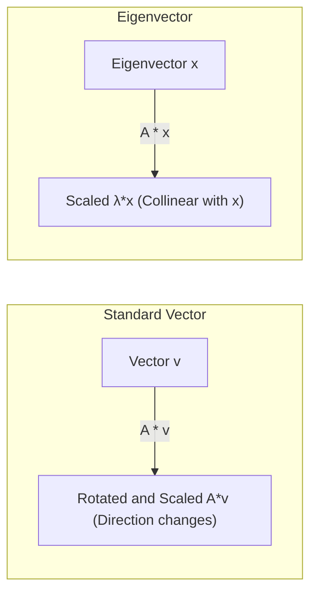
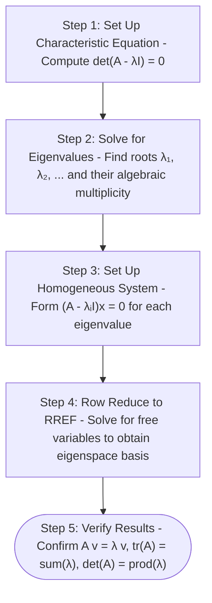

## What are Eigenvalues and Eigenvectors?

When a square matrix $A$ multiplies a vector $\mathbf{x}$, it typically changes both the **direction** and the **length** (magnitude) of $\mathbf{x}$.

However, for any matrix $A$, there exist special non-zero vectors whose direction remains **completely unchanged** (or is exactly reversed). The matrix transformation merely **scales** (stretches or shrinks) the vector along its original span.

These special vectors are called **eigenvectors**, and the scalar factors by which they are stretched are called **eigenvalues**.

### The Fundamental Eigen-Equation

Let $A$ be an $n \times n$ square matrix. A non-zero vector $\mathbf{x} \in \mathbb{R}^n$ ($\mathbf{x} \ne \mathbf{0}$) is an **eigenvector** of $A$ corresponding to the **eigenvalue** $\lambda \in \mathbb{R}$ (or $\mathbb{C}$) if and only if:

$$
\Huge
A\mathbf{x} = \lambda \mathbf{x}
$$

Where:
- $\large A$ is the $n \times n$ **linear transformation matrix**
- $\large \mathbf{x} \ne \mathbf{0}$ is the **eigenvector** (must be non-zero; the zero vector satisfies $A\mathbf{0} = \lambda\mathbf{0}$ trivially for every scalar)
- $\large \lambda$ is the **eigenvalue** associated with $\mathbf{x}$



---

## Geometric Intuition of the Eigenvalue $\lambda$

The sign and magnitude of $\lambda$ determine how the transformation scales the eigenvector $\mathbf{x}$:

| Value of $\lambda$ | Geometric Effect on $\mathbf{x}$ | Geometric Visualization |
| :--- | :--- | :--- |
| $\lambda > 1$ | Stretches $\mathbf{x}$ along its span | Stretched in same direction |
| $0 < \lambda < 1$ | Shrinks $\mathbf{x}$ along its span | Compressed in same direction |
| $\lambda = 1$ | Leaves $\mathbf{x}$ unchanged ($A\mathbf{x} = \mathbf{x}$) | Identity line / fixed line |
| $\lambda = 0$ | Collapses $\mathbf{x}$ into the origin ($A\mathbf{x} = \mathbf{0}$) | Vector is in the kernel / null space $\ker(A)$ |
| $-1 < \lambda < 0$ | Reverses direction ($180^\circ$ flip) and shrinks | Compressed along opposite ray |
| $\lambda < -1$ | Reverses direction ($180^\circ$ flip) and stretches | Stretched along opposite ray |
| $\lambda \in \mathbb{C}$ (Complex) | Involves rotation in $\mathbb{R}^n$ | No real invariant 1D line |

---

## Deriving the Characteristic Equation

To find the eigenvalues without guessing, rewrite the fundamental equation:

$$
A\mathbf{x} = \lambda \mathbf{x} \iff A\mathbf{x} - \lambda I \mathbf{x} = \mathbf{0} \iff (A - \lambda I)\mathbf{x} = \mathbf{0}
$$

Where $I$ is the $n \times n$ identity matrix.

### Why Must $\det(A - \lambda I) = 0$?

The equation $(A - \lambda I)\mathbf{x} = \mathbf{0}$ is a homogeneous system of linear equations:
1. If the matrix $(A - \lambda I)$ were invertible, we could multiply both sides by $(A - \lambda I)^{-1}$:
   $$
   \mathbf{x} = (A - \lambda I)^{-1}\mathbf{0} = \mathbf{0}
   $$
   This yields only the trivial solution $\mathbf{x} = \mathbf{0}$.
2. However, by definition, an eigenvector must be **non-zero** ($\mathbf{x} \ne \mathbf{0}$).
3. Therefore, for non-trivial solutions to exist, the matrix $(A - \lambda I)$ must be **singular (non-invertible)**.
4. By the Invertible Matrix Theorem, a square matrix is non-invertible if and only if its determinant is zero:

$$
\Huge
\det(A - \lambda I) = 0
$$

This equation is called the **characteristic equation** of $A$. Expanding the determinant produces the **characteristic polynomial** $p(\lambda)$, an $n$-th degree polynomial in $\lambda$.

---

## Eigenspaces and Multiplicities

### 1. The Eigenspace $E_\lambda$

For a specific eigenvalue $\lambda$, all corresponding eigenvectors, along with the zero vector $\mathbf{0}$, form a subspace of $\mathbb{R}^n$ called the **eigenspace** of $\lambda$:

$$
\Large
E_\lambda = \ker(A - \lambda I) = \text{null}(A - \lambda I) = \{\mathbf{x} \in \mathbb{R}^n \mid (A - \lambda I)\mathbf{x} = \mathbf{0}\}
$$

Because $E_\lambda$ is the null space of $(A - \lambda I)$, finding the eigenvectors is identical to finding a basis for $\text{null}(A - \lambda I)$.

### 2. Algebraic Multiplicity (AM) vs Geometric Multiplicity (GM)

When solving $p(\lambda) = 0$, an eigenvalue can repeat:

- **Algebraic Multiplicity ($\text{AM}$)**: The multiplicity of $\lambda$ as a root of the characteristic polynomial $p(\lambda) = 0$.
- **Geometric Multiplicity ($\text{GM}$)**: The dimension of the eigenspace $E_\lambda$, which is the number of linearly independent eigenvectors associated with $\lambda$:
  $$
  \text{GM}(\lambda) = \dim(E_\lambda) = \text{nullity}(A - \lambda I) = n - \text{rank}(A - \lambda I)
  $$

> [!IMPORTANT]
> **The Multiplicity Inequality**: For any eigenvalue $\lambda$:
> $$
> 1 \le \text{GM}(\lambda) \le \text{AM}(\lambda)
> $$
> - If $\text{GM}(\lambda) = \text{AM}(\lambda)$ for all eigenvalues, the matrix has a full basis of eigenvectors and is **diagonalizable** ($A = PDP^{-1}$).
> - If $\text{GM}(\lambda) < \text{AM}(\lambda)$ for at least one eigenvalue, the matrix is **defective** (cannot be diagonalized).

---

## Universal Step-by-Step Procedure



---

## Worked Examples

### Example 1: $2 \times 2$ Matrix with Distinct Real Eigenvalues

Find all eigenvalues and eigenvectors of:
$$
A = \begin{bmatrix} 4 & 2 \\ 3 & 3 \end{bmatrix}
$$

#### Step 1: Characteristic Equation
Subtract $\lambda$ from the main diagonal and set the determinant to zero:
$$
\det(A - \lambda I) = \begin{vmatrix} 4 - \lambda & 2 \\ 3 & 3 - \lambda \end{vmatrix} = 0
$$

Expand the $2 \times 2$ determinant:
$$
\begin{align*}
(4 - \lambda)(3 - \lambda) - (2)(3) &= 0 \\
\lambda^2 - 7\lambda + 12 - 6 &= 0 \\
\lambda^2 - 7\lambda + 6 &= 0
\end{align*}
$$

#### Step 2: Solve for Eigenvalues
Factor the quadratic:
$$
(\lambda - 6)(\lambda - 1) = 0 \implies \lambda_1 = 6, \quad \lambda_2 = 1
$$
*(Sanity check: $\lambda_1 + \lambda_2 = 7 = \text{tr}(A)$; $\lambda_1 \cdot \lambda_2 = 6 = \det(A)$. Matches!)*

---

#### Step 3: Find Eigenvectors for $\lambda_1 = 6$
Substitute $\lambda_1 = 6$ into $(A - 6I)\mathbf{x} = \mathbf{0}$:
$$
A - 6I = \begin{bmatrix} 4 - 6 & 2 \\ 3 & 3 - 6 \end{bmatrix} = \begin{bmatrix} -2 & 2 \\ 3 & -3 \end{bmatrix}
$$

Row-reduce the augmented matrix $\left[\begin{array}{cc|c} -2 & 2 & 0 \\ 3 & -3 & 0 \end{array}\right]$:
$$
\begin{bmatrix} -2 & 2 \\ 3 & -3 \end{bmatrix} \xrightarrow{R_1 \leftarrow -\frac{1}{2}R_1} \begin{bmatrix} 1 & -1 \\ 3 & -3 \end{bmatrix} \xrightarrow{R_2 \leftarrow R_2 - 3R_1} \begin{bmatrix} 1 & -1 \\ 0 & 0 \end{bmatrix}
$$

This gives the equation:
$$
x_1 - x_2 = 0 \implies x_1 = x_2
$$
$x_2$ is a free variable. Setting $x_2 = 1$:
$$
\mathbf{v}_1 = \begin{bmatrix} 1 \\ 1 \end{bmatrix}, \quad E_6 = \text{span}\left\{ \begin{bmatrix} 1 \\ 1 \end{bmatrix} \right\}
$$

---

#### Step 4: Find Eigenvectors for $\lambda_2 = 1$
Substitute $\lambda_2 = 1$ into $(A - 1I)\mathbf{x} = \mathbf{0}$:
$$
A - 1I = \begin{bmatrix} 4 - 1 & 2 \\ 3 & 3 - 1 \end{bmatrix} = \begin{bmatrix} 3 & 2 \\ 3 & 2 \end{bmatrix}
$$

Row-reduce:
$$
\begin{bmatrix} 3 & 2 \\ 3 & 2 \end{bmatrix} \xrightarrow{R_2 \leftarrow R_2 - R_1} \begin{bmatrix} 3 & 2 \\ 0 & 0 \end{bmatrix} \xrightarrow{R_1 \leftarrow \frac{1}{3}R_1} \begin{bmatrix} 1 & \frac{2}{3} \\ 0 & 0 \end{bmatrix}
$$

This gives:
$$
x_1 + \frac{2}{3}x_2 = 0 \implies x_1 = -\frac{2}{3}x_2
$$
Choose $x_2 = 3$ to eliminate fractions:
$$
\mathbf{v}_2 = \begin{bmatrix} -2 \\ 3 \end{bmatrix}, \quad E_1 = \text{span}\left\{ \begin{bmatrix} -2 \\ 3 \end{bmatrix} \right\}
$$

---

### Example 2: $3 \times 3$ Triangular Matrix (Full Eigenspaces)

Find the eigenvalues and eigenvectors of the upper triangular matrix:
$$
A = \begin{bmatrix} 1 & 2 & 2 \\ 0 & 2 & 1 \\ 0 & 0 & 3 \end{bmatrix}
$$

#### Step 1: Characteristic Equation
For any triangular or diagonal matrix, the determinant of $(A - \lambda I)$ is simply the product of its diagonal entries:
$$
\det(A - \lambda I) = (1 - \lambda)(2 - \lambda)(3 - \lambda) = 0
$$

Thus, the eigenvalues are read directly from the main diagonal:
$$
\lambda_1 = 1, \quad \lambda_2 = 2, \quad \lambda_3 = 3
$$

---

#### Step 2: Eigenvector for $\lambda_1 = 1$
$$
A - 1I = \begin{bmatrix} 0 & 2 & 2 \\ 0 & 1 & 1 \\ 0 & 0 & 2 \end{bmatrix}
$$
Row-reducing the augmented system:
1. $2x_3 = 0 \implies x_3 = 0$
2. $x_2 + x_3 = 0 \implies x_2 = 0$
3. First column has no pivot, so $x_1$ is free!

Setting $x_1 = 1$:
$$
\mathbf{v}_1 = \begin{bmatrix} 1 \\ 0 \\ 0 \end{bmatrix}, \quad E_1 = \text{span}\left\{ \begin{bmatrix} 1 \\ 0 \\ 0 \end{bmatrix} \right\}
$$

---

#### Step 3: Eigenvector for $\lambda_2 = 2$
$$
A - 2I = \begin{bmatrix} -1 & 2 & 2 \\ 0 & 0 & 1 \\ 0 & 0 & 1 \end{bmatrix} \xrightarrow{R_3 \leftarrow R_3 - R_2} \begin{bmatrix} -1 & 2 & 2 \\ 0 & 0 & 1 \\ 0 & 0 & 0 \end{bmatrix}
$$
Back-substituting:
1. Row 2: $x_3 = 0$
2. Row 1: $-x_1 + 2x_2 + 2(0) = 0 \implies x_1 = 2x_2$
3. $x_2$ is free. Let $x_2 = 1 \implies x_1 = 2$:

$$
\mathbf{v}_2 = \begin{bmatrix} 2 \\ 1 \\ 0 \end{bmatrix}, \quad E_2 = \text{span}\left\{ \begin{bmatrix} 2 \\ 1 \\ 0 \end{bmatrix} \right\}
$$

---

#### Step 4: Eigenvector for $\lambda_3 = 3$
$$
A - 3I = \begin{bmatrix} -2 & 2 & 2 \\ 0 & -1 & 1 \\ 0 & 0 & 0 \end{bmatrix}
$$
From Row 2: $-x_2 + x_3 = 0 \implies x_2 = x_3$.
From Row 1: $-2x_1 + 2x_2 + 2x_3 = 0 \implies -x_1 + x_3 + x_3 = 0 \implies x_1 = 2x_3$.
$x_3$ is free. Setting $x_3 = 1$:
$$
\mathbf{v}_3 = \begin{bmatrix} 2 \\ 1 \\ 1 \end{bmatrix}, \quad E_3 = \text{span}\left\{ \begin{bmatrix} 2 \\ 1 \\ 1 \end{bmatrix} \right\}
$$

---

### Example 3: Repeated Eigenvalues & The Defective Matrix Trap

Consider the shear matrix:
$$
A = \begin{bmatrix} 3 & 1 \\ 0 & 3 \end{bmatrix}
$$

1. **Characteristic Equation**:
   $$
   \det(A - \lambda I) = (3 - \lambda)^2 = 0 \implies \lambda = 3 \quad (\text{Algebraic Multiplicity } \text{AM} = 2)
   $$

2. **Find Eigenvectors**:
   $$
   A - 3I = \begin{bmatrix} 0 & 1 \\ 0 & 0 \end{bmatrix}
   $$
   Row 1 indicates: $0x_1 + 1x_2 = 0 \implies x_2 = 0$.
   $x_1$ is free. Let $x_1 = 1$:
   $$
   \mathbf{v} = \begin{bmatrix} 1 \\ 0 \end{bmatrix}, \quad E_3 = \text{span}\left\{ \begin{bmatrix} 1 \\ 0 \end{bmatrix} \right\}
   $$

3. **Comparison of Multiplicities**:
   - $\text{AM}(\lambda = 3) = 2$
   - $\text{GM}(\lambda = 3) = \dim(E_3) = 1$
   - Since $\text{GM} < \text{AM}$, $A$ does not have 2 linearly independent eigenvectors. Therefore, $A$ is **defective** and cannot be diagonalized.

---

### Example 4: Complex Eigenvalues ($90^\circ$ Geometric Rotation)

Consider the rotation matrix in $\mathbb{R}^2$ that rotates every vector counter-clockwise by $90^\circ$:
$$
R = \begin{bmatrix} \cos 90^\circ & -\sin 90^\circ \\ \sin 90^\circ & \cos 90^\circ \end{bmatrix} = \begin{bmatrix} 0 & -1 \\ 1 & 0 \end{bmatrix}
$$

1. **Characteristic Equation**:
   $$
   \det(R - \lambda I) = \begin{vmatrix} -\lambda & -1 \\ 1 & -\lambda \end{vmatrix} = \lambda^2 - (-1)(1) = \lambda^2 + 1 = 0 \implies \lambda = \pm i
   $$
2. **Geometric Insight**:
   - Because a $90^\circ$ rotation turns *every* vector away from its original line of action, **no real vector** can satisfy $R\mathbf{x} = \lambda \mathbf{x}$ for any $\lambda \in \mathbb{R}$.
   - The eigenvalues are purely imaginary ($\lambda_1 = i, \lambda_2 = -i$), confirming that there are no real eigenspaces.

---

## Fundamental Properties and Shortcuts

For any $n \times n$ matrix $A$ with eigenvalues $\lambda_1, \lambda_2, \dots, \lambda_n$:

| Property | Rule | Description / Fast Check |
| :--- | :--- | :--- |
| **Sum of Eigenvalues (Trace)** | $\sum_{i=1}^n \lambda_i = \text{tr}(A)$ | The sum of eigenvalues equals the sum of the main diagonal entries. |
| **Product of Eigenvalues (Determinant)** | $\prod_{i=1}^n \lambda_i = \det(A)$ | The product of all eigenvalues equals the determinant. |
| **Invertibility** | $\det(A) \ne 0 \iff \lambda_i \ne 0 \; \forall i$ | A matrix is invertible if and only if **zero is not an eigenvalue**. |
| **Triangular / Diagonal Matrices** | $\lambda_i = A_{ii}$ | Eigenvalues are precisely the diagonal entries (no calculation needed). |
| **Matrix Powers** | $A^k \mathbf{x} = \lambda^k \mathbf{x}$ | If $A$ has eigenvalue $\lambda$, then $A^k$ has eigenvalue $\lambda^k$ with the same eigenvector $\mathbf{x}$. |
| **Matrix Inverse** | $A^{-1} \mathbf{x} = \frac{1}{\lambda} \mathbf{x}$ | If $A$ is invertible with eigenvalue $\lambda$, $A^{-1}$ has eigenvalue $\frac{1}{\lambda}$. |
| **Transpose** | $\det(A^T - \lambda I) = \det(A - \lambda I)$ | $A$ and $A^T$ have identical eigenvalues. |
| **$2 \times 2$ Characteristic Shortcut** | $\lambda^2 - \text{tr}(A)\lambda + \det(A) = 0$ | Quickest formula to write the characteristic polynomial of any $2 \times 2$ matrix. |

---

## MATLAB Computation and Verification

MATLAB provides dedicated built-in functions to compute eigenvalues, eigenvectors, and characteristic polynomials:

```matlab
%% 1. Matrix Definition
A = [4, 2; 3, 3];

%% 2. Characteristic Polynomial
% poly(A) returns polynomial coefficients: [1, -tr(A), det(A)]
coeffs = poly(A);
disp('Characteristic Polynomial Coefficients:');
disp(coeffs);

% roots(coeffs) solves the characteristic polynomial
eigenvalues_from_poly = roots(coeffs);

%% 3. Eigenvalues and Eigenvector Matrix
% [V, D] computes eigenvectors as columns of V, and eigenvalues along the diagonal of D
[V, D] = eig(A);

disp('Eigenvalue Diagonal Matrix D:');
disp(D);

disp('Normalized Eigenvector Columns V:');
disp(V);

%% 4. Exact Integer Eigenspace Basis via null()
% Compute null space basis for (A - 6*I) using rational format
v1_exact = null(sym(A - 6*eye(2)));
v2_exact = null(sym(A - 1*eye(2)));

disp('Exact Eigenspace basis for lambda = 6:');
disp(v1_exact);

disp('Exact Eigenspace basis for lambda = 1:');
disp(v2_exact);

%% 5. Verification: A*x = lambda*x and Diagonal Decomposition
% Check A * V = V * D
is_eigen_decomposition = isequal(round(A * V, 6), round(V * D, 6));
disp(['Decomposition Valid: ', num2str(is_eigen_decomposition)]);
```

---

## Quick Reference Summary

```
                      ┌───────────────────────────────────────┐
                      │              A x = λ x                │
                      └──────────────────┬────────────────────┘
                                         │
                                         ▼
                      ┌───────────────────────────────────────┐
                      │          (A - λ I) x = 0              │
                      └──────────────────┬────────────────────┘
                                         │
                 ┌───────────────────────┴───────────────────────┐
                 │                                               │
                 ▼                                               ▼
      To find Eigenvalues (λ):                       To find Eigenvectors (x):
     Solve Characteristic Eq:                         For each found λᵢ, solve:
        det(A - λI) = 0                                (A - λᵢI) x = 0
                 │                                               │
                 ▼                                               ▼
   Yields roots λ₁, λ₂, ..., λₙ                   Row reduce [A - λᵢI | 0] to RREF
   Trace Check: Σλ = tr(A)                        Express free variables to find
   Det Check:   Πλ = det(A)                       basis for eigenspace E(λᵢ)
```
