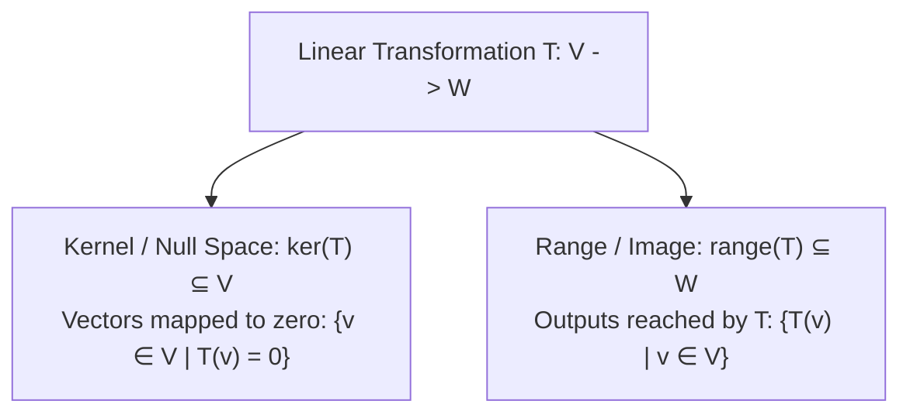
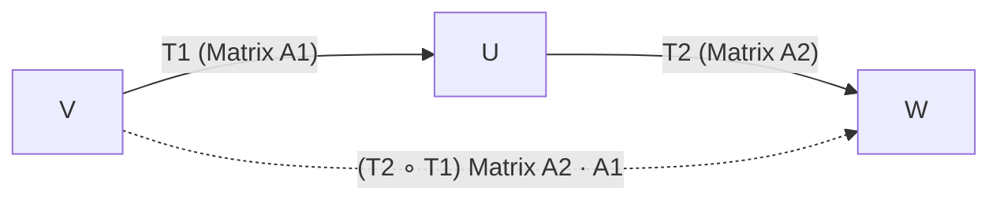

## Definition of a Linear Transformation

Let $V$ and $W$ be vector spaces over the real field $\mathbb{R}$. A mapping $T: V \to W$ is a **linear transformation** (or linear operator when $V = W$) if and only if it satisfies two fundamental linearity axioms for all vectors $u, v \in V$ and all scalars $c \in \mathbb{R}$:

1. **Additivity**:
   $$
   \Large
   T(u + v) = T(u) + T(v)
   $$

2. **Homogeneity (Scalar Multiplication)**:
   $$
   \Large
   T(c u) = c \, T(u)
   $$

Combined into a single compact superposition condition:
$$
\Huge
T(c_1 u + c_2 v) = c_1 T(u) + c_2 T(v)
$$


---

## Fundamental Properties

From the linearity axioms, several necessary properties follow directly:

- **Zero Vector Mapping**: $T(0_V) = 0_W$
- **Negative Vector Mapping**: $T(-v) = -T(v)$
- **Linear Combination Mapping**:
  $$
  T\left(\sum_{i=1}^{k} c_i v_i\right) = \sum_{i=1}^{k} c_i T(v_i)
  $$

---

## Kernel and Range

Two fundamental subspaces characterize every linear transformation $T: V \to W$:



### 1. Kernel (Null Space)

The **kernel** (or null space) of $T$, denoted $\ker(T)$, is the set of all vectors in domain $V$ that map to the zero vector in codomain $W$:

$$
\Large
\ker(T) = \{v \in V \mid T(v) = 0_W\}
$$

- $\ker(T)$ is a subspace of domain $V$.
- The dimension of $\ker(T)$ is called the **nullity** of $T$: $\text{nullity}(T) = \dim(\ker(T))$.
- $T$ is **injective (one-to-one)** if and only if $\ker(T) = \{0_V\}$ (nullity is $0$).

### 2. Range (Image)

The **range** (or image) of $T$, denoted $\text{range}(T)$ or $\text{Im}(T)$, is the set of all vectors in codomain $W$ that are images of at least one vector in $V$:

$$
\Large
\text{range}(T) = \{w \in W \mid \exists v \in V, \, T(v) = w\}
$$

- $\text{range}(T)$ is a subspace of codomain $W$.
- The dimension of $\text{range}(T)$ is called the **rank** of $T$: $\text{rank}(T) = \dim(\text{range}(T))$.
- $T$ is **surjective (onto)** if and only if $\text{range}(T) = W$ ($\text{rank}(T) = \dim(W)$).

---

## The Dimension Theorem (Rank-Nullity Theorem)

For any linear transformation $T: V \to W$ where domain $V$ is finite-dimensional:

$$
\Huge
\dim(V) = \text{rank}(T) + \text{nullity}(T)
$$

$$
\dim(V) = \dim(\text{range}(T)) + \dim(\ker(T))
$$

---

## Standard Matrix Representation

Every linear transformation $T: \mathbb{R}^n \to \mathbb{R}^m$ can be represented uniquely by an $m \times n$ matrix $A$, known as the **standard matrix of $T$**:

$$
\Large
T(x) = A x
$$

The columns of matrix $A$ are the images of the standard basis vectors $e_1, e_2, \dots, e_n$ of $\mathbb{R}^n$:

$$
\Huge
A = [T] = \begin{bmatrix} T(e_1) & T(e_2) & \dots & T(e_n) \end{bmatrix}
$$

Where in $\mathbb{R}^n$:
$$
e_1 = \begin{bmatrix} 1 \\ 0 \\ \vdots \\ 0 \end{bmatrix}, \quad e_2 = \begin{bmatrix} 0 \\ 1 \\ \vdots \\ 0 \end{bmatrix}, \quad \dots, \quad e_n = \begin{bmatrix} 0 \\ 0 \\ \vdots \\ 1 \end{bmatrix}
$$

---

## Geometric Linear Transformations in $\mathbb{R}^2$

| Transformation | Description | Standard Matrix $[T]$ | Formula |
| :--- | :--- | :---: | :--- |
| **Counterclockwise Rotation** | Rotates vector by angle $\theta$ around the origin | $\begin{bmatrix} \cos\theta & -\sin\theta \\ \sin\theta & \cos\theta \end{bmatrix}$ | $T(x, y) = (x\cos\theta - y\sin\theta, \; x\sin\theta + y\cos\theta)$ |
| **Reflection across $x$-axis** | Flips vertically over the horizontal axis | $\begin{bmatrix} 1 & 0 \\ 0 & -1 \end{bmatrix}$ | $T(x, y) = (x, -y)$ |
| **Reflection across $y$-axis** | Flips horizontally over the vertical axis | $\begin{bmatrix} -1 & 0 \\ 0 & 1 \end{bmatrix}$ | $T(x, y) = (-x, y)$ |
| **Reflection across $y = x$** | Swaps coordinate components | $\begin{bmatrix} 0 & 1 \\ 1 & 0 \end{bmatrix}$ | $T(x, y) = (y, x)$ |
| **Horizontal Shear** | Shifts parallel to $x$-axis by factor $k$ | $\begin{bmatrix} 1 & k \\ 0 & 1 \end{bmatrix}$ | $T(x, y) = (x + ky, y)$ |
| **Vertical Shear** | Shifts parallel to $y$-axis by factor $k$ | $\begin{bmatrix} 1 & 0 \\ k & 1 \end{bmatrix}$ | $T(x, y) = (x, kx + y)$ |
| **Scaling (Dilation / Contraction)** | Scales by horizontal factor $s_x$ and vertical $s_y$ | $\begin{bmatrix} s_x & 0 \\ 0 & s_y \end{bmatrix}$ | $T(x, y) = (s_x x, s_y y)$ |
| **Orthogonal Projection ($x$-axis)** | Projects orthogonally onto the $x$-axis | $\begin{bmatrix} 1 & 0 \\ 0 & 0 \end{bmatrix}$ | $T(x, y) = (x, 0)$ |

---

## Composition and Inverses of Linear Transformations



### 1. Composition

Let $T_1: V \to U$ with standard matrix $A_1$, and $T_2: U \to W$ with standard matrix $A_2$. The composite transformation $(T_2 \circ T_1): V \to W$ is linear, and its standard matrix is the matrix product:

$$
\Large
[T_2 \circ T_1] = [T_2] \cdot [T_1] = A_2 A_1
$$

> [!NOTE]
> Matrix multiplication corresponds to the composition of linear transformations. Because matrix multiplication is non-commutative in general, $T_2 \circ T_1 \neq T_1 \circ T_2$.

### 2. Inverse Transformation

A linear operator $T: V \to V$ is invertible if and only if its standard matrix $A$ is non-singular ($\det(A) \neq 0$). The inverse operator $T^{-1}: V \to V$ satisfies:

$$
\Large
[T^{-1}] = [T]^{-1} = A^{-1}
$$

---

## MATLAB Implementation

```matlab
%% Standard Matrix of Linear Transformation
% Let T: R^2 -> R^2 rotate by 45 degrees and scale by 2
theta = pi / 4;
R = [cos(theta), -sin(theta); sin(theta), cos(theta)];
S = [2, 0; 0, 2];

% Composite Transformation Matrix: Scale then Rotate
A = R * S;

% Transform a set of 2D points (e.g., a square)
square = [0 1 1 0 0; 
          0 0 1 1 0];
transformed_square = A * square;

% Kernel (Null Space) and Range (Column Space) Analysis
B = [1, 2, 0, -1;
     2, 4, 1,  1;
     1, 2, 1,  2];

r = rank(B);                  % Rank of the transformation
nullity = size(B, 2) - r;     % Nullity via Rank-Nullity theorem
N = null(B, 'r');             % Rational basis for kernel (null space)
C = colspace(sym(B));         % Basis for range (column space)

disp('Rank:'); disp(r);
disp('Nullity:'); disp(nullity);
disp('Kernel Basis (Null Space):'); disp(N);
disp('Range Basis (Column Space):'); disp(C);
```

---

## References

- Anton, H., & Rorres, C. (2014). *Elementary Linear Algebra: Applications Version* (11th ed.). Wiley.
- Lay, D. C., Lay, S. R., & McDonald, J. J. (2016). *Linear Algebra and Its Applications* (5th ed.). Pearson.
- Strang, G. (2016). *Introduction to Linear Algebra* (5th ed.). Wellesley-Cambridge Press.
