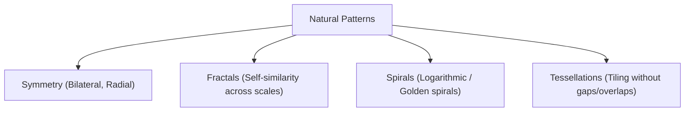

## Patterns in Nature

Patterns in nature are regularities of form, structure, or behavior found in the natural world:

---

## The Fibonacci Sequence

The **Fibonacci sequence** $\{F_n\}$ is a recursive sequence where each term is the sum of the two preceding terms:

$$
\Huge
F_n = F_{n-1} + F_{n-2} \quad (n \ge 3)
$$

With initial conditions:
$$
F_1 = 1, \quad F_2 = 1
$$

First terms of the sequence:
$$
1, 1, 2, 3, 5, 8, 13, 21, 34, 55, 89, 144, 233, 377, \dots
$$

---

## The Golden Ratio ($\Phi$)

As $n$ approaches infinity, the ratio of consecutive Fibonacci numbers converges to the **Golden Ratio** ($\Phi$):

$$
\huge
\lim_{n \to \infty} \frac{F_n}{F_{n-1}} = \Phi = \frac{1 + \sqrt{5}}{2} \approx 1.6180339887\dots
$$

### Algebraic Relationship

$$
\Large
\Phi^2 = \Phi + 1 \implies \Phi^2 - \Phi - 1 = 0
$$

---

## Binet's Formula

An explicit closed-form expression for the $n$-th Fibonacci number:

$$
\LARGE
F_n = \frac{1}{\sqrt{5}}\left[\left(\frac{1+\sqrt{5}}{2}\right)^n - \left(\frac{1-\sqrt{5}}{2}\right)^n\right] = \frac{\Phi^n - (-\Phi)^{-n}}{\sqrt{5}}
$$

$$
\textit{eg. Calculating } F_6:\\
\large
\begin{align*}
F_6 &= \frac{1.618034^6 - (-0.618034)^6}{\sqrt{5}}\\
&= \frac{17.94427 - 0.05573}{2.23607}\\
&= \frac{17.88854}{2.23607} = 8
\end{align*}
$$

---

## Casio fx-991CW Calculator "Cheat": Generating Fibonacci & $\Phi$

You can instantly generate the first 30 Fibonacci numbers and converge to the Golden Ratio on the **Casio fx-991CW** without adding terms by hand.

### 1. Generating Fibonacci Numbers via Table App

1. Press **HOME** $\to$ select **Table** $\to$ press **EXE**.
2. Press **TOOLS** $\to$ **Define $f(x)$ / $g(x)$** $\to$ select **$f(x)$**.
3. Input Binet's Formula using variable key **$x$**:
   $$f(x) = \frac{1}{\sqrt{5}} \left[ \left(\frac{1 + \sqrt{5}}{2}\right)^x - \left(\frac{1 - \sqrt{5}}{2}\right)^x \right]$$
4. Set Range: Press **TOOLS** $\to$ **Table Range**:
   - `Start: 1`, `End: 30`, `Step: 1` $\to$ press **EXE**.
5. **Result**: The table immediately outputs $F_1 = 1, F_2 = 1, F_3 = 2, F_4 = 3, F_5 = 5, \dots, F_{20} = 6765$.

### 2. Rapid Golden Ratio $\Phi$ Convergence via `Ans`
In **Calculate** app:
1. Type `1` $\to$ press **EXE**.
2. Type `1 + 1 / Ans` $\to$ press **EXE**.
3. Press **EXE** repeatedly:
   - Output 1: `2`
   - Output 2: `1.5`
   - Output 3: `1.6666...`
   - Output 4: `1.6`
   - Output 5: `1.625`
   - Output 10+: converges to `1.6180339887...` ($\Phi$)!

