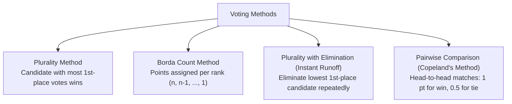
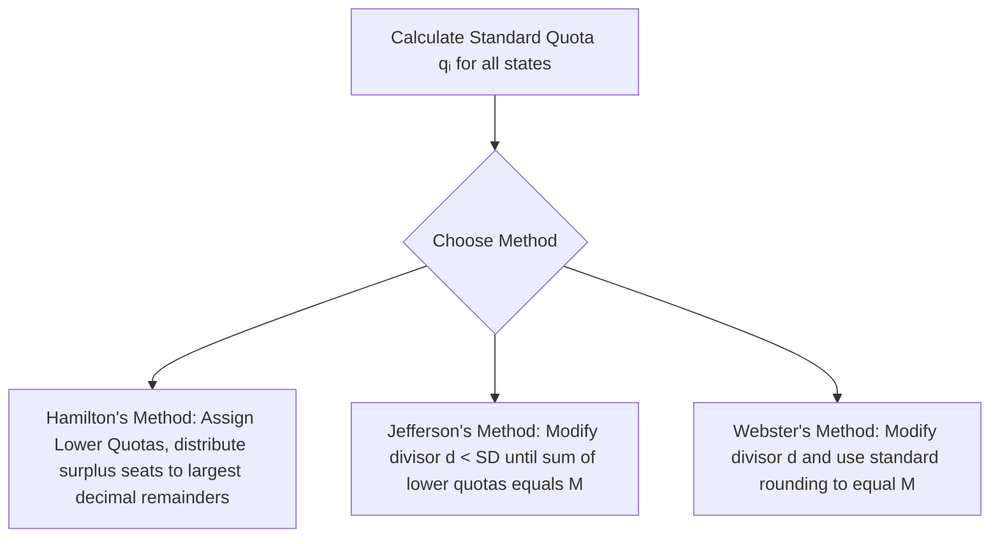

## Voting Methods (Social Choice Theory)

A **preference ballot** ranks candidates in order of preference ($1\text{st}, 2\text{nd}, 3\text{rd}, \dots$).

---

## Arrow's Impossibility Theorem & Fairness Criteria

Nobel laureate **Kenneth Arrow** proved that no ranked voting system with $3$ or more candidates can simultaneously satisfy all fairness criteria:

1. **Majority Criterion**: If a candidate receives a majority ($>50\%$) of 1st-place votes, they should win.
2. **Condorcet Criterion**: If a candidate beats every other candidate in pairwise head-to-head matchups, they should win.
3. **Monotonicity Criterion**: If voters increase preference for a winning candidate without changing others, that candidate should still win.
4. **Independence of Irrelevant Alternatives (IIA)**: If a non-winning candidate drops out, the winner should remain unchanged.

---

## Apportionment Methods

Apportionment is the problem of dividing a fixed number of discrete seats ($M$) among states proportionally based on population ($P$).

### Standard Divisor ($SD$)

$$
\Huge
SD = \frac{\text{Total Population } P}{\text{Total Number of Seats } M}
$$

### Standard Quota ($q_i$)

$$
\Huge
q_i = \frac{\text{State Population } p_i}{SD}
$$

- **Lower Quota**: $\lfloor q_i \rfloor$ (Rounded down)
- **Upper Quota**: $\lceil q_i \rceil$ (Rounded up)

---

## Apportionment Algorithms

---

## Casio fx-991CW Calculator "Cheat": Apportionment & Quotas

Calculating quotas for 5 to 10 states by hand is repetitive and error-prone. You can automate it using calculator variables and the **Table App**.

### 1. Memory Storage for Standard Divisor ($SD$)

1. In **Calculate** app, compute the Standard Divisor:
   $$SD = \frac{\text{Total Population } P}{\text{Total Seats } M}$$
2. Store this value in variable **$D$**:
   - Press **VARIABLE** $\to$ select **$D$** $\to$ choose **Store** (or assign).
3. For each state $p_i$, simply type:
   $$p_i \div D$$
   Press **EXE** $\to$ returns exact standard quota $q_i$ and its decimal remainder instantly.

### 2. Multi-State Quota Batching (Table App)
If you have a list of state populations:
1. Press **HOME** $\to$ **Table** $\to$ **TOOLS** $\to$ Define $f(x)$:
   $$f(x) = \frac{x}{D}$$
   *(Where $D$ is the stored standard divisor)*.
2. In the table, enter state populations in column $x$ $\to$ column $f(x)$ immediately yields all standard quotas $q_i$ side-by-side!

### 3. Huntington-Hill Cutoff Shortcut
The geometric mean cutoff between $n$ and $n+1$ seats is $\sqrt{n(n+1)}$.
- For $n = 3$: Type `sqrt(3 * 4)` $\to$ `3.464`.
- If state quota $> 3.464$, round up to $4$; otherwise round down to $3$.

