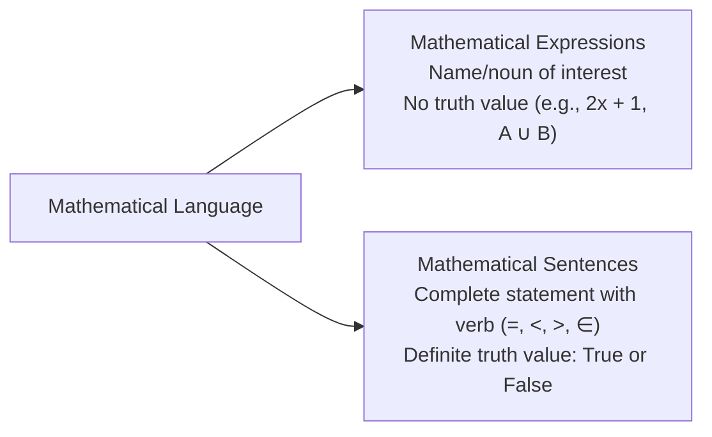
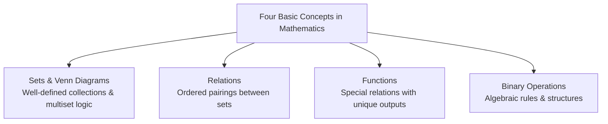
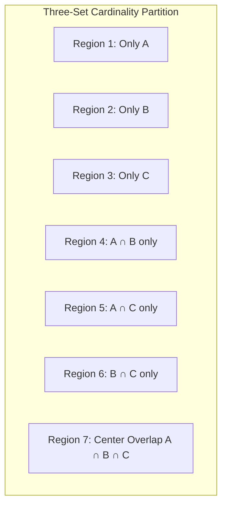
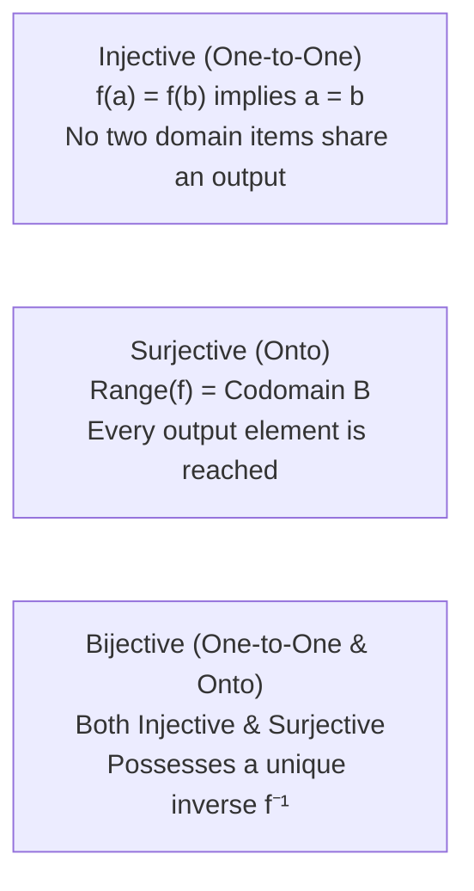
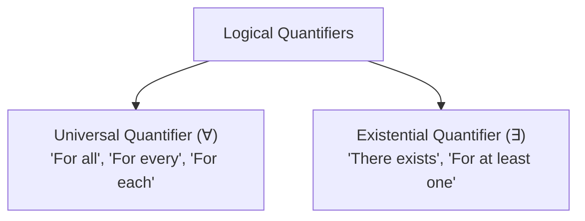

## Characteristics of Mathematical Language

Mathematical language is a specialized symbolic communication system designed to be:

1. **Precise**: Capable of making very fine distinctions without ambiguity.
2. **Concise**: Able to state complex propositions and operations briefly.
3. **Powerful**: Able to express advanced thoughts and models with relative ease.

### Mathematical Expressions vs. Mathematical Sentences

| Dimension | Mathematical Expression | Mathematical Sentence |
| :--- | :--- | :--- |
| **Linguistic Analog** | Noun / Noun Phrase | Complete Sentence (Noun + Verb) |
| **Components** | Numbers, variables, operations ($+$, $-$, $\cdot$) | Expressions joined by relational verbs ($=$, $<$, $>$, $\le$, $\ge$, $\in$, $\subseteq$) |
| **Truth Value** | **None** (Cannot be judged True or False) | **Definite** (Either strictly True, False, or open/conditional) |
| **Examples** | $5$, $3x^2 - 4$, $\sqrt{x + 1}$, $A \cap B$ | $3 + 4 = 7$ (True), $5 < 2$ (False), $2x + 1 = 9$ (Open sentence) |

---

## Four Basic Concepts in Mathematics

The foundational vocabulary of modern mathematics rests upon four central structural concepts:

---

## 1. Set Theory and Multi-Set Venn Diagrams

A **set** is a well-defined collection of distinct objects called elements.

### Set Operations Reference

| Operation | Notation | Set-Builder Definition | Venn Diagram Meaning |
| :--- | :--- | :--- | :--- |
| **Union** | $A \cup B$ | $\{x \mid x \in A \lor x \in B\}$ | All elements belonging to either $A$ or $B$ |
| **Intersection** | $A \cap B$ | $\{x \mid x \in A \land x \in B\}$ | Elements belonging to both $A$ and $B$ simultaneously |
| **Difference** | $A \setminus B$ | $\{x \mid x \in A \land x \notin B\}$ | Elements in $A$ excluding any that belong to $B$ |
| **Complement** | $A'$ or $A^c$ | $\{x \in U \mid x \notin A\}$ | Everything in universal set $U$ outside $A$ |
| **Cartesian Product** | $A \times B$ | $\{(a, b) \mid a \in A \land b \in B\}$ | Set of all ordered pairs $(a, b)$ |

### Multi-Set Venn Diagrams (3 Sets)

For three overlapping finite sets $A$, $B$, and $C$, the **Principle of Inclusion-Exclusion** computes total combined cardinality:

$$
\Huge
|A \cup B \cup C| = |A| + |B| + |C| - |A \cap B| - |A \cap C| - |B \cap C| + |A \cap B \cap C|
$$

---

## 2. Relations and Mappings

Let $A$ and $B$ be non-empty sets:

- A **relation** $R$ from $A$ to $B$ is a subset of the Cartesian product $A \times B$:
  $$
  R \subseteq A \times B
  $$
- The **Domain** is the set of all first coordinates: $\text{dom}(R) = \{a \in A \mid \exists b \in B, (a, b) \in R\}$.
- The **Range** is the set of all second coordinates: $\text{range}(R) = \{b \in B \mid \exists a \in A, (a, b) \in R\}$.

---

## 3. Functions

A **function** $f: A \to B$ is a relation where **each element in domain $A$ is associated with exactly one element in codomain $B$**:

- **Vertical Line Test**: A geometric curve in the Cartesian plane represents a function if and only if no vertical line intersects the curve at more than one point.

### Classification of Functions:

1. **Injective (One-to-One)**: Distinct inputs always map to distinct outputs ($\forall x_1, x_2, \, x_1 \neq x_2 \implies f(x_1) \neq f(x_2)$).
2. **Surjective (Onto)**: Every element in codomain $B$ has at least one pre-image in domain $A$ ($\forall y \in B, \, \exists x \in A \text{ such that } f(x) = y$).
3. **Bijective (One-to-One Correspondence)**: Both injective and surjective; guarantees the existence of an inverse function $f^{-1}: B \to A$.

---

## 4. Binary Operations and Algebraic Structures

A **binary operation** $*$ on a non-empty set $S$ is a rule that assigns to each ordered pair $(a, b) \in S \times S$ a uniquely determined element $a * b \in S$.

### Fundamental Algebraic Properties:

| Property | Formal Definition | Description |
| :--- | :--- | :--- |
| **Closure** | $\forall a, b \in S, \, a * b \in S$ | Operating on any elements within $S$ always produces an element inside $S$. |
| **Associativity** | $\forall a, b, c \in S, \, (a * b) * c = a * (b * c)$ | Grouping order does not alter the result. |
| **Commutativity** | $\forall a, b \in S, \, a * b = b * a$ | Element order does not alter the result. |
| **Identity Element** | $\exists e \in S, \, \forall a \in S, \, a * e = e * a = a$ | Operating with $e$ leaves elements unchanged ($0$ for $+$, $1$ for $\times$). |
| **Inverse Element** | $\forall a \in S, \, \exists a^{-1} \in S, \, a * a^{-1} = a^{-1} * a = e$ | Operating with an element's inverse yields the identity element. |

---

## Symbolic Logic and Truth Tables

A **proposition** is a declarative statement that is either strictly **True** ($T$) or strictly **False** ($F$), but never both.

### Master Truth Table of Logical Connectives

| $p$ | $q$ | Negation $\neg p$ | Conjunction $p \land q$ (*and*) | Disjunction $p \lor q$ (*or*) | Conditional $p \implies q$ (*if... then*) | Biconditional $p \iff q$ (*if and only if*) |
| :---: | :---: | :---: | :---: | :---: | :---: | :---: |
| **T** | **T** | F | **T** | **T** | **T** | **T** |
| **T** | **F** | F | **F** | **T** | **F** | **F** |
| **F** | **T** | T | **F** | **T** | **T** | **F** |
| **F** | **F** | T | **F** | **F** | **T** | **T** |

### Conditional Statement Variations

Given a conditional statement $p \implies q$:
- **Converse**: $q \implies p$
- **Inverse**: $\neg p \implies \neg q$
- **Contrapositive**: $\neg q \implies \neg p$ (*logically equivalent to $p \implies q$*)

---

## Logical Quantifiers

### Negation of Quantified Statements:

- **Negation of Universal**: $\neg(\forall x, P(x)) \equiv \exists x, \neg P(x)$
- **Negation of Existential**: $\neg(\exists x, P(x)) \equiv \forall x, \neg P(x)$

---

## References

- Alata, E. J. P., et al. (2018). *Mathematics in the Modern World*. Manila: Rex Book Store.
- Aufmann, R. N., et al. (2018). *Mathematics in the Modern World* (Philippine Edition). Cengage Learning.
- Epp, S. S. (2020). *Discrete Mathematics with Applications* (5th ed.). Cengage Learning.
