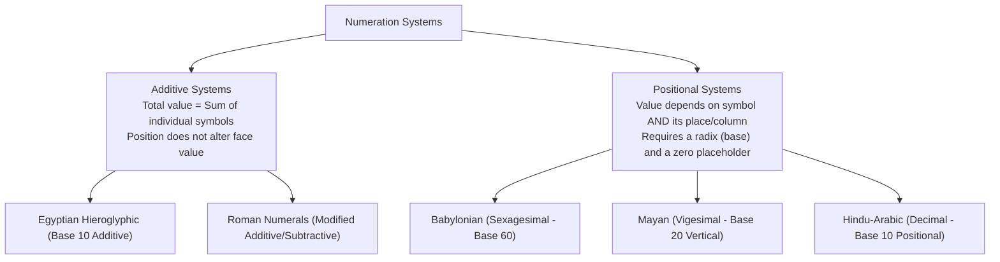
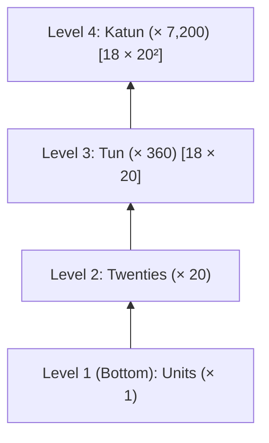

## Overview of Numeration Systems

A **numeration system** is a collection of symbols (numerals) and rules used to represent numbers. Historically, civilizations designed two major classes of numeration systems:



---

## 1. Egyptian Hieroglyphic Numeration System (~3000 BCE)

The ancient Egyptian system is an **additive, decimal (base-10)** system without a zero symbol. Numerals were written from right to left, left to right, or vertically:

| Symbol Description | Hieroglyph Name | Numerical Value |
| :--- | :--- | :---: |
| Single Stroke | **Staff / Vertical Stroke** | $1$ |
| Arch / Horseshoe | **Heel Bone** | $10$ |
| Coiled Rope | **Scroll** | $100$ |
| Water Lily | **Lotus Flower** | $1,000$ |
| Bent Finger | **Pointing Finger** | $10,000$ |
| Tadpole / Frog | **Polliwog / Tadpole** | $100,000$ |
| Kneeling Man with Arms Raised | **Astonished Man** | $1,000,000$ |

### Worked Example: Egyptian to Decimal

To write $243$ in Egyptian hieroglyphics:
- 2 Scrolls ($2 \times 100 = 200$)
- 4 Heel bones ($4 \times 10 = 40$)
- 3 Staffs ($3 \times 1 = 3$)
$$
\text{Total} = 200 + 40 + 3 = 243
$$

---

## 2. Babylonian Sexagesimal Numeration System (~2000 BCE)

The Babylonians developed the earliest known **positional system**, based on radix $60$ (**sexagesimal**). They used cuneiform styluses on clay tablets to press only two primary symbols:

| Cuneiform Symbol | Description | Value |
| :---: | :--- | :---: |
| $\nabla$ (or $\text{Y}$) | **Vertical Wedge** | $1$ |
| $\prec$ (or $<$) | **Corner Wedge** | $10$ |

```mermaid
flowchart RL
    P3["Place 3: 60² = 3,600s"] <-- P2["Place 2: 60¹ = 60s"] <-- P1["Place 1: 60⁰ = 1s"]
```

Within each sexagesimal place, numbers from $1$ to $59$ were formed additively using combinations of $\prec$ and $\nabla$.

### Worked Example: Babylonian to Decimal

Convert the Babylonian numeral with two groups: $[\prec\prec\nabla\nabla\nabla]$ followed by $[\prec\prec\prec\nabla\nabla]$:
- Group 1 (Leftmost, place value $60^1$): $10 + 10 + 1 + 1 + 1 = 23$
- Group 2 (Rightmost, place value $60^0$): $10 + 10 + 10 + 1 + 1 = 32$

$$
\Large
\text{Value} = (23 \times 60^1) + (32 \times 60^0) = 1380 + 32 = 1412_{10}
$$

---

## 3. Mayan Vigesimal Numeration System (~300 BCE)

The Maya civilization utilized a **vigesimal (base-20)** positional system arranged **vertically** from bottom to top. It was one of the first civilizations to introduce an explicit symbol for **zero**:

| Mayan Glyph | Meaning | Value |
| :---: | :--- | :---: |
| 🪨 (Shell glyph) | **Zero placeholder** | $0$ |
| $\bullet$ (Dot) | **Unit dot** | $1$ |
| $\textbf{—}$ (Bar) | **Five bar** | $5$ |

### Mayan Calendar Modified Place Values

For astronomical and calendrical purposes (*Long Count*), the third vertical position used $18 \times 20 = 360$ (approximating the solar year) instead of $20^2 = 400$:



### Worked Example: Mayan to Decimal

Evaluate a vertical Mayan numeral with three levels:
- **Level 3 (Top)**: Two dots ($\bullet\bullet$) $= 2 \times 360 = 720$
- **Level 2 (Middle)**: One bar and three dots ($\textbf{—}\bullet\bullet\bullet$) $= 8 \times 20 = 160$
- **Level 1 (Bottom)**: One shell (Zero) $= 0 \times 1 = 0$

$$
\Large
\text{Total} = 720 + 160 + 0 = 880_{10}
$$

---

## 4. Roman Numerals Reference

The Roman system is an additive system enhanced with subtractive principles:

| Symbol | I | V | X | L | C | D | M |
| :---: | :---: | :---: | :---: | :---: | :---: | :---: | :---: |
| **Value** | 1 | 5 | 10 | 50 | 100 | 500 | 1,000 |

### Rules of Subtractive Notation:

- Only powers of $10$ ($\text{I, X, C}$) can be subtracted.
- A symbol can only be subtracted from the next two higher symbols:
  - $\text{I}$ can be placed before $\text{V} (4)$ or $\text{X} (9)$.
  - $\text{X}$ can be placed before $\text{L} (40)$ or $\text{C} (90)$.
  - $\text{C}$ can be placed before $\text{D} (400)$ or $\text{M} (900)$.
- **Vinculum (Horizontal Bar)**: Placing a horizontal bar over a numeral multiplies its value by $1,000$ (e.g., $\overline{\text{V}} = 5,000$, $\overline{\text{X}} = 10,000$).

$$
\textit{eg. Converting } \text{MMCDLXXIX}:\\
2000 + (500 - 100) + 50 + 20 + (10 - 1) = 2000 + 400 + 70 + 9 = 2479
$$

---

## 5. Modern Positional Base Conversions

In an arbitrary radix $b \ge 2$, any number $(d_n d_{n-1} \dots d_1 d_0)_b$ expands into polynomial form:

$$
\Huge
N = \sum_{i=0}^{n} d_i \cdot b^i = d_n b^n + d_{n-1} b^{n-1} + \dots + d_1 b^1 + d_0 b^0
$$

### Algorithm 1: Base-$b$ to Decimal (Expansion Method)

Multiply each digit by $b^i$ where $i$ is the positional index from right to left:

$$
\textit{Convert } 2A5_{16} \text{ to Base 10:}\\
\large
2A5_{16} = (2 \cdot 16^2) + (10 \cdot 16^1) + (5 \cdot 16^0) = 512 + 160 + 5 = 677_{10}
$$

### Algorithm 2: Decimal to Base-$b$ (Successive Division Algorithm)

Divide the decimal integer repeatedly by base $b$, recording remainders until the quotient is zero. Read remainders from bottom to top (MSB to LSB):

$$
\textit{Convert } 156_{10} \text{ to Octal (Base 8):}\\
\large
\begin{align*}
156 \div 8 &= 19 \quad \text{R } 4 \quad (\text{LSB})\\
19 \div 8 &= 2 \quad \text{R } 3\\
2 \div 8 &= 0 \quad \text{R } 2 \quad (\text{MSB})\\[6pt]
\therefore 156_{10} &= 234_8
\end{align*}
$$

---

## References

- Alata, E. J. P., et al. (2018). *Mathematics in the Modern World*. Manila: Rex Book Store.
- Aufmann, R. N., et al. (2018). *Mathematics in the Modern World* (Philippine Edition). Cengage Learning.
- Ifrah, G. (2000). *The Universal History of Numbers: From Prehistory to the Invention of the Computer*. Wiley.
