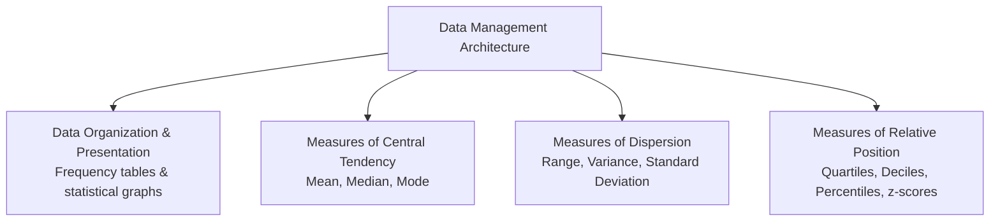
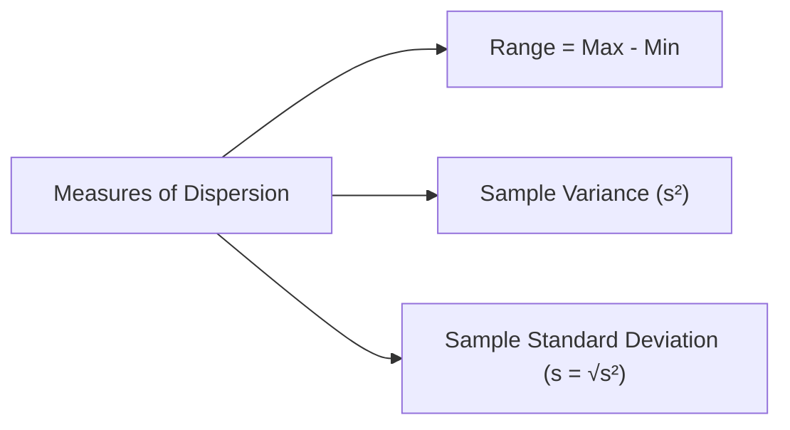
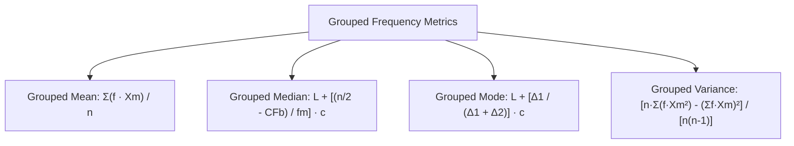

## Overview of Data Management

Data management involves collecting, organizing, summarizing, analyzing, and interpreting numerical data to make informed conclusions and strategic decisions:

---

## 1. Data Presentation and Graphical Representations

Raw research data must be structured into understandable visual forms:

| Graph / Chart Type | Best Suited For | Key Analytical Feature |
| :--- | :--- | :--- |
| **Bar Chart** | Categorical or discrete nominal data | Displays comparisons between categories using discrete rectangular bars separated by spaces. |
| **Histogram** | Continuous numerical distributions | Contiguous adjacent bars (no gaps) representing frequencies within continuous class intervals. |
| **Line Graph** | Time-series data | Visualizes trends, oscillations, and longitudinal shifts over time. |
| **Scatter Plot** | Bivariate continuous data | Evaluates correlation, association, and functional patterns between two variables $(x, y)$. |
| **Pie Chart** | Proportional composition of a whole | Displays percentage shares of mutually exclusive categories totaling $100\%$. |
| **Box-and-Whisker Plot** | Five-number summary | Summarizes Min, $Q_1$, Median, $Q_3$, Max, and flags potential outliers. |

---

## 2. Statistical Measures for Ungrouped Data

Let $x_1, x_2, \dots, x_n$ be a sample dataset of size $n$:

### Measures of Central Tendency

1. **Mean ($\bar{x}$)**: Arithmetic average:
   $$
   \Huge
   \bar{x} = \frac{\sum_{i=1}^{n} x_i}{n}
   $$

2. **Median ($\tilde{x}$)**: The physical midpoint of an ordered array:
   - For odd $n$: Value at index $\frac{n + 1}{2}$.
   - For even $n$: Mean of values at indices $\frac{n}{2}$ and $\frac{n}{2} + 1$.

3. **Mode ($\hat{x}$)**: The most frequently occurring value(s). Can be unimodal, bimodal, multimodal, or have no mode.

---

### Measures of Dispersion (Variability)

- **Range**: $\text{Range} = x_{\max} - x_{\min}$
- **Sample Variance ($s^2$)**:
  $$
  \Huge
  s^2 = \frac{\sum_{i=1}^{n} (x_i - \bar{x})^2}{n - 1} = \frac{n \sum x_i^2 - (\sum x_i)^2}{n(n - 1)}
  $$
- **Sample Standard Deviation ($s$)**:
  $$
  \Huge
  s = \sqrt{s^2} = \sqrt{\frac{\sum_{i=1}^{n} (x_i - \bar{x})^2}{n - 1}}
  $$

---

### Measures of Relative Position (Ungrouped)

- **Quartiles ($Q_k$)**: Divide an ordered dataset into four equal parts ($Q_1, Q_2, Q_3$).
  $$
  \text{Position of } Q_k = \frac{k(n + 1)}{4} \quad (k = 1, 2, 3)
  $$
- **Deciles ($D_k$)**: Divide an ordered dataset into ten equal parts ($k = 1, 2, \dots, 9$):
  $$
  \text{Position of } D_k = \frac{k(n + 1)}{10}
  $$
- **Percentiles ($P_k$)**: Divide an ordered dataset into one hundred equal parts ($k = 1, 2, \dots, 99$):
  $$
  \text{Position of } P_k = \frac{k(n + 1)}{100}
  $$
- **Interquartile Range ($IQR$)**: Measures spread of the middle $50\%$ of data:
  $$
  IQR = Q_3 - Q_1
  $$
- **Outlier Detection Fences**:
  $$
  \text{Lower Fence} = Q_1 - 1.5(IQR), \quad \text{Upper Fence} = Q_3 + 1.5(IQR)
  $$
- **Standard Score ($z$-Score)**: Measures relative distance from mean in standard deviation units:
  $$
  \Large
  z = \frac{x - \bar{x}}{s}
  $$

---

## 3. Statistical Measures for Grouped Data

When data is summarized into a grouped frequency distribution with class intervals:

### 1. Grouped Mean ($\bar{x}$)

$$
\Huge
\bar{x} = \frac{\sum f_i X_m}{n}
$$
Where:
- $f_i$ is the class frequency
- $X_m$ is the class midpoint: $X_m = \frac{\text{Lower Limit} + \text{Upper Limit}}{2}$
- $n = \sum f_i$ is the total number of observations

### 2. Grouped Median ($\tilde{x}$)

$$
\Huge
\tilde{x} = L_m + \left( \frac{\frac{n}{2} - CF_b}{f_m} \right) c
$$
Where:
- $L_m$ = Lower boundary of the median class (first class where cumulative frequency $\ge \frac{n}{2}$)
- $n$ = Total frequency
- $CF_b$ = Cumulative frequency of the class immediately *before* the median class
- $f_m$ = Frequency of the median class
- $c$ = Class width (interval size)

### 3. Grouped Mode ($\hat{x}$)

$$
\Huge
\hat{x} = L_{mo} + \left( \frac{\Delta_1}{\Delta_1 + \Delta_2} \right) c
$$
Where:
- $L_{mo}$ = Lower boundary of the modal class (class with the highest frequency)
- $\Delta_1 = f_{mo} - f_{mo-1}$ (difference between modal frequency and preceding class frequency)
- $\Delta_2 = f_{mo} - f_{mo+1}$ (difference between modal frequency and succeeding class frequency)
- $c$ = Class width

### 4. Grouped Variance and Standard Deviation

$$
\Huge
s^2 = \frac{n \sum f_i X_m^2 - \left(\sum f_i X_m\right)^2}{n(n - 1)}
$$

$$
\Huge
s = \sqrt{s^2}
$$

### 5. Grouped Percentiles ($P_k$)

$$
\Huge
P_k = L_p + \left( \frac{\frac{k \cdot n}{100} - CF_b}{f_p} \right) c
$$

---

## Grouped Data Worked Example

Given a sample frequency distribution of 40 exam scores ($n = 40$, class width $c = 5$):

| Class Interval | Frequency ($f$) | Midpoint ($X_m$) | $f \cdot X_m$ | $f \cdot X_m^2$ | Cumulative Frequency ($CF$) |
| :---: | :---: | :---: | :---: | :---: | :---: |
| 10 – 14 | 4 | 12 | 48 | 576 | 4 |
| 15 – 19 | 8 | 17 | 136 | 2,312 | 12 |
| 20 – 24 | 14 | 22 | 308 | 6,776 | 26 |
| 25 – 29 | 10 | 27 | 270 | 7,290 | 36 |
| 30 – 34 | 4 | 32 | 128 | 4,096 | 40 |
| **Total** | $\mathbf{n = 40}$ | — | $\mathbf{\sum fX_m = 890}$ | $\mathbf{\sum fX_m^2 = 21,050}$ | — |

### Computations:

1. **Mean**:
   $$
   \bar{x} = \frac{890}{40} = 22.25
   $$

2. **Median**:
   Median position $= \frac{40}{2} = 20$. Falls in class **20 – 24** ($L_m = 19.5, CF_b = 12, f_m = 14, c = 5$):
   $$
   \tilde{x} = 19.5 + \left(\frac{20 - 12}{14}\right) 5 = 19.5 + \left(\frac{8}{14}\right) 5 = 19.5 + 2.86 = 22.36
   $$

3. **Mode**:
   Modal class is **20 – 24** ($L_{mo} = 19.5, \Delta_1 = 14 - 8 = 6, \Delta_2 = 14 - 10 = 4$):
   $$
   \hat{x} = 19.5 + \left(\frac{6}{6 + 4}\right) 5 = 19.5 + (0.6 \times 5) = 19.5 + 3 = 22.5
   $$

4. **Standard Deviation**:
   $$
   s^2 = \frac{40(21,050) - (890)^2}{40(39)} = \frac{842,000 - 792,100}{1,560} = \frac{49,900}{1,560} \approx 31.99
   $$
   $$
   s = \sqrt{31.99} \approx 5.66
   $$

---

## Casio fx-991CW Calculator "Cheat": 1-Variable Statistics

Instead of manually calculating sums of squares, means, variances, standard deviations, and quartiles, the **1-Variable Statistics app** computes all of them simultaneously in one table.

### Step-by-Step Keystroke Guide

1. Press **HOME** $\to$ select **Statistics** $\to$ select **1-Variable** $\to$ press **EXE**.
2. **Frequency Column (Optional)**:
   - For raw lists: Enter values in column $x$.
   - For frequency distributions / grouped class marks ($x_i$ and $f_i$):
     - Press **TOOLS** $\to$ select **Frequency** $\to$ turn **On**.
     - Enter class marks ($x_i$) in the $x$ column and frequencies ($f_i$) in the $Freq$ column.
3. Enter all numbers pressing **EXE** after each.
4. Press **TOOLS** $\to$ select **1-Variable Calc** $\to$ press **EXE**.

### The "Cheat" Summary Output

The screen displays a scrollable list containing every statistical metric:

| Metric on fx-991CW Screen | Mathematical Symbol | Description |
| :--- | :--- | :--- |
| $\bar{x}$ | $\bar{x}$ or $\mu$ | **Sample Mean** |
| $\sum x$ | $\sum x_i$ | **Sum of all observations** |
| $\sum x^2$ | $\sum x_i^2$ | **Sum of squared values** |
| $s_x$ (or $\sigma_x$) | $s$ | **Sample Standard Deviation** ($n-1$ denominator) |
| $s_x^2$ | $s^2$ | **Sample Variance** (square $s_x$) |
| $\sigma_x$ | $\sigma$ | **Population Standard Deviation** ($n$ denominator) |
| $n$ | $n$ | **Total Number of Data Points / Sample Size** |
| $\text{Min}(x)$ | $x_{\min}$ | **Minimum Value** |
| $Q_1$ | $Q_1$ | **First Quartile (25th Percentile)** |
| $\text{Med}$ | $\tilde{x}$ | **Sample Median (50th Percentile)** |
| $Q_3$ | $Q_3$ | **Third Quartile (75th Percentile)** |
| $\text{Max}(x)$ | $x_{\max}$ | **Maximum Value** |

> [!TIP]
> **Interquartile Range ($IQR$) & Outliers**:
> - Compute $IQR = Q_3 - Q_1$ directly from the two screen outputs.
> - Outlier Fences: Lower $= Q_1 - 1.5(IQR)$, Upper $= Q_3 + 1.5(IQR)$.

---

## References

- Alata, E. J. P., et al. (2018). *Mathematics in the Modern World*. Manila: Rex Book Store.
- Aufmann, R. N., et al. (2018). *Mathematics in the Modern World* (Philippine Edition). Cengage Learning.
- Triola, M. F. (2018). *Elementary Statistics* (13th ed.). Pearson.
