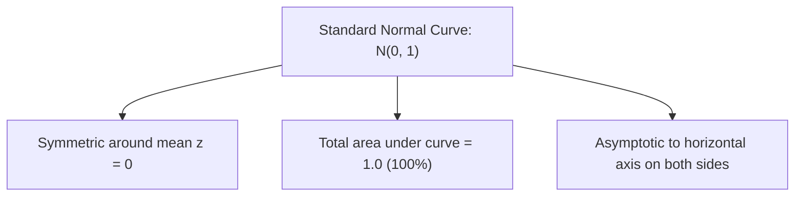

## The Normal Distribution

The **Normal (Gaussian) Distribution** is a continuous, bell-shaped, symmetric probability distribution centered at mean $\mu$ with dispersion determined by standard deviation $\sigma$.

---

## The Empirical Rule (68–95–99.7 Rule)

For any normally distributed dataset:

$$
\Large
\begin{cases}
\approx 68.26\% \text{ of data falls within } \mu \pm 1\sigma\\
\approx 95.44\% \text{ of data falls within } \mu \pm 2\sigma\\
\approx 99.74\% \text{ of data falls within } \mu \pm 3\sigma
\end{cases}
$$

---

## Standard Normal Score ($z$-Score)

The $z$-score standardizes any raw score $x$ by transforming it into the number of standard deviations it lies from the mean:

$$
\Huge
z = \frac{x - \mu}{\sigma} \quad \text{or} \quad z = \frac{x - \bar{x}}{s}
$$

Where:
- $\large x$ is the **Raw Score**
- $\large \mu$ is the **Population Mean**
- $\large \sigma$ is the **Population Standard Deviation**
- $\large z$ is the **Standard Normal Variable** ($Z \sim \mathcal{N}(0, 1)$)

---

## Computing Normal Probabilities

$$
\textit{eg. Finding } P(x > 85) \text{ when } \mu = 70, \; \sigma = 10:\\
\large
\begin{align*}
z &= \frac{85 - 70}{10} = \frac{15}{10} = 1.50\\[6pt]
P(X > 85) &= P(Z > 1.50) = 1 - P(Z \le 1.50)\\
&= 1 - 0.9332 = 0.0668 \quad (6.68\%)
\end{align*}
$$

---

## Casio fx-991CW Calculator "Cheat": Distribution App (No $z$-Table Needed)

The **Distribution App** on the **Casio fx-991CW** eliminates the need to manually compute $z$-scores or search paper statistical tables.

### 1. Cumulative Normal Probability (Normal CD)

1. Press **HOME** $\to$ select **Distribution** $\to$ press **EXE**.
2. Select **Normal CD** (Cumulative Distribution) $\to$ press **EXE**.
3. Input the parameters:
   - **Lower**: Lower bound (use `-9999` or $-1\times 10^{99}$ for $-\infty$).
   - **Upper**: Upper bound (use `9999` or $1\times 10^{99}$ for $+\infty$).
   - **$\sigma$**: Standard deviation (Enter `10`).
   - **$\mu$**: Mean (Enter `70`).
4. Highlight **Execute** $\to$ press **EXE**.

#### Worked Exam Scenarios:
- **Right Tail $P(X > 85)$**:
  - `Lower: 85`, `Upper: 9999`, $\sigma = 10, \mu = 70$
  - Output: $p = 0.066807$ ($6.68\%$).
- **Left Tail $P(X \le 65)$**:
  - `Lower: -9999`, `Upper: 65`, $\sigma = 10, \mu = 70$
  - Output: $p = 0.308537$ ($30.85\%$).
- **Between Two Values $P(60 \le X \le 80)$**:
  - `Lower: 60`, `Upper: 80`, $\sigma = 10, \mu = 70$
  - Output: $p = 0.682689$ ($68.27\%$).
- **Standard Normal $Z \sim \mathcal{N}(0, 1)$**:
  - Simply set $\mu = 0$ and $\sigma = 1$.

---

### 2. Inverse Normal (Finding Cutoff Scores / Percentiles)
When given a percentile (e.g., *"Find the top 10% cutoff score"* $\implies$ Area = $0.90$):
1. In **Distribution**, select **Inverse Normal** $\to$ press **EXE**.
2. Set:
   - **Area**: `0.90` (cumulative probability from the left)
   - **$\sigma$**: `10`
   - **$\mu$**: `70`
3. Highlight **Execute** $\to$ press **EXE**.
   - Output: $x = 82.8155$.
   - A student needs a score of **$82.82$** to be in the top $10\%$. Zero algebra or inverse $z$-lookup required!

