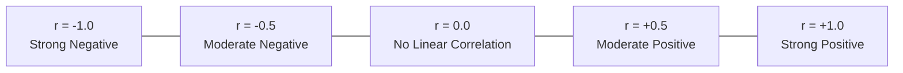

## Pearson's Correlation Coefficient ($r$)

The **Pearson Product-Moment Correlation Coefficient** ($r$) measures the strength and direction of a linear relationship between two quantitative variables:

$$
\Large
r = \frac{n \sum xy - (\sum x)(\sum y)}{\sqrt{\left[n \sum x^2 - (\sum x)^2\right] \left[n \sum y^2 - (\sum y)^2\right]}}\\
\Huge
or\\
\Large
r = \frac{\sum(x - \bar{x})(y - \bar{y})}{\sqrt{[\sum(x-\bar{x})^2][\sum(y-\bar{y})^2]}}
$$

- $\large -1 \le r \le 1$
Where:
- $\large r = +1$: Perfect positive linear correlation
- $\large r = -1$: Perfect negative linear correlation
- $\large r = 0$: No linear relationship

---

## Simple Linear Regression Equation

The regression line (line of best fit) predicts the value of dependent variable $y$ from independent variable $x$:

$$
\Huge
\hat{y} = a + bx
$$

Where:

### Slope ($b$)

$$
\Large
b = \frac{n \sum xy - (\sum x)(\sum y)}{n \sum x^2 - (\sum x)^2}
$$

### $y$-Intercept ($a$)

$$
\Large
a = \bar{y} - b\bar{x} = \frac{\sum y - b\sum x}{n}
$$

---

## Coefficient of Determination ($r^2$)

The proportion of the total variation in $y$ that is explained by the linear relationship with $x$:

$$
\Large
r^2 = (r)^2 \quad (0 \le r^2 \le 1)
$$

---

## Casio fx-991CW Calculator "Cheat": 2-Variable Regression ($y = a + bx$)

The **Casio fx-991CW** features a built-in 2-variable linear regression calculator that extracts correlation coefficient $r$, slope $b$, intercept $a$, and all summation terms in seconds.

### Keystroke Instructions

1. Press **HOME** $\to$ select **Statistics** $\to$ select **$y = a + bx$** $\to$ press **EXE**.
2. Enter your paired data points $(x, y)$ in the table:
   - Type $x_1$ $\to$ **EXE**, $x_2$ $\to$ **EXE**, etc.
   - Use right-arrow to move to the $y$ column and enter $y_1, y_2, \dots$
3. Press **TOOLS** $\to$ select **Regression Calc** (or **2-Variable Calc**) $\to$ press **EXE**.

### The "Cheat" Output Values

The screen immediately displays:

| Symbol on fx-991CW | Description | Use in Exams |
| :--- | :--- | :--- |
| **$a$** | $y$-Intercept of regression line | Regression equation $\hat{y} = a + bx$ |
| **$b$** | Slope of regression line | Regression equation $\hat{y} = a + bx$ |
| **$r$** | Pearson's correlation coefficient | Measures strength and direction ($-1 \le r \le 1$) |
| **$r^2$** | Coefficient of Determination | Proportion of variance explained |
| **$\sum x, \sum y$** | Sums of observations | Manual formula showing work |
| **$\sum x^2, \sum y^2$** | Sums of squared values | Manual formula denominators |
| **$\sum xy$** | Sum of cross products | Manual formula numerator |
| **$\bar{x}, \bar{y}$** | Sample means of $x$ and $y$ | Centroid of data $(\bar{x}, \bar{y})$ |
| **$s_x, s_y$** | Sample standard deviations | Spread metrics |

> [!TIP]
> **Prediction Shortcut**:
> Once $a$ and $b$ are given, predict $\hat{y}$ for a new $x$ value simply by typing:
> $$a + b \times x_{\text{new}}$$
> in the Calculate app!

