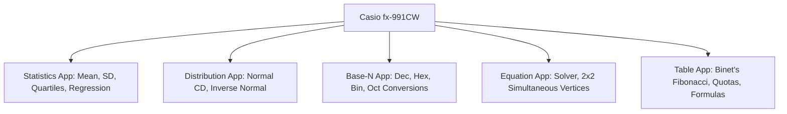

# Casio fx-991CW Calculator Hacks for Mathematics in the Modern World (MMW)

The **Casio fx-991CW ClassWiz** contains built-in apps and functions that can solve, shortcut, or verify nearly every computation-heavy module in Mathematics in the Modern World.

---

## 1. Module 1: Fibonacci Sequence and Golden Ratio ($\Phi$)

### Generating the First 30 Fibonacci Numbers
- **App**: `HOME` $\to$ **Table**
- **Function**: Define $f(x)$ using Binet's formula:
  $$f(x) = \frac{1}{\sqrt{5}}\left[\left(\frac{1+\sqrt{5}}{2}\right)^x - \left(\frac{1-\sqrt{5}}{2}\right)^x\right]$$
- **Table Range**: `Start: 1`, `End: 30`, `Step: 1`
- **Output**: Instantly lists $F_1, F_2, \dots, F_{30}$.

### Golden Ratio ($\Phi$) Continuous Loop
- **App**: `HOME` $\to$ **Calculate**
- Type `1` $\to$ `EXE`.
- Type `1 + 1 / Ans` $\to$ `EXE`.
- Press `EXE` repeatedly $\implies$ converges directly to $\Phi = 1.6180339887\dots$

---

## 2. Module 4: Numeration Systems & Base Conversions

### Decimal $\leftrightarrow$ Binary $\leftrightarrow$ Octal $\leftrightarrow$ Hexadecimal
- **App**: `HOME` $\to$ **Base-N**
- **Input**:
  1. Press **FORMAT** $\to$ select your starting base (Decimal, Binary, Octal, Hexadecimal).
  2. Enter the number, press **EXE**.
  3. Press **FORMAT** $\to$ choose the target base.
  4. The calculator instantly displays the converted value.
- **Hexadecimal Letters**: In **Hex** mode, letter keys `A, B, C, D, E, F` are directly active on the keyboard without pressing `ALPHA`.

---

## 3. Module 5: Data Management (1-Variable Statistics)

> [!IMPORTANT]
> The single greatest time-saver on exam day. Replaces 20 minutes of manual arithmetic.

### Keystrokes
1. `HOME` $\to$ **Statistics** $\to$ **1-Variable**
2. (For grouped / frequency data): Press **TOOLS** $\to$ **Frequency** $\to$ **On**.
3. Enter values into column $x$ (and frequencies into $Freq$).
4. Press **TOOLS** $\to$ select **1-Variable Calc** $\to$ **EXE**.

### Everything the Display Gives You
- **Mean**: $\bar{x}$
- **Sums**: $\sum x$, $\sum x^2$
- **Sample Standard Deviation**: $s_x$
- **Sample Variance**: $s_x^2$ (square $s_x$)
- **Population Standard Deviation**: $\sigma_x$
- **Sample Size**: $n$
- **Five-Number Summary**: $\text{Min}(x)$, $Q_1$, $\text{Med}$, $Q_3$, $\text{Max}(x)$
- **Interquartile Range**: $IQR = Q_3 - Q_1$
- **Outlier Fences**: Lower $= Q_1 - 1.5(IQR)$, Upper $= Q_3 + 1.5(IQR)$

---

## 4. Module 6: Normal Distribution Probabilities

No need to calculate $z$-scores manually or carry paper tables!

### Cumulative Normal Probabilities (Normal CD)
- **App**: `HOME` $\to$ **Distribution** $\to$ **Normal CD**
- Directly input:
  - **Lower**: Lower limit (e.g. `-9999` for $-\infty$)
  - **Upper**: Upper limit
  - **$\sigma$**: Standard deviation
  - **$\mu$**: Mean
- Press **EXE** $\implies$ returns exact probability $p = P(\text{Lower} \le X \le \text{Upper})$.

### Inverse Normal (Cutoff Values / Percentiles)
- **App**: `HOME` $\to$ **Distribution** $\to$ **Inverse Normal**
- Enter cumulative probability (e.g., top $10\% \implies \text{Area} = 0.90$), $\sigma$, and $\mu$.
- Press **EXE** $\implies$ returns exact boundary score $x$.

---

## 5. Module 7: Linear Correlation and Regression

### Keystrokes
1. `HOME` $\to$ **Statistics** $\to$ **$y = a + bx$**
2. Enter pairs $(x_i, y_i)$ into the two columns.
3. Press **TOOLS** $\to$ select **Regression Calc** $\to$ **EXE**.

### Results Obtained
- **$a$**: $y$-intercept
- **$b$**: Slope of regression line ($\hat{y} = a + bx$)
- **$r$**: Pearson correlation coefficient ($-1 \le r \le 1$)
- **$r^2$**: Coefficient of determination
- **All Sums**: $\sum x, \sum y, \sum x^2, \sum y^2, \sum xy, \bar{x}, \bar{y}$

---

## 6. Module 8: Mathematics of Finance

### Compound Interest Rate ($r$) and Time ($t$) via Solver
- **App**: `HOME` $\to$ **Equation** $\to$ **Solver** (or in **Calculate**: type equation $\to$ `TOOLS` $\to$ `Solver`)
- Type the compound interest formula:
  $$A = P \times \left(1 + \frac{R}{M}\right)^{M \times T}$$
- Enter known values, highlight unknown ($T$ or $R$) $\to$ press **EXE**.
- Solves for time $t$ **without logarithms**, and solves for rate $r$ **without $n$-th roots**!

---

## 7. Module 9: Linear Programming (Corner Points)

### Finding Feasible Region Vertices Instantly
- **App**: `HOME` $\to$ **Equation** $\to$ **Simultaneous Equation** $\to$ **2 Unknowns**
- Enter the coefficients of any two intersecting constraint boundary lines:
  $$a_1 x + b_1 y = c_1$$
  $$a_2 x + b_2 y = c_2$$
- Press **EXE** $\implies$ outputs exact intersection coordinates $(x, y)$.
- Evaluate objective function $Z = ax + by$ at each vertex in the **Calculate** app.

---

## 8. Module 10: Apportionment & Quotas

### Standard Divisor & Multi-State Quota Batching
- Compute Standard Divisor: $SD = P / M$ in **Calculate**.
- Store in variable **$D$**: `VARIABLE` $\to$ $D$.
- In **Table App**: Set $f(x) = x / D$.
- Enter state populations into $x$ column $\implies$ column $f(x)$ immediately prints all standard quotas $q_i$ and decimal parts!
