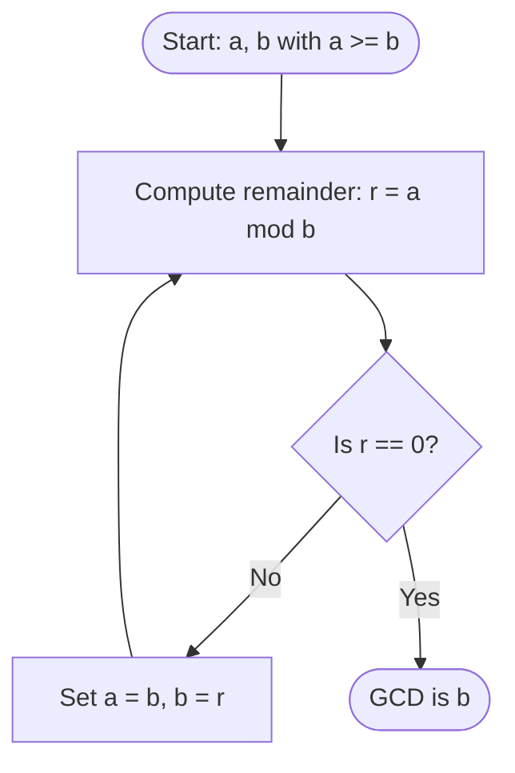

## Greatest Common Divisor (GCD)

The Greatest Common Divisor of two non-zero integers $a$ and $b$, denoted by $\gcd(a, b)$, is the largest positive integer $d$ that divides both $a$ and $b$:

$$
\Large
d = \gcd(a, b) \iff (d \mid a) \land (d \mid b) \land (\forall c \in \mathbb{Z}, (c \mid a \land c \mid b) \implies c \le d)
$$

### Properties of GCD

- $\gcd(a, b) = \gcd(b, a)$
- $\gcd(a, b) = \gcd(|a|, |b|)$
- $\gcd(a, 0) = |a|$ for $a \ne 0$
- If $\gcd(a, b) = 1$, then $a$ and $b$ are **relatively prime** (coprime).

---

## Least Common Multiple (LCM)

The Least Common Multiple of two integers $a$ and $b$, denoted by $\operatorname{lcm}(a, b)$, is the smallest positive integer $m$ that is a multiple of both $a$ and $b$.

### Relationship between GCD and LCM

$$
\Huge
\gcd(a, b) \cdot \operatorname{lcm}(a, b) = |a \cdot b|
$$

$$
\textit{eg.}\\
\large
\begin{align*}
a = 12, \; b = 18 &\implies \gcd(12, 18) = 6\\
&\implies \operatorname{lcm}(12, 18) = \frac{12 \cdot 18}{6} = 36
\end{align*}
$$

---

## The Euclidean Algorithm

The Euclidean Algorithm computes $\gcd(a, b)$ efficiently using repeated division with remainders:

$$
\Large
\gcd(a, b) = \gcd(b, r) \quad \text{where } a = bq + r
$$

### Step-by-Step Example

Find $\gcd(252, 105)$:

$$
\large
\begin{align*}
252 &= 105 \cdot 2 + 42\\
105 &= 42 \cdot 2 + 21\\
42 &= 21 \cdot 2 + 0 \quad (\text{Remainder is } 0)\\
\implies \gcd(252, 105) &= 21
\end{align*}
$$

---

## Bézout's Identity and Linear Combinations

For any non-zero integers $a$ and $b$, there exist integers $x$ and $y$ such that:

$$
\Huge
\gcd(a, b) = ax + by
$$

### Extended Euclidean Algorithm (Back-Substitution)

Using the divisions from $\gcd(252, 105) = 21$:

$$
\large
\begin{align*}
21 &= 105 - 42 \cdot 2\\
42 &= 252 - 105 \cdot 2\\
\implies 21 &= 105 - (252 - 105 \cdot 2) \cdot 2\\
&= 105 - 252(2) + 105(4)\\
&= 252(-2) + 105(5)\\
\therefore x &= -2, \quad y = 5
\end{align*}
$$

---

## Casio fx-991CW Calculator "Cheat": Instant GCD, LCM & Euclidean Steps

The **Casio fx-991CW** provides built-in `GCD` and `LCM` functions in the **Calculate** app.

### 1. Direct $\gcd(a, b)$ and $\operatorname{lcm}(a, b)$

1. Press **HOME** $\to$ select **Calculate** $\to$ press **EXE**.
2. Press **CATALOG** $\to$ select **Numeric Calc** $\to$ select **GCD** (or **LCM**).
3. Input the numbers separated by a comma: `GCD(252, 105)` $\to$ press **EXE**.
   - Output: `21`.
4. For LCM: `LCM(12, 18)` $\to$ press **EXE**.
   - Output: `36`.
5. **For Three Numbers**: Nest the function:
   - `GCD(GCD(a, b), c)` $\to$ computes $\gcd(a, b, c)$ directly!

---

### 2. Auto-Generating Euclidean Algorithm Division Steps

To show complete step-by-step division work on an exam without doing manual long division:
Use **`Int÷`** (`CATALOG` $\to$ **Numeric Calc** $\to$ **`Int÷`**):

- **Step 1**: Type `252 Int÷ 105` $\to$ returns `Q = 2, R = 42`.
  - Write down: $252 = 105(2) + 42$.
- **Step 2**: Type `105 Int÷ 42` $\to$ returns `Q = 2, R = 21`.
  - Write down: $105 = 42(2) + 21$.
- **Step 3**: Type `42 Int÷ 21` $\to$ returns `Q = 2, R = 0`.
  - Write down: $42 = 21(2) + 0$.
- **Conclusion**: The last non-zero remainder is **$21$**, so $\gcd(252, 105) = 21$.

---

### 3. Verifying Bézout's Identity ($ax + by = d$)
Once you find candidate coefficients $x = -2$ and $y = 5$:
- Type `252*(-2) + 105*(5)` in Calculate $\to$ press **EXE** $\to$ confirms `21`.

