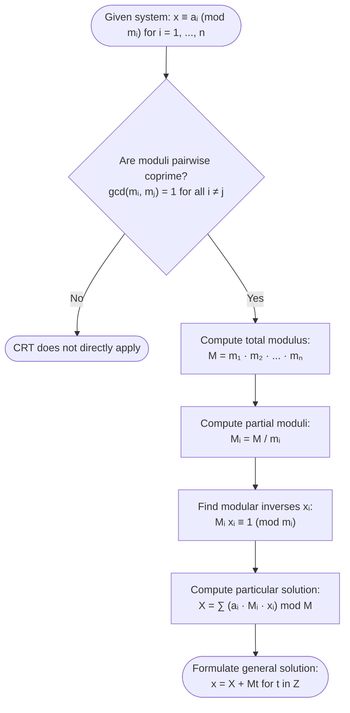

## Solving Linear Congruences

A **linear congruence** in one variable is an equation of the form:

$$
\Huge
ax \equiv b \pmod{m}
$$

Where:
- $\large a, b \in \mathbb{Z}$ and $m \in \mathbb{Z}^+$ ($m > 0$)
- $\large x \in \mathbb{Z}$ is the unknown integer to be solved

---

### Solvability Criterion

Let $d = \gcd(a, m)$:

1. **No Solutions**: If $d \nmid b$, then the congruence has **no solutions**.
2. **Unique Solution Modulo $m$**: If $d = 1$ (i.e., $a$ and $m$ are coprime), then the congruence has **exactly one unique solution** modulo $m$.
3. **Multiple Solutions Modulo $m$**: If $d \mid b$, then the congruence has **$d$ mutually incongruent solutions** modulo $m$.

---

### Linear Congruence Examples

#### Example 1: No Solution ($d \nmid b$)

Solve the congruence:
$$
2x \equiv 3 \pmod 8
$$

**1. Determine $d = \gcd(a, m)$:**
$$
d = \gcd(2, 8) = 2
$$

**2. Check divisibility:**
$$
2 \nmid 3
$$

$$
\therefore\ \fbox{The linear congruence has no solutions.}
$$

---

#### Example 2: Unique Solution ($d = 1$)

Solve the congruence:
$$
3x \equiv 5 \pmod 7
$$

**1. Determine $d = \gcd(a, m)$:**
$$
d = \gcd(3, 7) = 1
$$
Since $1 \mid 5$, there is **exactly $1$ unique solution** modulo $7$.

**2. Find the modular multiplicative inverse of $3$ modulo $7$ ($3^{-1} \pmod 7$):**
We seek an integer $y$ such that $3y \equiv 1 \pmod 7$:
$$
\begin{align*}
3(1) &= 3 \equiv 3 \pmod 7\\
3(2) &= 6 \equiv 6 \pmod 7\\
3(3) &= 9 \equiv 2 \pmod 7\\
3(4) &= 12 \equiv 5 \pmod 7\\
3(5) &= 15 \equiv 1 \pmod 7 \implies 3^{-1} \equiv 5 \pmod 7
\end{align*}
$$

**3. Multiply both sides by the inverse ($5$):**
$$
\begin{align*}
5 \cdot (3x) &\equiv 5 \cdot 5 \pmod 7\\
(15)x &\equiv 25 \pmod 7\\
x &\equiv 4 \pmod 7
\end{align*}
$$

**4. Check the solution:**
$$
3(4) = 12 = 7(1) + 5 \equiv 5 \pmod 7 \quad \checkmark
$$

$$
\therefore\ \fbox{$x \equiv 4 \pmod 7 \quad \text{(or } x = 4 + 7t, \; t \in \mathbb{Z}\text{)}$}
$$

---

#### Example 3: Multiple Incongruent Solutions ($d > 1$ and $d \mid b$)

Solve the congruence:
$$
6x \equiv 9 \pmod{15}
$$

**1. Determine $d = \gcd(a, m)$:**
$$
d = \gcd(6, 15) = 3
$$

**2. Check divisibility:**
$$
3 \mid 9 \implies \text{There are exactly } d = 3 \text{ mutually incongruent solutions modulo } 15.
$$

**3. Divide the entire congruence by $d = 3$ to obtain a reduced congruence:**
$$
\frac{6}{3}x \equiv \frac{9}{3} \pmod{\frac{15}{3}} \implies 2x \equiv 3 \pmod 5
$$

**4. Solve the reduced congruence:**
Find the inverse of $2$ modulo $5$:
$$
2(3) = 6 \equiv 1 \pmod 5 \implies 2^{-1} \equiv 3 \pmod 5
$$
Multiply both sides by $3$:
$$
\begin{align*}
x_0 &\equiv 3 \cdot 3 \pmod 5\\
x_0 &\equiv 9 \equiv 4 \pmod 5
\end{align*}
$$

**5. Generate all $d = 3$ solutions modulo $15$:**
The $d$ incongruent solutions modulo $m$ are given by:
$$
x_k = x_0 + k \cdot \left(\frac{m}{d}\right) = 4 + k(5) \quad \text{for } k = 0, 1, 2
$$

- For $k = 0$: $x_0 = 4$
- For $k = 1$: $x_1 = 4 + 5(1) = 9$
- For $k = 2$: $x_2 = 4 + 5(2) = 14$

**6. Verification:**
- $6(4) = 24 = 15(1) + 9 \equiv 9 \pmod{15} \quad \checkmark$
- $6(9) = 54 = 15(3) + 9 \equiv 9 \pmod{15} \quad \checkmark$
- $6(14) = 84 = 15(5) + 9 \equiv 9 \pmod{15} \quad \checkmark$

$$
\therefore\ \fbox{x \equiv 4, 9, 14 \pmod{15}}
$$

---

## Chinese Remainder Theorem (CRT)

The **Chinese Remainder Theorem** is used to solve a system of simultaneous linear congruences with one variable and pairwise coprime moduli:

$$
\Huge
\begin{cases}
x \equiv a_1 \pmod{m_1}\\
x \equiv a_2 \pmod{m_2}\\
\quad \vdots\\
x \equiv a_n \pmod{m_n}
\end{cases}
$$

### Theorem Statement

If the moduli $m_1, m_2, \dots, m_n$ are positive integers such that they are **pairwise coprime**:
$$
\Large
\gcd(m_i, m_j) = 1 \quad \text{for all } i \ne j
$$

Then the system has a **unique solution** modulo $M$, where:
$$
\Huge
M = \prod_{i=1}^{n} m_i = m_1 \cdot m_2 \cdots m_n
$$

---

### Step-by-Step CRT Algorithm

1. **Extract values**: Identify the remainders $a_i$ and moduli $m_i$.
2. **Verify pairwise coprimality**: Ensure $\gcd(m_i, m_j) = 1$ for all $i \ne j$.
3. **Calculate total modulus $M$**:
   $$
   M = \prod_{i=1}^{n} m_i = m_1 \cdot m_2 \cdots m_n
   $$
4. **Calculate partial moduli $M_i$**:
   $$
   M_i = \frac{M}{m_i}
   $$
5. **Find modular inverse $x_i$ for each congruence**:
   Solve each linear congruence for $x_i$:
   $$
   M_i x_i \equiv 1 \pmod{m_i}
   $$
6. **Calculate the particular solution $X$**:
   $$
   X = \left(\sum_{i=1}^{n} a_i M_i x_i\right) \bmod M
   $$
7. **Write the general solution**:
   $$
   x \equiv X \pmod M \implies x = X + Mt \quad (t \in \mathbb{Z})
   $$

---

### Worked Examples for CRT

#### Example 1: Classic System of 3 Congruences (Sunzi's Problem)

Find an integer $x$ that satisfies the system:
$$
\begin{cases}
x \equiv 2 \pmod 3\\
x \equiv 3 \pmod 5\\
x \equiv 2 \pmod 7
\end{cases}
$$

**1. Identify coefficients:**
- $a_1 = 2, \; m_1 = 3$
- $a_2 = 3, \; m_2 = 5$
- $a_3 = 2, \; m_3 = 7$

**2. Verify pairwise coprimality:**
$$
\gcd(3, 5) = 1, \quad \gcd(3, 7) = 1, \quad \gcd(5, 7) = 1 \quad \checkmark
$$

**3. Compute total modulus $M$:**
$$
M = 3 \cdot 5 \cdot 7 = 105
$$

**4. Compute partial moduli $M_i$:**
$$
\begin{align*}
M_1 &= \frac{105}{3} = 35\\
M_2 &= \frac{105}{5} = 21\\
M_3 &= \frac{105}{7} = 15
\end{align*}
$$

**5. Find inverses $x_i$ such that $M_i x_i \equiv 1 \pmod{m_i}$:**

- **For $i = 1$:**
  $$
  35 x_1 \equiv 1 \pmod 3 \implies 2x_1 \equiv 1 \pmod 3 \implies x_1 = 2 \quad (\text{since } 2 \cdot 2 = 4 \equiv 1)
  $$

- **For $i = 2$:**
  $$
  21 x_2 \equiv 1 \pmod 5 \implies 1x_2 \equiv 1 \pmod 5 \implies x_2 = 1
  $$

- **For $i = 3$:**
  $$
  15 x_3 \equiv 1 \pmod 7 \implies 1x_3 \equiv 1 \pmod 7 \implies x_3 = 1
  $$

**6. Calculate particular solution $X$:**
$$
\begin{align*}
X &= a_1 M_1 x_1 + a_2 M_2 x_2 + a_3 M_3 x_3\\
&= (2)(35)(2) + (3)(21)(1) + (2)(15)(1)\\
&= 140 + 63 + 30\\
&= 233
\end{align*}
$$

Reduce modulo $M = 105$:
$$
X \equiv 233 \bmod 105 = 233 - 2(105) = 23
$$

**7. Verification:**
- $23 = 3(7) + 2 \equiv 2 \pmod 3 \quad \checkmark$
- $23 = 5(4) + 3 \equiv 3 \pmod 5 \quad \checkmark$
- $23 = 7(3) + 2 \equiv 2 \pmod 7 \quad \checkmark$

$$
\therefore\ \fbox{x \equiv 23 \pmod{105} \quad \text{or} \quad x = 23 + 105t \quad (t \in \mathbb{Z})}
$$
The smallest positive integer solution is **$x = 23$**.

---

#### Example 2: System with Higher Moduli

Solve the system:
$$
\begin{cases}
x \equiv 1 \pmod 4\\
x \equiv 2 \pmod 5\\
x \equiv 4 \pmod 9
\end{cases}
$$

**1. Check pairwise coprimality:**
$$
\gcd(4, 5) = 1, \quad \gcd(4, 9) = 1, \quad \gcd(5, 9) = 1 \quad \checkmark
$$

**2. Compute total modulus $M$:**
$$
M = 4 \cdot 5 \cdot 9 = 180
$$

**3. Compute partial moduli $M_i$:**
$$
\begin{align*}
M_1 &= \frac{180}{4} = 45\\
M_2 &= \frac{180}{5} = 36\\
M_3 &= \frac{180}{9} = 20
\end{align*}
$$

**4. Find inverses $x_i$:**

- **For $x_1$:**
  $$
  45 x_1 \equiv 1 \pmod 4 \implies 1x_1 \equiv 1 \pmod 4 \implies x_1 = 1
  $$

- **For $x_2$:**
  $$
  36 x_2 \equiv 1 \pmod 5 \implies 1x_2 \equiv 1 \pmod 5 \implies x_2 = 1
  $$

- **For $x_3$:**
  $$
  20 x_3 \equiv 1 \pmod 9 \implies 2x_3 \equiv 1 \pmod 9
  $$
  Since $2(5) = 10 \equiv 1 \pmod 9$, we have $x_3 = 5$.

**5. Compute particular solution $X$:**
$$
\begin{align*}
X &= a_1 M_1 x_1 + a_2 M_2 x_2 + a_3 M_3 x_3\\
&= (1)(45)(1) + (2)(36)(1) + (4)(20)(5)\\
&= 45 + 72 + 400\\
&= 517
\end{align*}
$$

Reduce modulo $M = 180$:
$$
517 = 2(180) + 157 \implies X \equiv 157 \pmod{180}
$$

**6. Verification:**
- $157 = 4(39) + 1 \equiv 1 \pmod 4 \quad \checkmark$
- $157 = 5(31) + 2 \equiv 2 \pmod 5 \quad \checkmark$
- $157 = 9(17) + 4 \equiv 4 \pmod 9 \quad \checkmark$

$$
\therefore\ \fbox{x \equiv 157 \pmod{180} \quad \text{or} \quad x = 157 + 180t \quad (t \in \mathbb{Z})}
$$

---

#### Example 3: System with Non-Unit Coefficients (Pre-reduction)

Solve the system of congruences:
$$
\begin{cases}
2x \equiv 1 \pmod 3\\
3x \equiv 4 \pmod 5
\end{cases}
$$

**1. Reduce each equation to standard form $x \equiv a_i \pmod{m_i}$:**

- **First equation:** $2x \equiv 1 \pmod 3$
  Multiply by $2^{-1} \equiv 2 \pmod 3$:
  $$
  x \equiv 2(1) \equiv 2 \pmod 3
  $$

- **Second equation:** $3x \equiv 4 \pmod 5$
  Multiply by $3^{-1} \equiv 2 \pmod 5$ (since $3 \cdot 2 = 6 \equiv 1$):
  $$
  x \equiv 2(4) = 8 \equiv 3 \pmod 5
  $$

The simplified system is:
$$
\begin{cases}
x \equiv 2 \pmod 3\\
x \equiv 3 \pmod 5
\end{cases}
$$

**2. Apply CRT:**
- $M = 3 \cdot 5 = 15$
- $M_1 = \frac{15}{3} = 5$
- $M_2 = \frac{15}{5} = 3$

**3. Inverses:**
- $5x_1 \equiv 1 \pmod 3 \implies 2x_1 \equiv 1 \pmod 3 \implies x_1 = 2$
- $3x_2 \equiv 1 \pmod 5 \implies x_2 = 2$ (since $3 \cdot 2 = 6 \equiv 1$)

**4. Combine:**
$$
\begin{align*}
X &= a_1 M_1 x_1 + a_2 M_2 x_2\\
&= (2)(5)(2) + (3)(3)(2)\\
&= 20 + 18 = 38
\end{align*}
$$

Reduce modulo $15$:
$$
X \equiv 38 \bmod 15 = 8
$$

**5. Verification in original congruences:**
- $2(8) = 16 = 3(5) + 1 \equiv 1 \pmod 3 \quad \checkmark$
- $3(8) = 24 = 5(4) + 4 \equiv 4 \pmod 5 \quad \checkmark$

$$
\therefore\ \fbox{x \equiv 8 \pmod{15} \quad \text{or} \quad x = 8 + 15t \quad (t \in \mathbb{Z})}
$$

---

#### Example 4: Real-World Word Problem Application

> **Problem:**
> A student is organizing a collection of books.
> - When arranged into stacks of $5$, there are $3$ books left over.
> - When arranged into stacks of $7$, there are $4$ books left over.
> - When arranged into stacks of $11$, there are $6$ books left over.
>
> What is the smallest positive number of books the student could have?

**1. Translate to a system of congruences:**
Let $x$ be the number of books:
$$
\begin{cases}
x \equiv 3 \pmod 5\\
x \equiv 4 \pmod 7\\
x \equiv 6 \pmod{11}
\end{cases}
$$

**2. Verify pairwise coprimality:**
The moduli $5, 7, 11$ are all prime numbers, so they are pairwise coprime.

**3. Calculate moduli:**
$$
\begin{align*}
M &= 5 \cdot 7 \cdot 11 = 385\\[6pt]
M_1 &= \frac{385}{5} = 77\\
M_2 &= \frac{385}{7} = 55\\
M_3 &= \frac{385}{11} = 35
\end{align*}
$$

**4. Find modular inverses:**

- **For $x_1$:**
  $$
  77 x_1 \equiv 1 \pmod 5 \implies 2x_1 \equiv 1 \pmod 5 \implies x_1 = 3 \quad (\text{since } 2 \cdot 3 = 6 \equiv 1)
  $$

- **For $x_2$:**
  $$
  55 x_2 \equiv 1 \pmod 7 \implies 6x_2 \equiv 1 \pmod 7 \implies x_2 = 6 \quad (\text{since } 6 \cdot 6 = 36 \equiv 1)
  $$

- **For $x_3$:**
  $$
  35 x_3 \equiv 1 \pmod{11} \implies 2x_3 \equiv 1 \pmod{11} \implies x_3 = 6 \quad (\text{since } 2 \cdot 6 = 12 \equiv 1)
  $$

**5. Calculate $X$:**
$$
\begin{align*}
X &= a_1 M_1 x_1 + a_2 M_2 x_2 + a_3 M_3 x_3\\
&= (3)(77)(3) + (4)(55)(6) + (6)(35)(6)\\
&= 693 + 1320 + 1260\\
&= 3273
\end{align*}
$$

Reduce modulo $M = 385$:
$$
\frac{3273}{385} = 8 \text{ remainder } 193 \implies X \equiv 193 \pmod{385}
$$

**6. Verification:**
- $193 = 5(38) + 3 \equiv 3 \pmod 5 \quad \checkmark$
- $193 = 7(27) + 4 \equiv 4 \pmod 7 \quad \checkmark$
- $193 = 11(17) + 6 \equiv 6 \pmod{11} \quad \checkmark$

$$
\therefore\ \fbox{\text{The student has at least } 193 \text{ books.}}
$$

---

## Casio fx-991CW Calculator "Cheat": Modular Inverses and CRT Verification

The **Casio fx-991CW** makes finding modular inverses and verifying CRT solutions effortless.

### 1. Solving Modular Inverses $y \equiv M_i^{-1} \pmod{m_i}$ via Table App
To find the inverse of $77$ modulo $5$ (solving $77y \equiv 1 \pmod 5$):
1. Press **HOME** $\to$ **Table** $\to$ **TOOLS** $\to$ Define $f(x)$.
2. Enter: $f(x) = (77 \cdot x) \text{ Int÷ } 5$
   *(Or simply $(2x) \text{ Int÷ } 5$ because $77 \equiv 2 \pmod 5$)*.
   - Note: on the fx-991CW, you can also enter: $f(x) = (77x) - 5 \times \text{Floor}((77x)/5)$.
3. Set Range: `Start: 0`, `End: 4`, `Step: 1`.
4. Look for the row where the remainder is **$1$**.
   - At $x = 3$: remainder is $1$.
   - Therefore, the modular inverse is $y_1 = 3$!

### 2. Verifying the Final CRT Solution with `Int÷`
Once you calculate $X = 193$:
- In **Calculate** app:
  - Type `193 Int÷ 5` $\to$ displays `Q = 38, R = 3` (Matches $x \equiv 3 \pmod 5$)
  - Type `193 Int÷ 7` $\to$ displays `Q = 27, R = 4` (Matches $x \equiv 4 \pmod 7$)
  - Type `193 Int÷ 11` $\to$ displays `Q = 17, R = 6` (Matches $x \equiv 6 \pmod{11}$)
- All congruences verified in 15 seconds!
