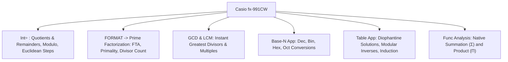

# Casio fx-991CW Calculator Hacks for Number Theory

The **Casio fx-991CW ClassWiz** is uniquely suited for discrete mathematics and number theory because of its built-in integer division (`Int÷`), prime factorization (`FACT`), GCD/LCM functions, and sequence tables.

---

## 1. Module 1: Base Conversions & Two's Complement

### Quick Conversions
- **App**: `HOME` $\to$ **Base-N**
- Press **FORMAT** $\to$ set starting base (Dec, Bin, Oct, Hex).
- Enter number $\to$ press **EXE**.
- Press **FORMAT** $\to$ select target base $\implies$ instant conversion.
- Keys `A, B, C, D, E, F` are active directly on the keyboard for hexadecimal digits.

---

## 2. Module 2: Summation ($\sum$) and Product ($\prod$)

### Instant Sum and Product Evaluation
- **App**: `HOME` $\to$ **Calculate**
- **Summation**: `CATALOG` $\to$ **Func Analysis** $\to$ **Summation ($\sum$)**
  $$\sum_{x=l}^{u} f(x)$$
- **Product**: `CATALOG` $\to$ **Func Analysis** $\to$ **Product ($\prod$)**
  $$\prod_{x=l}^{u} f(x)$$
- *Exam Trick*: Verify closed-form formulas (e.g. $\sum_{i=1}^n i^2$) by testing $n=10$ on both sides.

---

## 3. Module 3: Mathematical Induction Verification

### Verifying Conjectured Formulas via Table App
- **App**: `HOME` $\to$ **Table**
- Define $f(x) = \sum_{i=1}^x \text{LHS}(i)$ (via `CATALOG` $\to$ Func Analysis $\to$ Summation).
- Define $g(x) = \text{RHS}(x)$ (your hypothesized closed-form formula).
- Range: `Start: 1`, `End: 25`, `Step: 1`.
- If $f(x) = g(x)$ for all rows, the formula and algebra are guaranteed correct.

---

## 4. Module 4: Divisibility and the Division Algorithm

### Integer Division with Remainder (`Int÷`)
- **App**: `HOME` $\to$ **Calculate**
- Key Path: `CATALOG` $\to$ **Numeric Calc** $\to$ **`Int÷`**
- Type: `a Int÷ b`
- **Output**: `Q = quotient, R = remainder`
  - $R = 0 \implies b \mid a$ (clean divisor).
  - $R > 0 \implies b \nmid a$.
  - Generates the Division Algorithm form: $a = b \cdot Q + R$.

---

## 5. Module 5: GCD, LCM, and Euclidean Algorithm

### Instant $\gcd$ and $\operatorname{lcm}$
- **App**: `HOME` $\to$ **Calculate**
- `CATALOG` $\to$ **Numeric Calc** $\to$ **GCD**: `GCD(a, b)` $\to$ `EXE`.
- `CATALOG` $\to$ **Numeric Calc** $\to$ **LCM**: `LCM(a, b)` $\to$ `EXE`.
- For three numbers: `GCD(GCD(a, b), c)`.

### Auto-Generating Euclidean Algorithm Steps
Repeatedly use `Int÷` to generate the sequence of quotients and remainders:
1. `252 Int÷ 105` $\implies Q=2, R=42 \implies 252 = 105(2) + 42$
2. `105 Int÷ 42` $\implies Q=2, R=21 \implies 105 = 42(2) + 21$
3. `42 Int÷ 21` $\implies Q=2, R=0 \implies 42 = 21(2) + 0$
- Last non-zero remainder $= 21 = \gcd(252, 105)$.

---

## 6. Module 6: Prime Factorization (`FACT`) and Primality Testing

### Prime Factorization
- **App**: `HOME` $\to$ **Calculate**
- Type any integer (up to 10 digits), press **EXE**.
- Press **FORMAT** $\to$ select **Prime Factorization** $\to$ **EXE**.
  - *Example*: `2520` $\implies 2^3 \times 3^2 \times 5 \times 7$.

### Instant Primality Test
- Type candidate number $N$ $\to$ **EXE** $\to$ **FORMAT** $\to$ **Prime Factorization**.
- If display returns $N$ unaltered, **$N$ is prime!**

### Divisor Count $\tau(n)$ and Sum $\sigma(n)$
From the prime powers $p_1^{k_1} p_2^{k_2} \dots$:
- $\tau(n) = (k_1 + 1)(k_2 + 1)\dots$
- $\sigma(n) = (1 + p_1 + \dots + p_1^{k_1})(1 + p_2 + \dots + p_2^{k_2})\dots$

---

## 7. Module 7: Linear Diophantine Equations ($ax + by = c$)

### Finding a Particular Solution $(x_0, y_0)$ in 10 Seconds
1. Rearrange equation: $y = \frac{c - ax}{b}$.
2. Open `HOME` $\to$ **Table**.
3. Set $f(x) = \frac{c - ax}{b}$.
4. Range: `Start: -15`, `End: 15`, `Step: 1`.
5. Scroll until $f(x)$ is an integer!
   - That row is your particular solution $(x_0, y_0)$.
6. General Solution: $x = x_0 + (b/d)t, \; y = y_0 - (a/d)t$ where $d = \gcd(a, b)$.

---

## 8. Module 8: Chinese Remainder Theorem & Modular Inverses

### Modular Inverse via Table App
To solve $ax \equiv 1 \pmod m$:
- In **Table**: Set $f(x) = (ax) - m \times \text{Floor}((ax)/m)$.
- Range: `Start: 0`, `End: m-1`, `Step: 1`.
- Look for row where $f(x) = 1$. The corresponding $x$ is your modular inverse!

---

## 9. Extra Modules (E1 & E2)

### Modular Exponentiation ($a^b \pmod m$)
- Discover cycle length using **Table** with $f(x) = (a^x) \pmod m$.
- Successive squaring using `Int÷`: compute `Ans^2 Int÷ m` iteratively.

### Zeller's Formula (Day of Week)
- Enter formula in **Calculate** using `Int` (`CATALOG` $\to$ `Numeric Calc` $\to$ `Int`):
  `q + Int(13*(m+1)/5) + K + Int(K/4) + Int(J/4) + 5*J` $\to$ `EXE`.
- Follow with `Ans Int÷ 7` $\to$ remainder $R$ is the day code ($0 = \text{Sat}, 1 = \text{Sun}, \dots, 6 = \text{Fri}$).
