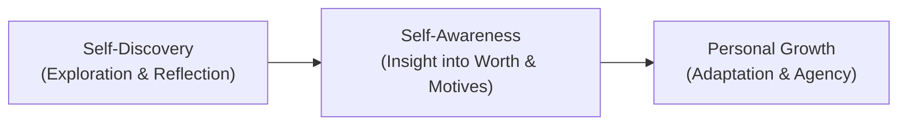
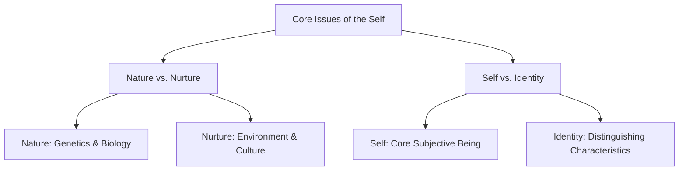

## Overview of the Self

The question "Who am I?" is central to human existence. Attempts to answer this question vary across individuals, developmental stages, cultures, and life circumstances. While some individuals formulate an identity with ease, others navigate an extensive journey of reflection.

Understanding the self is a fundamental endeavor. It requires engaging in two complementary processes:

- **Self-Discovery**: The active process of exploring, learning, and uncovering one's inner potential, motives, character, and values.
- **Self-Awareness**: The conscious knowledge of one's own character, feelings, motives, desires, and personal worth. Self-awareness is the direct outcome of continuous self-discovery.

---

## The Concept and Nature of the Self

A person's name signifies who they are, but the name is not the person itself. A name serves as an external signifier. The self is not a static or rigid entity; it is a dynamic construct that an individual continuously shapes, molds, and develops throughout life.

The self represents the totality of an individual's personality, shaped by four primary dimensions:

- **S** – Social factors
- **E** – Environmental influences
- **L** – Life experiences
- **F** – Foundational personal choices

### Etymology and Definition of Personality

The word **personality** originates from the Greek word *persona*, referring to the theatrical masks worn by actors in ancient drama. In life, individuals assume diverse roles across different contexts (such as child, student, worker, and friend).

Personality is defined as the characteristic patterns of thoughts, feelings, and behaviors that make an individual distinct and enduring across time and situations.

---

## Core Issues in the Study of the Self

Two fundamental debates shape contemporary discussions on the development and nature of selfhood:

### 1. Nature vs. Nurture

The nature versus nurture debate investigates the primary drivers of human development and personal attributes:

| Dimension | Focus | Key Factors | Examples |
| :--- | :--- | :--- | :--- |
| **Nature** | Biological and genetic heritage | Heredity, genetics, neurochemistry, physical maturation | Eye color, height, innate temperamental tendencies |
| **Nurture** | Environmental and social influences | Upbringing, family dynamics, peer groups, culture, life events | Language, social values, personal beliefs, customs |

Current consensus across psychology and social sciences rejects a strict dichotomy. The self is recognized as an emergent product of the dynamic interaction between biological predispositions (**nature**) and socio-cultural experiences (**nurture**).

### 2. Self vs. Identity

Although frequently used interchangeably, social scientists make an analytical distinction between self and identity:

- **The Self**: The essential, unified individual as a whole. It refers to the person that someone truly is, serving as the conscious subject of experience.
- **Identity**: The specific qualities, beliefs, social roles, and group affiliations that distinguish a person or collective from others. Identity is context-dependent, multi-faceted, and socially negotiated.

| Feature | Self | Identity |
| :--- | :--- | :--- |
| **Core Question** | *"Who am I at my core?"* | *"What distinguishes me within my social world?"* |
| **Nature** | Subjective, continuous, experiential | Categorical, relational, contextual |
| **Components** | Thoughts, emotions, agency, consciousness | Cultural labels, occupational roles, social affiliations |

---

## References

- Alata, E. J. P., et al. (2018). *Understanding the Self*. Manila: Rex Book Store.
- Macayan, J. V., Pinugu, J. N. J., & Castillo, J. C. D. (2018). *Understanding the Self: An Outcome-Based Modular Courseware*. Quezon City: C & E Publishing.
