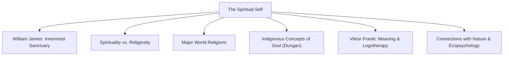
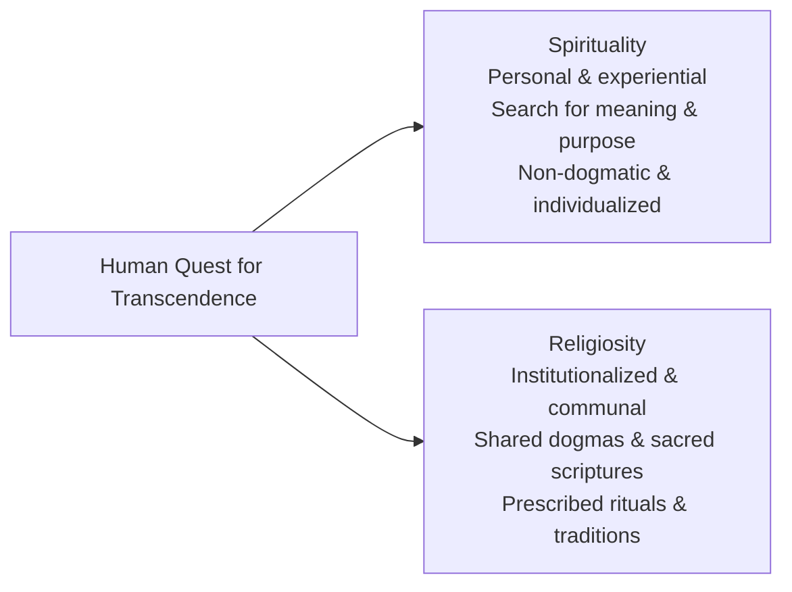
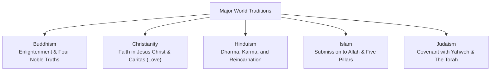
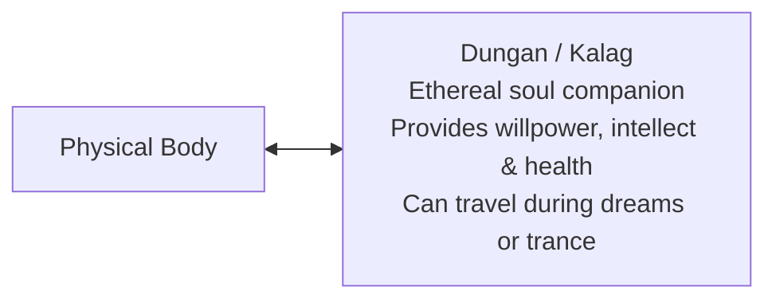
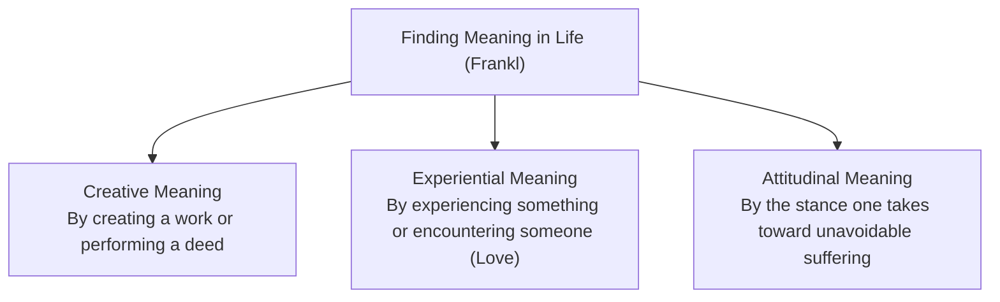

## What is the Spiritual Self?

Human beings are multidimensional. While the physical domain encompasses the somatic body and the psychological domain governs cognitive and affective processes, the **Spiritual Self** addresses the innermost subjective core of human existence.

The word **spirituality** originates from the Latin root *spiritus*, meaning breath, life force, or wind. The spiritual self represents an individual's personal quest for existential meaning, moral purpose, wholeness, and connection with a transcendent reality (whether conceived as God, the cosmos, or nature).

---

## William James: The Spiritual Self as the Inner Core

In *The Principles of Psychology* (1890), **William James** designated the **Spiritual Self** as the most intimate and permanent constituent of the empirical self:

- It represents the individual's inner mental, moral, and emotional sanctuary.
- It is the realm where intellectual discernment, moral conscience, and personal will operate.
- Unlike material goods or social accolades that shift over time, the spiritual self provides enduring existential continuity.

---

## Spirituality vs. Religiosity

While frequently intertwined, sociologists and psychologists make clear distinctions between spirituality and religion:

| Dimension | Spirituality | Religion / Religiosity |
| :--- | :--- | :--- |
| **Focus** | Individual experiential journey toward sacredness, purpose, and inner peace. | Shared system of theological beliefs, moral codes, and formal practices. |
| **Structure** | Fluid, personal, adaptable, and introspective. | Institutionalized, formal, and organized around a church, temple, or clergy. |
| **Authority** | Personal conscience, spiritual reflection, and intuitive insight. | Sacred scriptures, formal doctrines, and established religious traditions. |
| **Durkheim's Stance** | Focuses on subjective transcendence. | A unified system of beliefs and practices relative to **sacred things**, uniting adherents into a single moral community. |

---

## Major World Religions Overview

The spiritual self often finds expression within major religious traditions:

### 1. Buddhism

- **Origins**: Founded by Siddhartha Gautama (the Buddha) in ancient India (~500 BCE).
- **Core Insights**: The Four Noble Truths address the ubiquity of suffering (*dukkha*) caused by attachment and craving. Freedom from the reactive cycle is achieved via the Eightfold Path.
- **Practices**: Meditation (*Samatha* for tranquility and *Vipassana* for mindful insight) and non-violence (*ahimsa*).

### 2. Christianity

- **Origins**: Emerged 2,000 years ago in Palestine through the ministry, death, and resurrection of Jesus of Nazareth.
- **Core Insights**: Monotheism expressed through the Holy Trinity (Father, Son, Holy Spirit). Salvation, eternal life, and redemption occur through faith in Christ and unconditional love (*caritas* / *agape*).
- **Practices**: Sacraments (Baptism and Holy Communion), communal worship, scripture reading (The Holy Bible), and service to the marginalized.

### 3. Hinduism

- **Origins**: The world's oldest living religion, originating in the Indus River Valley (~4,500 years ago).
- **Core Insights**: The cyclical process of birth, death, and rebirth (*samsara*) governed by moral cause and effect (*karma*). Ultimate liberation (*moksha*) occurs when the soul (*Atman*) realizes oneness with the ultimate reality (*Brahman*).
- **Practices**: Ritual worship, meditation, yogic disciplines, reading sacred texts (Vedas, Upanishads, Bhagavad Gita), and festivals (Diwali, Navaratri).

### 4. Islam

- **Origins**: Monotheistic revelation proclaimed by Prophet Muhammad in Mecca, Saudi Arabia (7th century CE).
- **Core Insights**: Total submission to the will of Allah (One God). The Holy Quran is revered as the verbatim word of God revealed through Angel Gabriel.
- **The Five Pillars of Islam**:
  1. *Shahadah*: Declaration of faith (*"There is no god but Allah, and Muhammad is His messenger"*).
  2. *Salat*: Ritual prayer performed five times daily.
  3. *Zakat*: Obligatory charitable giving (2.5% of accumulated wealth to assist the poor).
  4. *Sawm*: Fasting from dawn to sunset during the holy month of Ramadan.
  5. *Hajj*: Pilgrimage to the holy city of Mecca at least once in a lifetime for those physically and financially able.

### 5. Judaism

- **Origins**: Covenantal tradition between Yahweh (God) and the Hebrew people through Abraham and Moses.
- **Core Insights**: Ethical monotheism emphasizing righteous action, divine justice, and moral observance in this world as guided by the **Torah** (the Law) and the **Talmud**.
- **Practices**: Observing the weekly Sabbath (*Shabbat*), circumcision (*Brit Milah*), and major festivals (Passover, Rosh Hashanah, Yom Kippur).

---

## Indigenous Filipino Concepts of the Soul

Long before European colonization, indigenous Filipino cultures possessed sophisticated animistic understandings of spiritual vitality:

- **The Dungan (Visayan) / Kalag (Tagalog/Cebuano)**: The indigenous concept of the soul as a spiritual double inhabiting the physical body.
- **Vulnerability of the Soul**: Pre-colonial ancestors believed that emotional shock, extreme fear, or illness could dislodge the *dungan* from the body, causing sickness or disorientation. Healing rituals performed by indigenous spiritual leaders (*babaylan* / *catalonan*) restored harmony between the body and soul.
- **Animism and Natural Harmony**: Ancestral spirituality recognized spirits (*anitos* and *diwatas*) dwelling in forests, ancient trees (balete), mountains, and rivers. Preserving respect for nature was vital to avoid spiritual imbalance.

---

## Viktor Frankl: The Will to Meaning and Logotherapy

Austrian psychiatrist and Holocaust survivor **Viktor Frankl** founded **Logotherapy**, a branch of psychotherapy anchored in existential philosophy. Frankl posited that the primary human motivation is neither pleasure (Freud) nor power (Adler), but the **will to meaning**:

### Frankl's Core Tenets:

- Life possesses meaning under all circumstances, even through intense suffering and adversity.
- Individuals retain the ultimate human freedom: the ability to choose one's attitude in any given circumstance.
- Meaning is discovered through three avenues:
  1. **By Creating a Work or Doing a Deed**: Purposeful labor, artistic creation, or technical problem solving.
  2. **By Experiencing Something or Encountering Someone**: Engaging with truth, goodness, beauty, nature, or genuine love for another human being.
  3. **By the Attitude Adopted Toward Unavoidable Suffering**: Transforming personal tragedy into human triumph and moral courage (*tragic optimism*).

---

## Connections with Nature and Ecopsychology

The spiritual self extends outward into the living ecosystem:

- **Affinity with Nature**: The degree to which individuals include the natural world as an essential component of their self-identity. Recognizing our interconnectedness with ecosystems inspires pro-environmental stewardship.
- **Ecopsychology**: A discipline exploring the therapeutic interconnections between human psychological well-being and the natural environment. Contact with green spaces, forests, and natural water systems reduces cortisol levels, relieves cognitive fatigue, and restores inner equilibrium.

---

## References

- Alata, E. J. P., et al. (2018). *Understanding the Self*. Manila: Rex Book Store.
- Durkheim, É. (1912). *The Elementary Forms of the Religious Life*. London: Allen & Unwin.
- Frankl, V. E. (1959). *Man's Search for Meaning*. Boston: Beacon Press.
- James, W. (1890). *The Principles of Psychology*. New York: Henry Holt and Company.
- Macayan, J. V., Pinugu, J. N. J., & Castillo, J. C. D. (2018). *Understanding the Self: An Outcome-Based Modular Courseware*. Quezon City: C & E Publishing.
- Magos, A. (1992). *The Concept of Dungan: Visayan Concept of the Soul*. Diliman, Quezon City: University of the Philippines Press.
