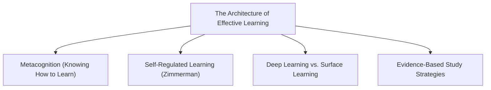
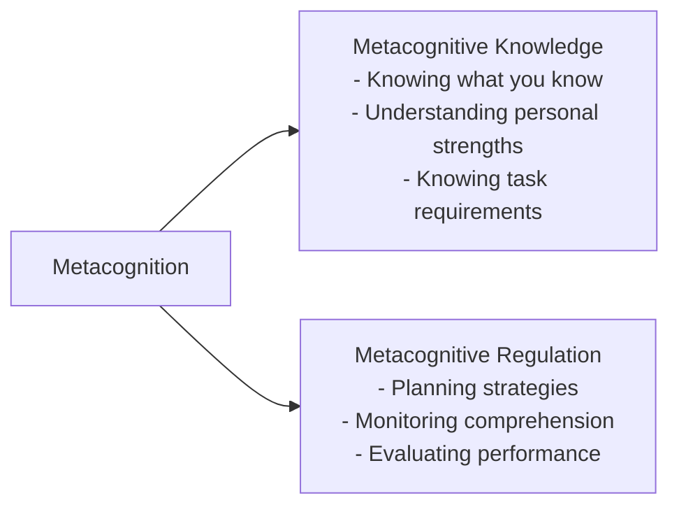
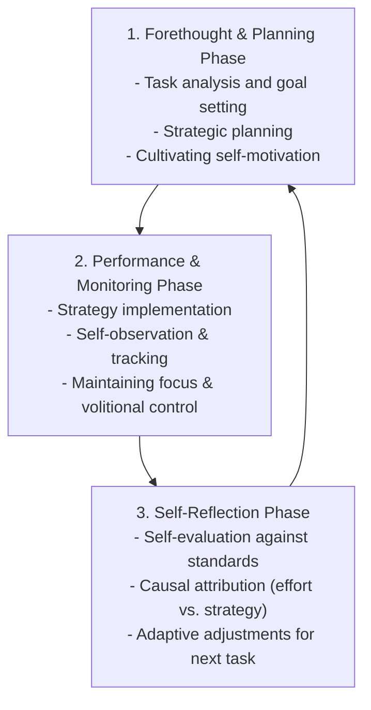
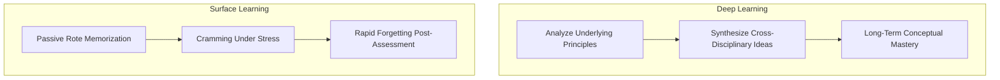
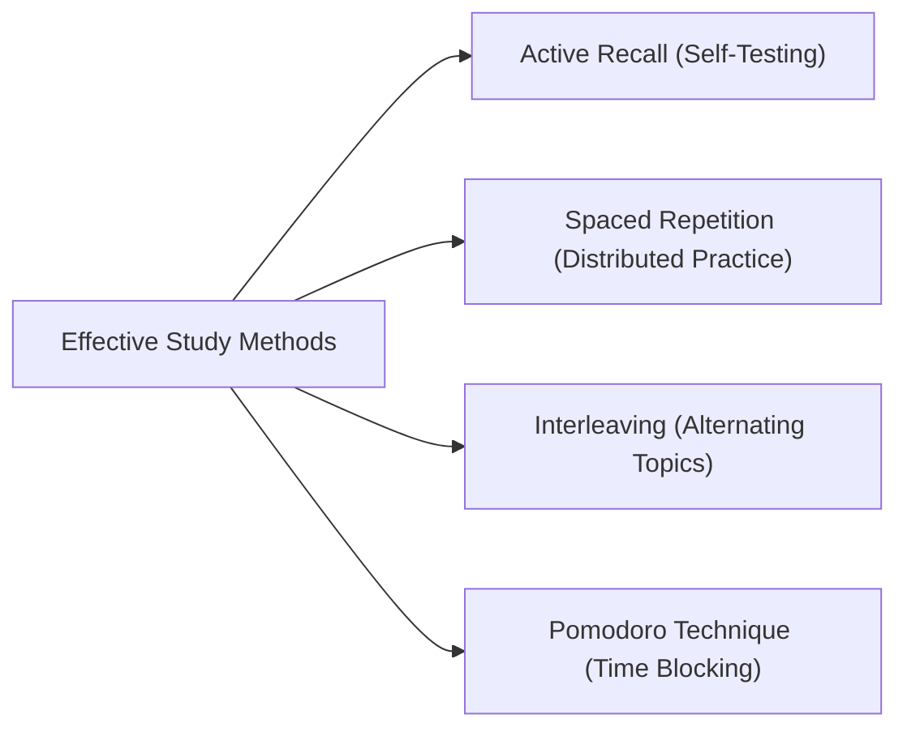

## What is Learning?

Psychologists define **learning** as a relatively permanent change in an individual's behavior, knowledge, skills, or attitudes resulting from experience, instruction, and deliberate practice.

Early behavioral psychologists, such as **John B. Watson** and **B.F. Skinner**, examined learning exclusively through observable stimuli and conditioned responses. Contemporary cognitive and educational perspectives (Ambrose et al., 2010) expand this view:

- Learning is not something passively done *to* students; it is an active process that students *themselves* execute.
- Learning alters mental schemas, allowing individuals to interpret and respond to new situations with greater competence and insight.

---

## Outcome-Based Education (OBE)

Modern higher education is grounded in **Outcome-Based Education (OBE)**, pioneered by **William Spady**:

- **Core Premise**: Clear specification of what students should demonstrably *know*, *value*, and *be able to do* upon completing a course or program.
- **Student-Centered**: Shifts the emphasis away from passive seat-time and teacher lecturing toward measurable student performance, practical application, and critical thinking.

---

## Metacognition: Learning How to Learn

Coined by developmental psychologist **John Flavell**, **metacognition** refers to "thinking about thinking"—the conscious awareness, monitoring, and management of one's own cognitive processes.

### Two Key Dimensions of Metacognition:

1. **Metacognitive Knowledge**:
   - *Person Variables*: Recognizing one's strengths, cognitive limits, and optimal study environments.
   - *Task Variables*: Gauging the difficulty, scope, and cognitive demands of an academic assignment.
   - *Strategy Variables*: Selecting appropriate methods (e.g., summarizing, diagrams, self-testing) for specific tasks.
2. **Metacognitive Regulation**:
   - Actively tracking comprehension during reading, identifying when understanding breaks down, and selecting alternative learning strategies.

---

## Barry Zimmerman: The Cycle of Self-Regulated Learning (SRL)

**Self-regulated learning** is the process whereby learners systematically direct their thoughts, feelings, and actions toward achieving personal academic goals (Zimmerman, 2002). SRL operates as a continuous three-phase cyclical process:

### 1. Forethought and Planning Phase

- **Goal Setting**: Deciding on specific, proximal milestones before starting work.
- **Strategic Planning**: Selecting particular methods, environments, and time allocations.
- **Self-Motivation Beliefs**: Mobilizing self-efficacy, intrinsic interest, and task value.

### 2. Performance and Monitoring Phase

- **Self-Control**: Implementing planned strategies (e.g., eliminating phone distractions, using flashcards).
- **Self-Observation**: Mentally tracking whether progress is occurring at an acceptable pace.

### 3. Self-Reflection Phase

- **Self-Evaluation**: Assessing completed work against objective grading rubrics or exam keys (e.g., using **exam wrappers** to analyze why errors occurred).
- **Causal Attributions**: Attributing successes and setbacks to controllable factors (effort and study strategies) rather than fixed innate intelligence.

---

## Deep Learning vs. Surface Learning

Educational research highlights two divergent orientations toward studying:

| Dimension | Deep Approach to Learning | Surface Approach to Learning |
| :--- | :--- | :--- |
| **Primary Motivation** | Intrinsic curiosity; desire to achieve authentic mastery. | Extrinsic pressure; aiming for minimum passing grades or avoiding failure. |
| **Cognitive Process** | Relates new concepts to prior knowledge and real-world experience. | Relies on passive rote memorization and disjointed recall of isolated facts. |
| **Focus** | Focuses on underlying principles, arguments, and structures. | Focuses on memorizing verbatim definitions likely to appear on exams. |
| **Retention** | Long-term conceptual retention and transferable problem-solving skills. | Rapid forgetting immediately following exams (*"cram and forget"*). |

---

## Evidence-Based Study Strategies

Cognitive science provides clear strategies to replace passive habits with high-yield techniques:

### 1. Active Recall (Retrieval Practice)

- **Mechanism**: Actively retrieving information from memory without looking at notes strengthens neural pathways far more than passive rereading or highlighting.
- **Application**: Use flashcards (e.g., Anki), blank-page retrieval tests, and practice questions.

### 2. Spaced Repetition (Distributed Practice)

- **Mechanism**: Counteracts the **Ebbinghaus Forgetting Curve** by distributing reviews across expanding time intervals (e.g., Day 1, Day 3, Day 7, Day 14, Day 30).
- **Application**: Avoid last-minute cramming; review lecture summaries periodically throughout the academic term.

### 3. Interleaving Practice

- **Mechanism**: Alternating between related problem types or subjects during a study session improves the brain's ability to categorize problems and select correct solutions.
- **Application**: Mix algebraic problems with geometric proofs instead of solving 50 identical equations in a row.

### 4. The Pomodoro Technique

- **Mechanism**: Sustained focus requires managing cognitive fatigue.
- **Application**: Work with total focus for 25 minutes, followed by a 5-minute break. After four consecutive cycles, take an extended 20–30 minute rest.

---

## References

- Alata, E. J. P., et al. (2018). *Understanding the Self*. Manila: Rex Book Store.
- Ambrose, S. A., et al. (2010). *How Learning Works: Seven Research-Based Principles for Smart Teaching*. San Francisco: Jossey-Bass.
- Flavell, J. H. (1979). *Metacognition and Cognitive Monitoring: A New Area of Cognitive-Developmental Inquiry*. American Psychologist, 34(10), 906–911.
- Macayan, J. V., Pinugu, J. N. J., & Castillo, J. C. D. (2018). *Understanding the Self: An Outcome-Based Modular Courseware*. Quezon City: C & E Publishing.
- Zimmerman, B. J. (2002). *Becoming a Self-Regulated Learner: An Overview*. Theory Into Practice, 41(2), 64–70.
