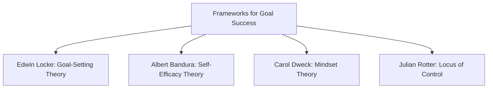
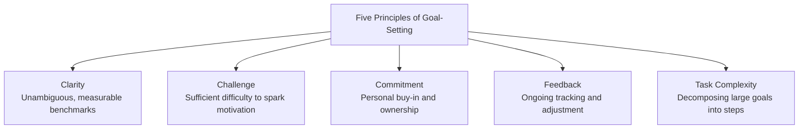
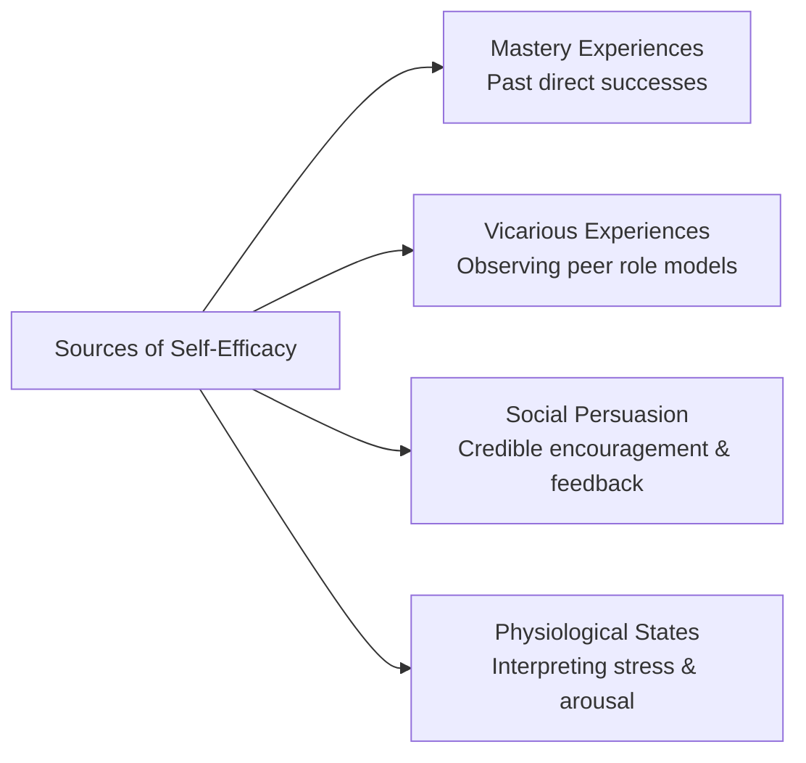
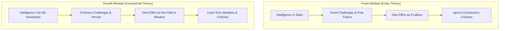
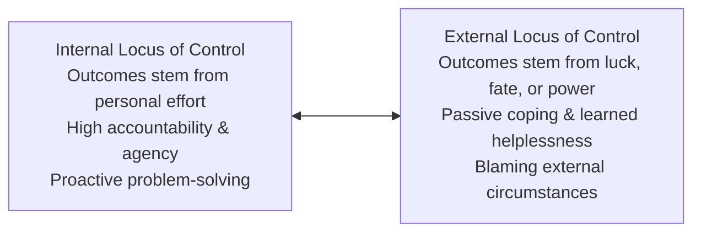

## What is Goal-Setting?

A **goal** is the aim or object of an action—a specific standard of proficiency or achievement to be reached within a designated time limit (Locke & Latham, 2002). Conscious goals regulate human motivation, focus attention, and channel effort toward meaningful accomplishment.

Goal-setting provides the directional structure through which individuals translate broad aspirations into actionable achievements.

---

## Edwin Locke: Goal-Setting Theory

Pioneered by **Dr. Edwin Locke** and **Dr. Gary Latham** (1990, 2002), **Goal-Setting Theory** demonstrates that performance is significantly higher when individuals commit to **specific and challenging goals** compared to vague instructions (*"do your best"*) or excessively easy targets.

### The Five Core Principles:

1. **Clarity**: Clear goals eliminate ambiguity regarding expected results, enabling accurate tracking and reward systems.
2. **Challenge**: Moderately difficult goals stimulate effort, cognitive engagement, and persistence. However, goals must remain attainable to prevent demoralization.
3. **Commitment**: The harder the target, the more personal dedication is required. Involving learners in defining their milestones increases ownership.
4. **Feedback**: Ongoing feedback clarifies expectations, benchmarks progress, and allows learners to recalibrate their efforts.
5. **Task Complexity**: Highly complex or long-term goals must be decomposed into manageable sub-goals (*milestones*) to prevent cognitive overload.

---

## The SMART Goal Framework

The **SMART** mnemonic provides an operational tool for translating Locke's principles into actionable plans:

| Criterion | Question to Address | Guideline |
| :--- | :--- | :--- |
| **S – Specific** | *What exact outcome do I want to accomplish?* | Clearly state the who, what, where, and why; avoid vague statements. |
| **M – Measurable** | *How will I measure progress and success?* | Establish quantifiable criteria (e.g., scores, hours, word counts). |
| **A – Achievable** | *Is the goal realistic given my constraints?* | Ensure resources, skills, and time are sufficient while maintaining a healthy challenge. |
| **R – Relevant** | *Does this align with my broader life values?* | Confirm that the target supports long-term academic, career, or personal development. |
| **T – Time-bound** | *What is the exact deadline?* | Set a definite target date to establish urgency and prevent procrastination. |

---

## Albert Bandura: Self-Efficacy Theory

**Self-efficacy** is an individual's belief in their capability to execute the specific behaviors necessary to produce designated performance attainments (Bandura, 1997). Unlike generalized self-esteem (which measures global self-worth), self-efficacy is **task-specific** (e.g., a student may exhibit high self-efficacy in mathematics but low self-efficacy in public speaking).

### The Four Sources of Self-Efficacy:

1. **Mastery Experiences**: The single most influential source. Successfully overcoming challenges builds a resilient sense of efficacy. Occasional setbacks teach that success requires sustained effort.
2. **Vicarious Experiences (Modeling)**: Seeing peers or relatable role models succeed through effort convinces observers that they also possess the capabilities to master comparable activities.
3. **Social / Verbal Persuasion**: Encouragement from credible mentors, teachers, or peers can boost confidence and encourage individuals to try new strategies.
4. **Physiological and Emotional States**: How individuals interpret somatic stress signals (e.g., accelerated heart rate before an exam) matters. Viewing physical arousal as readiness rather than impending failure preserves high self-efficacy.

---

## Carol Dweck: Mindset Theory

Stanford psychologist **Carol Dweck** (2006) established that beliefs regarding the nature of human intelligence dictate how individuals approach challenges, criticism, and setbacks:

| Trait | Fixed Mindset | Growth Mindset |
| :--- | :--- | :--- |
| **Core Belief** | Intelligence and talent are static, inborn gifts (*"You either have it or you don't"*). | Intelligence and skills can be developed through deliberate effort and learning. |
| **Response to Challenge** | Avoids challenges to protect the illusion of innate talent; fears being exposed. | Embraces challenges as opportunities to expand existing cognitive capacities. |
| **View of Effort** | Views effort as evidence of inadequacy (*"If I were smart, it would be easy"*). | Views focused effort, practice, and strategy as the fundamental vehicle for mastery. |
| **Response to Failure** | Becomes defensive, blames external circumstances, or abandons the endeavor. | Treats mistakes as diagnostic data indicating where strategy adjustments are needed. |

---

## Julian Rotter: Locus of Control

Psychologist **Julian Rotter** introduced the concept of **Locus of Control**, reflecting an individual's belief regarding where control over life events resides:

- **Internal Locus of Control**: Believing that one's achievements, grades, and life circumstances result directly from personal decisions, diligence, and strategy. Promotes resilience and self-determination.
- **External Locus of Control**: Believing that outcomes are dictated by external forces, luck, chance, or powerful others. Can result in fatalism, passive coping, and reduced motivation.

---

## References

- Alata, E. J. P., et al. (2018). *Understanding the Self*. Manila: Rex Book Store.
- Bandura, A. (1997). *Self-Efficacy: The Exercise of Control*. New York: W. H. Freeman.
- Dweck, C. S. (2006). *Mindset: The New Psychology of Success*. Random House.
- Locke, E. A., & Latham, G. P. (2002). *Building a Practically Useful Theory of Goal Setting and Task Motivation: A 35-Year Odyssey*. American Psychologist, 57(9), 705–717.
- Macayan, J. V., Pinugu, J. N. J., & Castillo, J. C. D. (2018). *Understanding the Self: An Outcome-Based Modular Courseware*. Quezon City: C & E Publishing.
- Rotter, J. B. (1966). *Generalized Expectancies for Internal Versus External Control of Reinforcement*. Psychological Monographs, 80(1), 1–28.
