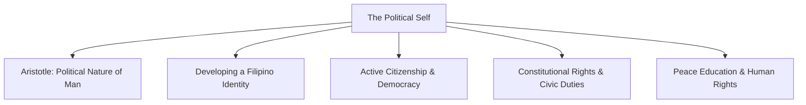
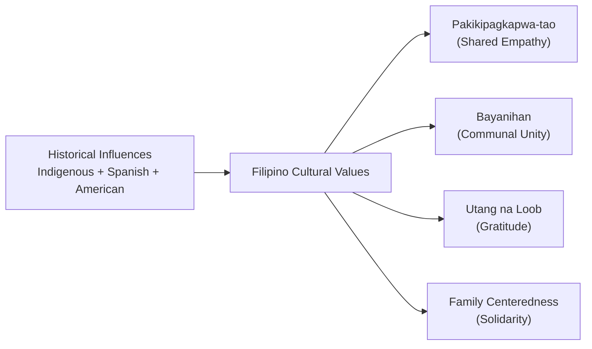
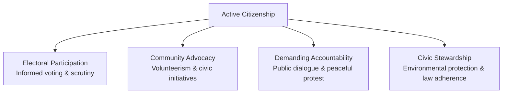
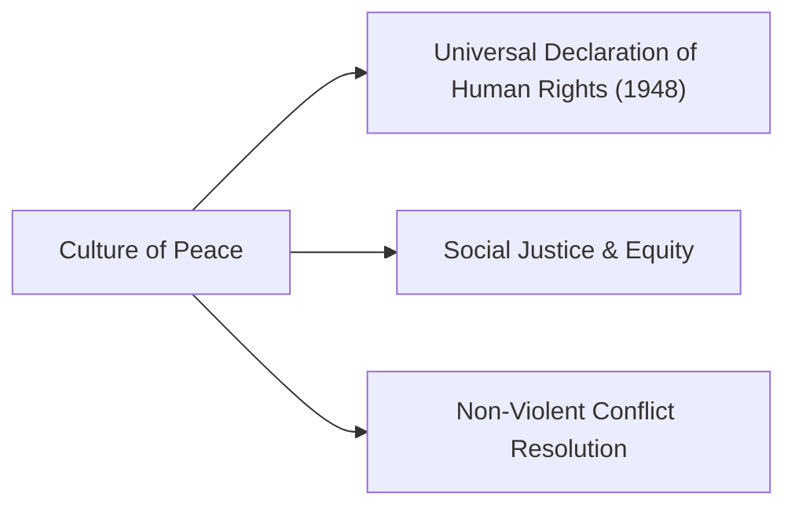

## What is the Political Self?

The **Political Self** reflects how an individual's identity, rights, duties, and social values are shaped by historical, economic, and political contexts. Humans do not live in isolation; individual well-being and personal beliefs are inextricably bound to civic affairs and social structures.

As ancient Greek philosopher **Aristotle** famously observed:

> *"Man is by nature a political animal."*

Aristotle argued that humans are social creatures naturally drawn to political association. Participating in the civic community (*the polis*) is necessary to achieve the "good life," administer justice, and realize full moral agency.

---

## Developing a Filipino Identity

A person's political self is anchored in national identity, cultural history, and communal values. The Filipino identity is an amalgamation of indigenous heritage, four centuries of Spanish Catholicism, American institutional systems, and Asian trade relations.

### Core Filipino Values:

- **Pakikipagkapwa-tao**: The foundational Filipino moral principle of recognizing fellow humans (*kapwa*) as extensions of oneself. Emphasizes genuine empathy, mutual respect, and compassion toward the disadvantaged.
- **Bayanihan**: The spirit of collective cooperation and communal solidarity without expectation of monetary compensation (traditionally symbolized by neighbors carrying a nipa hut).
- **Utang na Loob**: A deep sense of reciprocal gratitude and relational obligation to those who have extended life-saving assistance or goodwill.
- **Family Centeredness and Clannishness**: Deep loyalty and devotion to the family unit, which provides personal identity, emotional refuge, and financial security.
- **Joy and Humor**: A cultural resilience that allows Filipinos to maintain optimism, cheerfulness, and humor during disasters and personal adversity.

### Cultural Dilemmas:

- **Colonial Mentality**: An internalized preference for foreign goods, standards, and cultural forms over domestic equivalents, originating from colonial subjugation.
- **Extreme Personalism and Regionalism**: Prioritizing personal connections, kinship ties, and regional origins (*padrino system*) over impersonal institutional standards and the common national good.

---

## Active Citizenship and Democracy

**Active citizenship** refers to structured, voluntary engagement with political processes and community life. It extends far beyond passive residency:

### Key Pillars of Active Citizenship:

- **Enabling Democracy**: Democracy is more than a formal governmental structure; it is a collaborative social system where citizens exercise free, informed choices to hold leaders accountable.
- **Social Cohesion**: Active citizenship bridges social divides, fostering mutual trust and shared responsibility across socioeconomic classes.
- **Empowerment**: Cultivates cognitive understanding of state functions and legal rights, empowering citizens to effect systemic reforms.

---

## Political Rights, Privileges, and Obligations

In the Philippines, the civic and legal rights of citizens are guaranteed under the **1987 Philippine Constitution**:

### 1. The Bill of Rights (Article III)

The Bill of Rights sets constitutional limits on state power to protect individual liberties:
- **Due Process and Equal Protection (Section 1)**: No person shall be deprived of life, liberty, or property without due process of law.
- **Freedom of Speech, Expression, and Peaceful Assembly (Section 4)**: The right to articulate opinions, criticize governance, and assemble peacefully for redress of grievances.
- **Freedom of Religion (Section 5)**: Free exercise of religious beliefs without state establishment of religion.
- **Right to Information and Suffrage**: Access to official public records and the fundamental right to cast ballots in democratic elections without property qualifications.

### 2. Fundamental Civic Duties and Responsibilities

Democratic rights are balanced by mandatory civic duties:
- **Loyalty to the Republic**: Defending national sovereignty and honoring the national flag and constitution.
- **Obedience to the Rule of Law**: Adhering to laws enacted for public welfare and safety.
- **Taxation**: Contributing an equitable share to public revenues to support national infrastructure, education, and healthcare.
- **Participation in Public Affairs**: Engaging in elections, community meetings, and civic oversight.

---

## Peace Education and Human Rights

**Peace education** fosters the knowledge, values, and skills necessary to cultivate a just, non-violent society:

- **Universal Declaration of Human Rights (UDHR)**: Adopted by the United Nations General Assembly in 1948, the UDHR affirms that every human being is born free and equal in dignity and rights, regardless of race, gender, religion, or nationality.
- **Non-Violent Conflict Resolution**: Prioritizes dialogue, restorative justice, institutional reform, and mutual empathy over violent coercion.
- **Social Justice**: Dismantles systemic inequalities, poverty, and corruption to ensure that peace is anchored in genuine economic fairness and dignity for all.

---

## References

- Alata, E. J. P., et al. (2018). *Understanding the Self*. Manila: Rex Book Store.
- Aristotle. (350 BCE). *Politics* (B. Jowett, Trans.). Oxford: Clarendon Press.
- Macayan, J. V., Pinugu, J. N. J., & Castillo, J. C. D. (2018). *Understanding the Self: An Outcome-Based Modular Courseware*. Quezon City: C & E Publishing.
- Republic of the Philippines. (1987). *The 1987 Constitution of the Republic of the Philippines*.
- United Nations. (1948). *Universal Declaration of Human Rights*. UN General Assembly.
