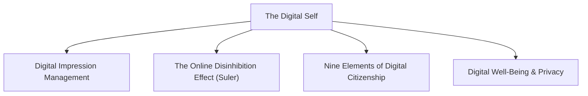
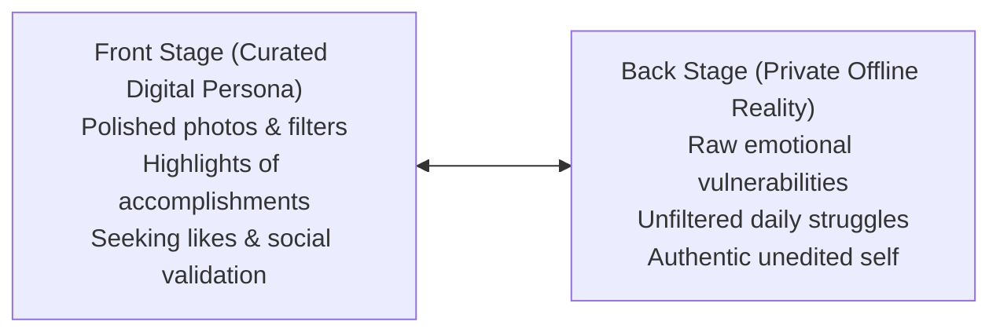
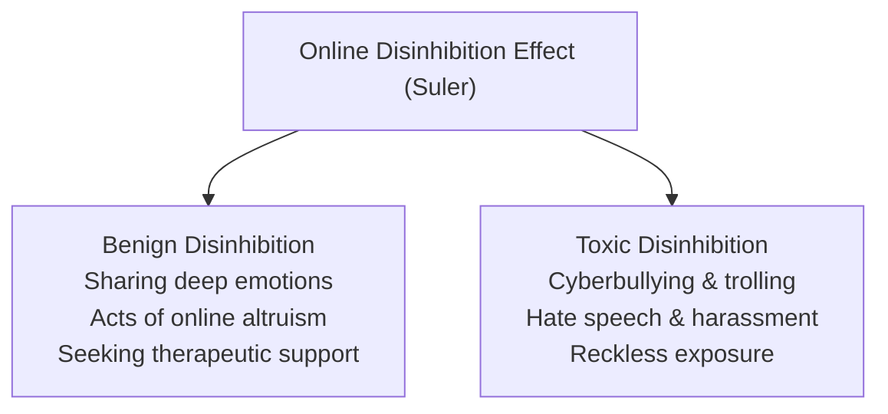

## What is the Digital Self?

The **Digital Self** is the persona, identity, and behavioral presence an individual constructs, negotiates, and projects in cyberspace, social media platforms, and digital environments.

With the proliferation of smartphones, algorithmic social networks, and virtual platforms, human communication has transformed. The digital domain is no longer merely a communication tool; it is an active social space where self-presentation, social comparison, relationship formation, and personal reputation unfold.

---

## The Socio-Digital Self and Impression Management

Sociologist **Erving Goffman** (1959) introduced the dramaturgical model of social life, proposing that individuals act like theatrical performers managing impressions on "front stage" and "back stage" settings. In the digital era, Goffman's theory applies directly to online behavior:

- **Curated Identity**: Users actively select which photos, achievements, and status updates to post, projecting an idealized, carefully curated version of themselves.
- **The Dopamine Loop**: Social media platforms leverage variable reward schedules. Notifications, "likes," retweets, and comments trigger neurochemical rewards, which can lead to social media dependency.
- **FOMO (Fear of Missing Out)**: Constant exposure to peers' curated highlights induces upward social comparison, leading individuals to believe others lead more fulfilling, successful lives.

---

## The Online Disinhibition Effect

Psychologist **John Suler** (2004) identified the **Online Disinhibition Effect**—the phenomenon where individuals loosen behavioral inhibitions, acting more openly, intensely, or aggressively online than in face-to-face interactions.

### The Six Contributing Factors (Suler, 2004):

1. **Dissociative Anonymity (*"You don't know me"*)**: When using pseudonyms or avatars, people feel their online behaviors cannot be traced back to their real-world identities.
2. **Invisibility (*"You can't see me"*)**: Lacking physical co-presence eliminates non-verbal cues (facial expressions, tone, eye contact), shielding individuals from observing immediate emotional pain in others.
3. **Asynchronicity (*"See you later"*)**: Interactions do not occur in real time. Users can post provocative comments and disconnect without dealing with immediate feedback.
4. **Solipsistic Introjection (*"It's all in my head"*)**: Text-based reading creates an internal monologue where readers assign imagined voices and personas to online communicators.
5. **Dissociative Imagination (*"It's just a game"*)**: Treating virtual environments as make-believe spaces detached from real-world ethical consequences.
6. **Minimization of Status and Authority (*"We are equals online"*)**: Offline social hierarchies (teachers, bosses, law enforcement) lose authority in peer-to-peer web environments.

---

## The Nine Elements of Digital Citizenship

Educational technologist **Mike Ribble** formulated the **Nine Elements of Digital Citizenship**, outlining the ethical, technical, and social competencies needed to navigate digital life:

| Category | Element | Focus and Responsibility |
| :--- | :--- | :--- |
| **Respect** | **1. Digital Access** | Advocating for equal digital rights and technological access for all socioeconomic groups. |
| **Respect** | **2. Digital Etiquette (Netiquette)** | Maintaining polite, constructive, and respectful standards of conduct in online interactions. |
| **Respect** | **3. Digital Law** | Abiding by legal statutes regarding copyright, intellectual property, data theft, and cybercrime. |
| **Educate** | **4. Digital Communication** | Making thoughtful choices regarding which communication channels are appropriate for specific messages. |
| **Educate** | **5. Digital Literacy** | Developing critical thinking to evaluate online sources, recognize disinformation, and master technical skills. |
| **Educate** | **6. Digital Commerce** | Practicing safe financial transactions and ethical consumer habits on e-commerce platforms. |
| **Protect** | **7. Digital Rights & Responsibilities** | Exercising digital freedom of expression while defending the safety and dignity of fellow users. |
| **Protect** | **8. Digital Security (Safety)** | Protecting passwords, using two-factor authentication, and safeguarding personal data against cyberattacks. |
| **Protect** | **9. Digital Health & Wellness** | Managing screen time, preventing eye strain, ergonomic awareness, and protecting psychological health from tech addiction. |

---

## Mindful Digital Boundaries

Cultivating a healthy digital self requires establishing intentional boundaries between technology and human life:

- **Filter What You Share**: Maintain personal boundaries; never broadcast sensitive private information (home addresses, financial details, intimate photographs) online.
- **Practice Critical Media Literacy**: Remember that posts reflect highlights rather than whole realities; resist comparing your daily life to someone else's highlight reel.
- **Unplug Regularly**: Implement scheduled digital detoxes to reconnect with physical environments, family, and reflective stillness.

> [!IMPORTANT]
> *"Don't let technology define you; you should define yourself."*

---

## References

- Alata, E. J. P., et al. (2018). *Understanding the Self*. Manila: Rex Book Store.
- Goffman, E. (1959). *The Presentation of Self in Everyday Life*. New York: Anchor Books.
- Macayan, J. V., Pinugu, J. N. J., & Castillo, J. C. D. (2018). *Understanding the Self: An Outcome-Based Modular Courseware*. Quezon City: C & E Publishing.
- Ribble, M. (2015). *Digital Citizenship in Schools: Nine Elements All Students Should Know*. International Society for Technology in Education (ISTE).
- Suler, J. (2004). *The Online Disinhibition Effect*. CyberPsychology & Behavior, 7(3), 321–326.
