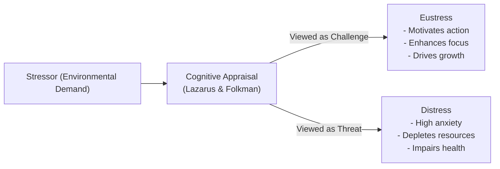
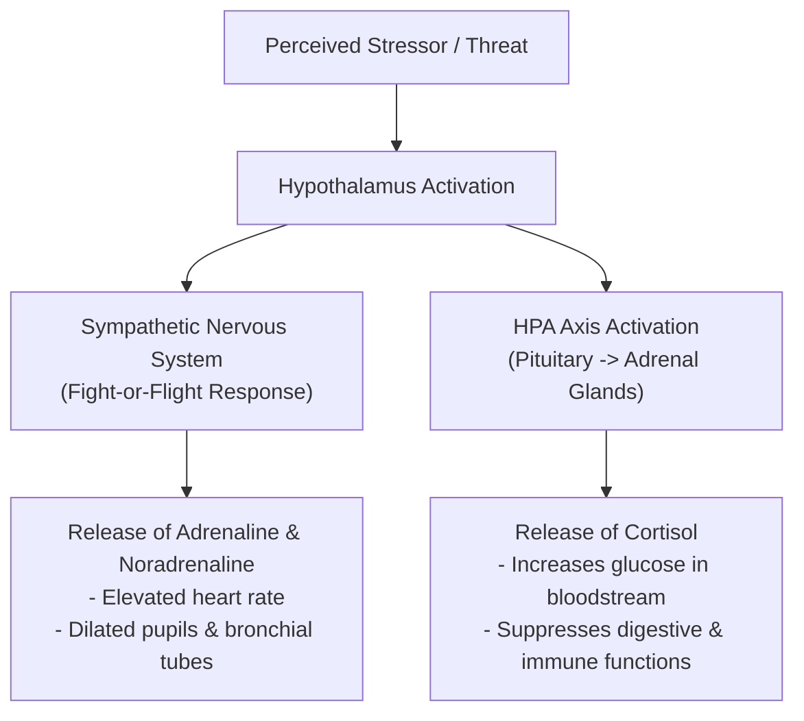
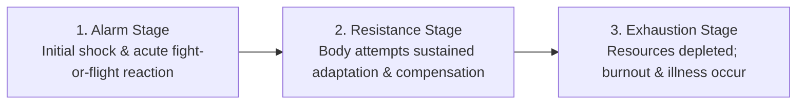
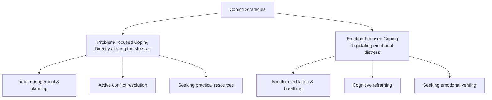
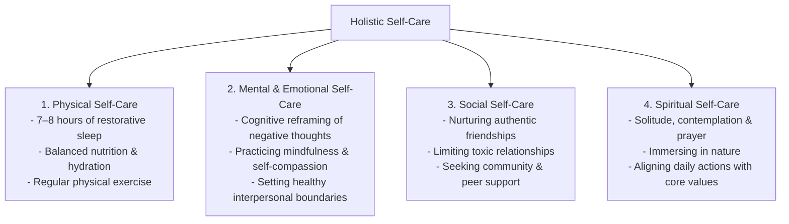

## What is Stress?

**Stress** is the body's non-specific physiological and psychological response to any demand, challenge, or perceived threat (a **stressor**). 

Stress is an unavoidable dimension of human life. It is not inherently negative; our appraisal and reaction to stressors dictate whether stress produces motivation or physical and psychological exhaustion.

### Eustress vs. Distress

- **Eustress (Positive Stress)**: Moderate psychological stress interpreted as an exciting challenge. Enhances alertness, sharpens cognitive focus, and boosts performance (e.g., preparing for graduation or a musical recital).
- **Distress (Negative Stress)**: Severe, chronic, or unmanageable stress where perceived demands overwhelm personal coping resources. Causes mental fatigue, anxiety, cardiovascular strain, and immune suppression.

---

## The Biological Architecture of Stress

Human biology reacts to perceived danger through coordinated neuroendocrine pathways:

### 1. Walter Cannon: The Fight-or-Flight Response

In emergency situations, the autonomic nervous system triggers the **fight-or-flight response**, preparing the body to either confront physical danger or flee. Blood is redirected from digestive organs to skeletal muscles, heart rate accelerates, and respiration quickens.

### 2. Hans Selye: General Adaptation Syndrome (GAS)

Endocrinologist **Hans Selye** documented how the mammalian body responds to chronic, long-term stressors across three predictable stages:

1. **Alarm Stage**: Immediate physiological shock upon encountering the stressor; adrenaline surges and resistance drops temporarily before spiking.
2. **Resistance Stage**: The body mobilizes energy to adapt to the persistent stressor. Heart rate and hormone levels remain elevated as the individual works to endure.
3. **Exhaustion Stage**: If the stressor continues indefinitely, energy reserves are depleted. Chronic elevated cortisol leads to immune breakdown, chronic fatigue, depressive symptoms, and physical illness.

---

## Stress in the Filipino Cultural Context

The experience and manifestation of stress among Filipinos are shaped by cultural institutions and relational values:

- **The Double Edge of *Bahala Na***: Often translated as fatalism (*"come what may"*), its indigenous psychological root (*Bathala Na*) reflects trust in divine providence, helping Filipinos maintain courage in catastrophic crises. However, if used passively, it can lead to negligence or avoidance of practical planning.
- **Social Support and *Bayanihan***: When faced with bereavement, illness, or financial calamity, the extended family and community rally to provide mutual assistance (*damayan*), serving as a crucial buffer against mental distress.
- **Familial Obligation**: Many young Filipinos experience intense stress from perceived duties to become primary breadwinners and lift extended families out of economic difficulty.

---

## Coping Mechanisms: Problem-Focused vs. Emotion-Focused

Pioneered by **Richard Lazarus and Susan Folkman** (1984), coping represents deliberate cognitive and behavioral efforts to manage internal and external demands:

| Dimension | Problem-Focused Coping | Emotion-Focused Coping |
| :--- | :--- | :--- |
| **Best Used When** | The stressor is controllable and changeable (e.g., an upcoming difficult exam). | The stressor is uncontrollable or irreversible (e.g., the death of a loved one). |
| **Primary Goal** | Remove, alter, or solve the root source of the stress. | Relieve emotional pain, anxiety, and distress caused by the situation. |
| **Methods** | Action plans, budgeting, studying, asserting boundaries. | Journaling, deep breathing exercises, positive cognitive reappraisal, prayer. |

---

## Holistic Self-Care Strategies

Caring for the self requires intentional attention across physical, psychological, social, and spiritual dimensions:

---

## References

- Alata, E. J. P., et al. (2018). *Understanding the Self*. Manila: Rex Book Store.
- Cannon, W. B. (1932). *The Wisdom of the Body*. New York: W. W. Norton.
- Lazarus, R. S., & Folkman, S. (1984). *Stress, Appraisal, and Coping*. New York: Springer.
- Macayan, J. V., Pinugu, J. N. J., & Castillo, J. C. D. (2018). *Understanding the Self: An Outcome-Based Modular Courseware*. Quezon City: C & E Publishing.
- Selye, H. (1956). *The Stress of Life*. New York: McGraw-Hill.
