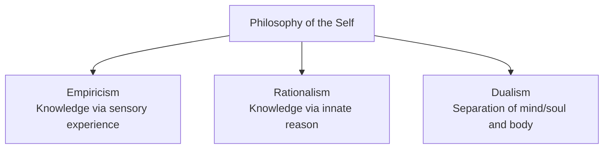
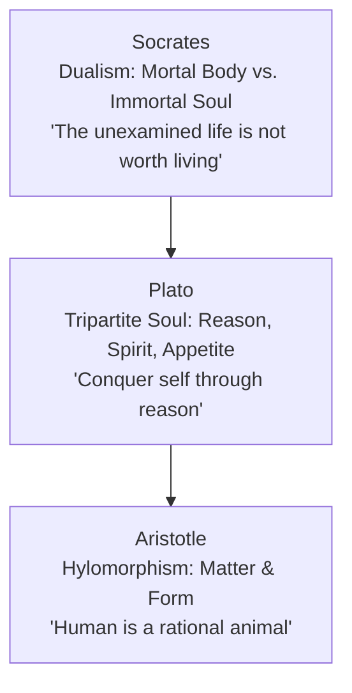
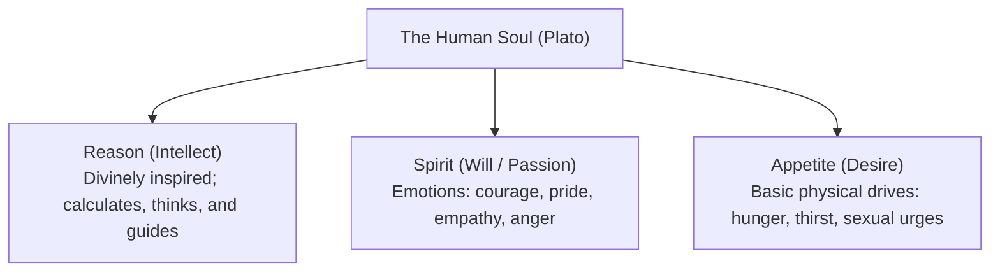
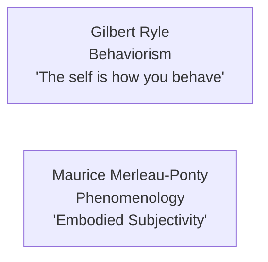

## What is Philosophy?

Philosophy is traditionally described as the "mother of all disciplines" because all academic fields originated as philosophical inquiries. The term derives from the Greek words *philo* (loving) and *sophia* (wisdom), translating literally to the "love of wisdom."

In classical thought, philosophy is the pursuit of knowledge through rational inquiry, systematic reflection, and logical analysis. Philosophers examine foundational questions regarding the nature of reality, human existence, ethics, and the definition of the **self**.

---

## Major Epistemological Frameworks

Philosophical investigations into the self often utilize three primary frameworks:

- **Empiricism**: Argues that the self and knowledge are derived from sensory experiences and direct observation.
- **Rationalism**: Asserts that reason and innate intellectual faculties, rather than sensory impressions, are the foundation of true knowledge and selfhood.
- **Dualism**: Posits that reality and the human person consist of two distinct realms: the mental or spiritual (immaterial mind/soul) and the physical (material body).

---

## Classical Antiquity

### Socrates: "The unexamined life is not worth living"

Socrates viewed self-knowledge as the highest human pursuit. He proposed that the self is fundamentally dualistic:

- **The Physical Body**: Imperfect, changing, mortal, and tangible.
- **The Soul**: Eternal, unchanging, perfect, and immortal.

For Socrates, the soul existed prior to bodily incarnation and possesses innate wisdom. Entry into the material world induces forgetfulness and ignorance. Engaging in constant self-examination through reasoned inquiry is necessary to liberate the soul and achieve virtue.

### Plato: The Tripartite Soul

Plato, a student of Socrates, maintained mind-body dualism and asserted that genuine selfhood resides in the immortal soul. In *The Republic*, Plato proposed that the human soul consists of three dynamic components:

- **Reason**: The divine and rational faculty responsible for deep thinking, critical judgment, and discerning universal truths.
- **Spirit (Will)**: The emotional engine driving passion, ambition, righteous indignation, and moral resolve.
- **Physical Appetite**: The biological urges necessary for bodily survival and physical pleasure.

Plato argued that personal justice and authentic happiness occur only when **Reason** rules over **Spirit** and **Appetite**, maintaining internal equilibrium.

### Aristotle: The Rational Animal

Aristotle rejected Plato's radical separation between the ideal and material realms. He introduced the concept of **hylomorphism**, proposing that every being consists of:

- **Matter (*hyle*)**: The physical substance or substrate.
- **Form (*morphe*) / Essence**: That which gives purpose, meaning, and actualization to matter.

Aristotle asserted that the soul is the form of the living body; the two cannot exist independently. He defined the human person as a **rational animal**—a biological creature differentiated by its faculty of rational thought.

---

## The Enlightenment and Modern Philosophy

| Philosopher | Core Principle | Definition of the Self |
| :--- | :--- | :--- |
| **John Locke** | *Tabula Rasa* & Memory Continuity | The self is conscious awareness and the continuity of personal memory over time. |
| **Immanuel Kant** | Synthesis of Rationalism and Empiricism | The self is an active organizing agent that structures raw sensory data into coherent experience. |

### John Locke: "The Self is Consciousness"

John Locke posited that the human mind at birth is a ***tabula rasa*** (a blank slate). He asserted that:

- Knowledge is acquired entirely through sensory experience and reflection.
- The self is not an abstract metaphysical substance, but rather **consciousness** itself.
- Personal identity is defined by the continuity of consciousness through memory: a person is identical to their past self to the extent that they can remember their past conscious experiences.

### Immanuel Kant: "We Construct the Self"

Immanuel Kant responded to David Hume's claim that the self is merely a "bundle of perceptions." Kant argued that raw sensory experiences would remain chaotic without an active unifying consciousness:

- Humans possess an active rational faculty that organizes sensory inputs using innate cognitive structures (such as space, time, and causality).
- The self has two dimensions:
  - **The Inner Self**: The psychological state, rational faculties, and internal consciousness.
  - **The Outer Self**: The physical senses, bodily representations, and interactions with the physical world.

---

## Contemporary Perspectives

### Gilbert Ryle: "The Self is How You Behave"

Gilbert Ryle attacked Cartesian dualism, dismissing the idea of an immaterial mind inside a material body as the dogma of the "ghost in the machine." Ryle's behaviorist perspective established that:

- The self is not an unobservable entity hidden within the body.
- The self is best understood as a consistent **pattern of observable behavior** and dispositions across various circumstances.
- Actions reflect mental operations: "I act, therefore I am."

### Maurice Merleau-Ponty: "The Self is an Embodied Subjectivity"

Maurice Merleau-Ponty approached the self through phenomenology, rejecting Cartesian dualism:

- The mind and body are fundamentally unified; consciousness is inherently **embodied**.
- An individual experiences the world through bodily immersion, sensory perception, and subjective reflection.
- The self is an **embodied subjectivity**—an integrated nexus where physical sensations, mental processes, and environmental interactions continually inform one another.

---

## Summary Matrix of Philosophical Views

| Thinker | Era | Stance on Self | Famous Principle |
| :--- | :--- | :--- | :--- |
| **Socrates** | Classical | Dualism of body and soul | *"The unexamined life is not worth living."* |
| **Plato** | Classical | Tripartite soul governed by reason | *"The first and best victory is to conquer self."* |
| **Aristotle** | Classical | Soul as form of the physical body | *"Human is a rational animal."* |
| **John Locke** | Enlightenment | Consciousness and memory continuity | *Tabula rasa* (blank slate) |
| **Immanuel Kant** | Enlightenment | Active synthetic consciousness | Construction of experience through reason |
| **Gilbert Ryle** | Modern | Behavioral tendencies and actions | *"The self is how you behave."* |
| **Maurice Merleau-Ponty** | Modern | Embodied phenomenological experience | *"The self is an embodied subjectivity."* |

---

## References

- Alata, E. J. P., et al. (2018). *Understanding the Self*. Manila: Rex Book Store.
- Chaffee, J. (2016). *The Philosopher's Way: Thinking Critically About Profound Ideas*. Pearson.
- Macayan, J. V., Pinugu, J. N. J., & Castillo, J. C. D. (2018). *Understanding the Self: An Outcome-Based Modular Courseware*. Quezon City: C & E Publishing.
