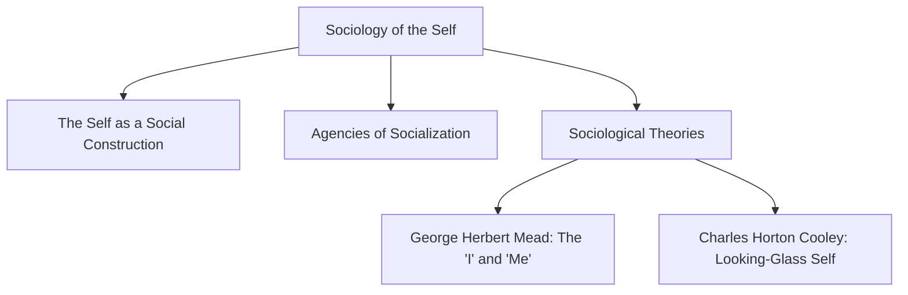
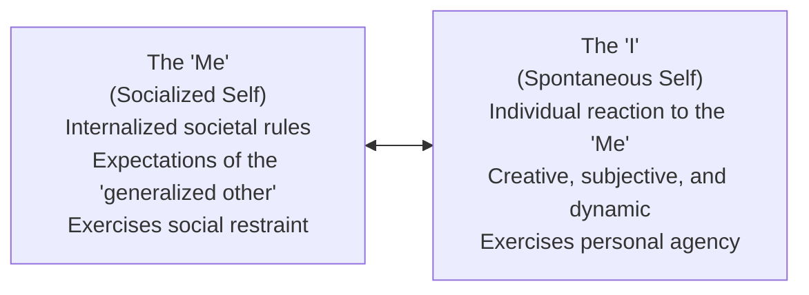
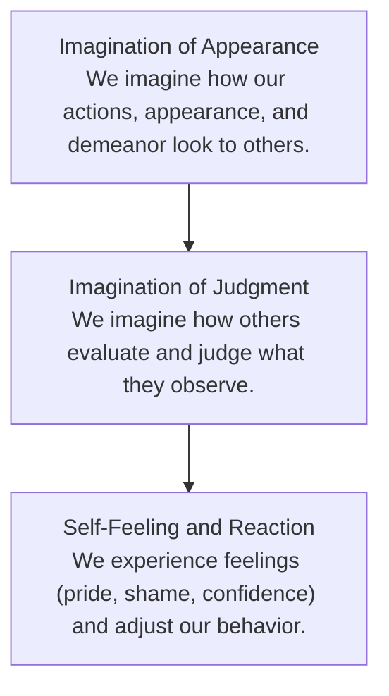

## What is Sociology?

**Sociology** is the scientific study of social behavior, social groups, institutions, and the role of society in shaping human identity. Rather than analyzing the human mind in biological or psychological isolation, sociology examines how external structures, cultural norms, and interpersonal interactions construct the individual.

---

## The Self as a Social Construction

The sociological perspective establishes that the self is a **social construction**. Individuals do not develop a sense of self in isolation; selfhood emerges through continuous social interaction:

- **Relational Identity**: How people understand themselves is directly linked to how they understand their social world and their standing among others.
- **Socialization**: The lifelong process through which an individual acquires the language, values, norms, roles, and behaviors appropriate to their culture.
- **Active Agency**: Individuals are not merely passive recipients of cultural programming; they actively interpret, negotiate, and reshape social expectations.

---

## Key Agencies of Socialization

Socialization occurs through distinct institutions known as **agencies of socialization**:

| Agency | Role and Function | Impact on the Self |
| :--- | :--- | :--- |
| **Family** | Primary agency of socialization; foundational environment. | Transmits emotional security, language, basic norms, core values, and behavioral habits. |
| **School** | Secondary formal institution; structured learning environment. | Introduces formal evaluation criteria, bureaucratic standards, peer collaboration, and civic duties. |
| **Peer Groups** | Voluntary associations of equals with similar age and status. | Cultivates social autonomy outside family oversight, emotional validation, and subcultural norms. |
| **Community & Media** | Broader societal environment and mass communication networks. | Shapes cultural worldviews, consumer habits, political attitudes, and communal obligations. |

---

## Major Sociological Theories of the Self

### 1. George Herbert Mead: The "I" and the "Me"

**George Herbert Mead**, a founder of American pragmatism and social psychology, formulated the theory of the **social self**. Mead argued that the self is not biologically present at birth, but develops sequentially through social experience and symbolic communication.

Mead differentiated two complementary phases of the self:

- **The "Me" (The Socialized Phase)**:
  - Represents the internalized expectations, norms, and attitudes of the wider community (referred to as the **generalized other**).
  - Functions as an internal regulatory mechanism that promotes adherence to societal standards and boundaries.
  - Represents the past experiences and learned societal knowledge of the individual.
- **The "I" (The Active and Spontaneous Phase)**:
  - Represents the individual's spontaneous, creative, and voluntary response to the expectations of the "Me."
  - Serves as the source of innovation, personal initiative, and distinct individuality.
  - Operates in the present and shapes future behavior.

The relationship between the "I" and the "Me" operates as a didactic system of checks and balances, allowing an individual to respect cultural norms while retaining personal authenticity.

### 2. Charles Horton Cooley: The Looking-Glass Self

**Charles Horton Cooley** asserted that a person's self-understanding is constructed through social interaction, coining the concept of the **Looking-Glass Self**. Cooley used the metaphor of a mirror to explain how other individuals reflect back images of ourselves:

#### The Three Sequential Steps:

1. **Perception**: An individual imagines how they appear to other people in a given social situation.
2. **Interpretation**: The individual imagines the judgments, opinions, or assessments that others make regarding that appearance.
3. **Response**: The individual develops self-feelings (such as pride, embarrassment, validation, or guilt) based on those perceived evaluations and adjusts their self-concept accordingly.

#### Analytical Nuances:

- **Differential Weighting**: Individuals do not value all social feedback equally; reactions from significant figures (parents, close friends, respected mentors) carry far greater weight than impressions from strangers.
- **Subjective Misinterpretation**: The looking-glass self is based on an individual's *perception* of what others think, which may not always reflect actual external opinions.
- **Internal Alignment**: Self-development is an ongoing quest for equilibrium between internal values and external social reflections.

---

## Comparative Summary: Mead vs. Cooley

| Dimension | George Herbert Mead | Charles Horton Cooley |
| :--- | :--- | :--- |
| **Core Concept** | The Social Self ("I" vs. "Me") | The Looking-Glass Self |
| **Origin of Self** | Social interactions, language, and role-taking | Internalizing perceived judgments of others |
| **Key Mechanism** | Internalizing the "generalized other" | Using social interaction as a reflective mirror |
| **Dual Phases** | "Me" (social constraint) vs. "I" (creative action) | Perceived judgment vs. emotional reaction |
| **Outcome** | Balance between social norms and individuality | Continuous alignment of internal self with external feedback |

---

## References

- Alata, E. J. P., et al. (2018). *Understanding the Self*. Manila: Rex Book Store.
- Cooley, C. H. (1902). *Human Nature and the Social Order*. New York: Scribner's.
- Macayan, J. V., Pinugu, J. N. J., & Castillo, J. C. D. (2018). *Understanding the Self: An Outcome-Based Modular Courseware*. Quezon City: C & E Publishing.
- Mead, G. H. (1934). *Mind, Self, and Society*. Chicago: University of Chicago Press.
