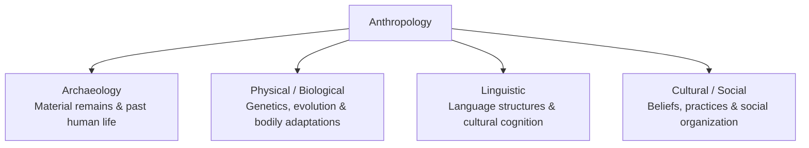
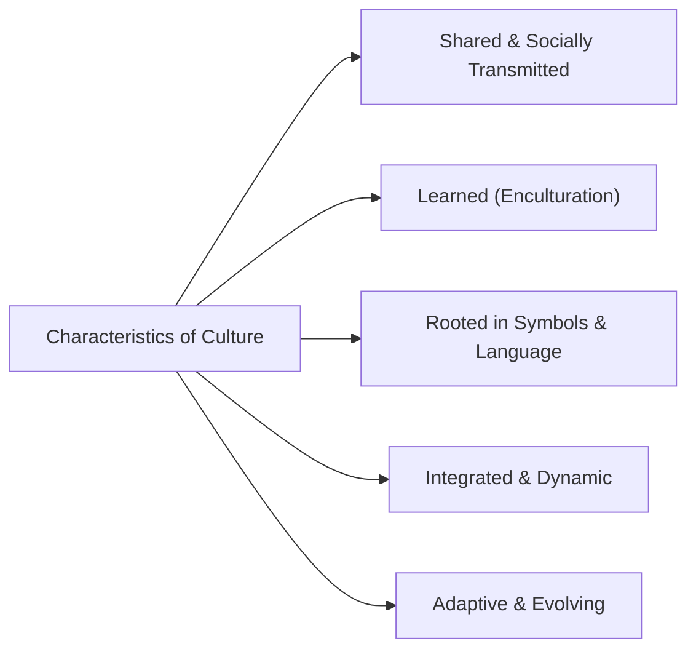
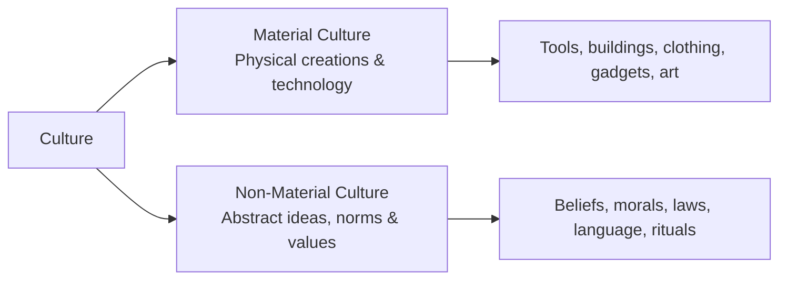

## What is Anthropology?

**Anthropology** is the holistic and comparative study of humanity, encompassing human origin, biological evolution, linguistic development, and cultural practices across time and space. The term derives from the Greek words *anthropos* (human being) and *logos* / *logia* (study of).

While disciplines such as psychology and sociology focus heavily on modern individuals and institutions, anthropology provides a broader perspective by examining human diversity across historical epochs, geographical regions, and ecological contexts.

---

## Four Main Subfields of Anthropology

Anthropology is traditionally divided into four primary subfields:

| Subfield | Core Focus | Methods and Artifacts | Relevance to the Self |
| :--- | :--- | :--- | :--- |
| **Archaeology** | Past human cultures and behaviors | Excavation of artifacts, pottery, tools, architectural ruins, fossils | Demonstrates how material environments and technological shifts shaped human lifestyles. |
| **Physical Anthropology** | Biological evolution and physical variations | Genetics, fossil records, osteology, primatology, human adaptation | Explains biological foundations, hereditary mechanisms, and physiological plasticity. |
| **Linguistic Anthropology** | Evolution and structure of language | Discourse analysis, linguistic historical mapping, sociolinguistics | Shows how linguistic symbols and speech patterns structure thought, worldview, and self-expression. |
| **Cultural Anthropology** | Living societies and cultural systems | Participant observation, ethnography, comparative field interviews | Explores how customs, rituals, values, and social hierarchies construct personal identity. |

---

## Culture and Its Characteristics

In 1871, **Sir Edward B. Tylor**, a founding figure of cultural anthropology, formulated the classical definition of culture:

> *"Culture is that complex whole which includes knowledge, belief, art, morals, law, custom, and any other capabilities and habits acquired by man as a member of society."*

### Key Attributes of Culture:

- **Learned**: Culture is not inherited biologically; it is acquired through **enculturation** (socialization within a specific cultural community).
- **Shared**: Cultural values, customs, and standards are shared collectively by members of a group rather than invented by a single individual.
- **Symbolic**: Culture relies on verbal and non-verbal symbols, language, metaphors, and artistic expressions.
- **Integrated**: The diverse elements of a culture (economy, kinship, religion, politics) form a coherent, interconnected system.
- **Adaptive**: Culture evolves to meet changing environmental, technological, and socio-economic challenges.

---

## Two Essential Components of Culture

Cultural systems consist of two interconnected dimensions:

- **Material Culture**: The physical objects, artifacts, architecture, and technology produced and utilized by humans. These tangible creations reflect social values and facilitate daily survival.
- **Non-Material Culture**: The intangible ideas, values, norms, folkways, mores, laws, philosophies, and religious beliefs that guide human interaction and cognitive orientation.

---

## The Self Embedded in Culture

In anthropology, the self is understood as a **culturally situated construct**. An individual cannot be disentangled from the cultural matrix in which they are embedded:

### 1. Egocentric vs. Sociocentric Conceptions of the Self

Anthropologists distinguish between two predominant cultural paradigms of selfhood:

| Dimension | Egocentric View (Independent) | Sociocentric View (Interdependent) |
| :--- | :--- | :--- |
| **Cultural Context** | Prevalent in Western societies | Prevalent in Asian, African, and traditional societies |
| **Core Definition** | Self is viewed as an autonomous, distinct, self-contained agent. | Self is defined by social relationships, kin obligations, and community standing. |
| **Boundaries** | Clear boundaries separating self from others | Fluid boundaries; self is interdependent with others |
| **Primary Value** | Personal freedom, autonomy, self-reliance | Communal harmony, social duty, collective welfare |

### 2. Clifford Geertz and the "Control Mechanisms"

American anthropologist **Clifford Geertz** described the human person as an incomplete animal whose nature is finalized by culture. According to Geertz:

- Humans are genetically equipped with general capacities, but rely on cultural symbols, traditions, and instructions to make specific choices.
- Culture functions as a set of **"control mechanisms"**—plans, recipes, rules, and instructions—for governing behavior and giving meaning to human action.
- Without cultural frameworks, human behavior would become chaotic and directionless. The self is an active participant operating within these symbolic systems.

---

## References

- Alata, E. J. P., et al. (2018). *Understanding the Self*. Manila: Rex Book Store.
- Geertz, C. (1973). *The Interpretation of Cultures*. Basic Books.
- Macayan, J. V., Pinugu, J. N. J., & Castillo, J. C. D. (2018). *Understanding the Self: An Outcome-Based Modular Courseware*. Quezon City: C & E Publishing.
- Tylor, E. B. (1871). *Primitive Culture*. London: John Murray.
