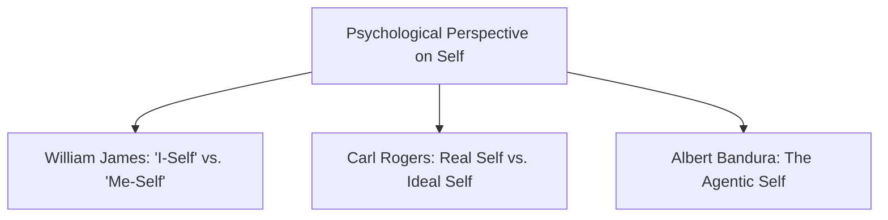
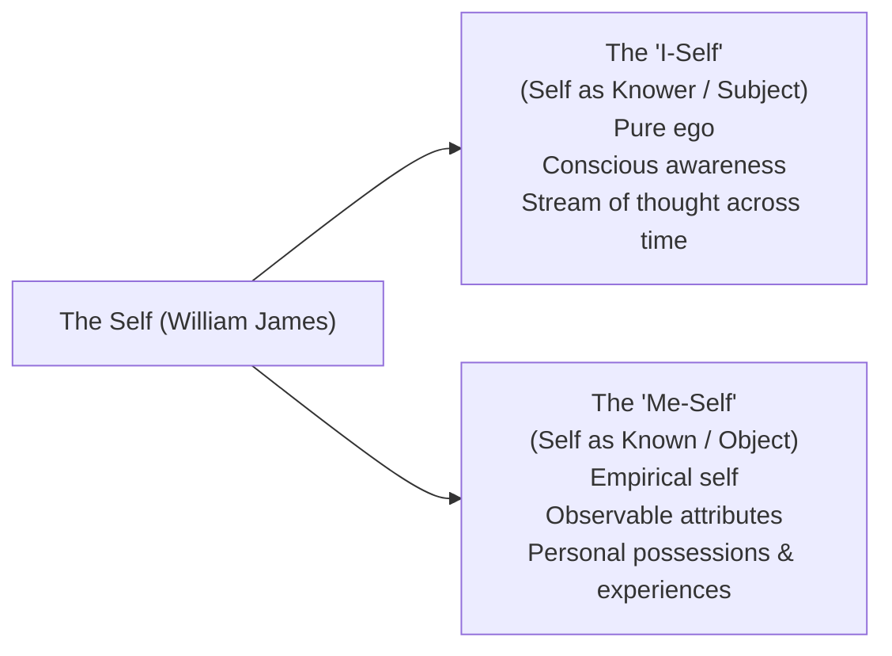
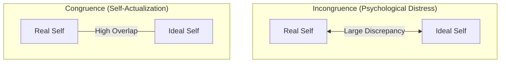
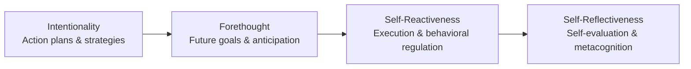

## What is Psychology?

**Psychology** is the scientific study of human behavior and mental processes. The word derives from the Greek roots *psyche* (soul or mind) and *logos* (study). 

While ancient philosophy treated the mind through metaphysical contemplation, psychology emerged as an empirical science in **1879**, when **Wilhelm Wundt** established the first experimental psychology laboratory in Leipzig, Germany. Modern psychology examines cognitive processes, emotional reactions, neurological mechanisms, behavioral patterns, and personal identity.

---

## William James: The Duality of the Self

In his foundational work *The Principles of Psychology* (1890), **William James** presented the first comprehensive modern psychological theory of the self, proposing that the self operates along two interconnected dimensions:

### 1. The "I-Self" (The Knower)

- The self as a **subject of experience** (pure ego).
- Represents the active, conscious agent that perceives, thinks, feels, and evaluates.
- Provides continuity of personal identity, linking past memories, present experiences, and future plans into a single stream of consciousness.

### 2. The "Me-Self" (The Known)

- The self as an **object of experience** (the empirical self).
- Encompasses everything that a person considers to be theirs, divided into three constituents:

| Constituent | Scope | Examples |
| :--- | :--- | :--- |
| **Material Self** | Physical body, clothing, family, and material possessions | One's body, intimate apparel, nuclear family, home, automobile |
| **Social Self** | How an individual is perceived, recognized, and regarded by different social groups | Professional persona, peer-group reputation, familial role |
| **Spiritual Self** | Inner psychological core, subjective awareness, and moral dispositions | Core values, ethical conscience, personal aspirations, spiritual convictions |

> [!NOTE]
> James famously observed that an individual has "as many social selves as there are distinct groups of persons about whose opinion he cares."

---

## Carl Rogers: Real Self vs. Ideal Self

**Carl Rogers**, a founder of humanistic psychology, formulated a person-centered theory of personality. Rogers posited that every human being possesses an innate **actualizing tendency**—an intrinsic drive to grow, develop, and realize their fullest creative and productive potential.

### Key Components of Self-Concept:

- **The Real Self**: The person one intrinsically is. It reflects authentic feelings, genuine thoughts, actual abilities, and everyday experiences.
- **The Ideal Self**: The person one strives to become or feels they *ought* to be. It is shaped by external standards, role models, parental ambitions, and societal expectations.

### Congruence vs. Incongruence

| State | Definition | Emotional and Behavioral Outcome |
| :--- | :--- | :--- |
| **Congruence** | High degree of alignment between Real Self and Ideal Self. | High self-esteem, psychological adjustment, authenticity, and openness to experience. |
| **Incongruence** | Substantial divergence between Real Self and Ideal Self. | Chronic anxiety, cognitive dissonance, dissatisfaction, vulnerability, and defensive distortion. |

### The Role of Unconditional Positive Regard

Rogers emphasized that achieving congruence depends heavily on **unconditional positive regard**—an attitude of complete acceptance, warmth, and validation without prerequisites. When individuals receive unconditional support (from parents, mentors, or therapists), they are less likely to construct a rigid, artificial ideal self and can embrace their authentic real self.

---

## Albert Bandura: The Agentic Self

Psychologist **Albert Bandura** emphasized that individuals are not merely reactive products of environmental conditioning, but **proactive, self-regulating agents** of their lives. Human agency operates through four distinct core features:

1. **Intentionality**: The conscious formulation of action plans and purposeful commitments.
2. **Forethought**: Setting temporal goals and visualizing anticipated outcomes to guide present behavior.
3. **Self-Reactiveness**: Constructing appropriate courses of action and regulating their execution in real time.
4. **Self-Reflectiveness**: Metacognitive examination of one's own functioning, thoughts, values, and actions to make adjustments.

---

## Summary Matrix of Psychological Frameworks

| Theorist | Core Psychological Concept | Definition of Selfhood |
| :--- | :--- | :--- |
| **William James** | "I-Self" vs. "Me-Self" | Distinction between the self as subjective conscious knower ("I") and objective empirical construct ("Me"). |
| **Carl Rogers** | Real Self vs. Ideal Self | Congruence between authentic personal experience (Real) and internalized aspirations (Ideal) fosters health. |
| **Albert Bandura** | Agentic Self & Self-Efficacy | Humans proactively organize, self-regulate, and execute actions through intentional cognitive agency. |

---

## References

- Alata, E. J. P., et al. (2018). *Understanding the Self*. Manila: Rex Book Store.
- Bandura, A. (2001). *Social Cognitive Theory: An Agentic Perspective*. Annual Review of Psychology, 52(1), 1–26.
- James, W. (1890). *The Principles of Psychology*. New York: Henry Holt and Company.
- Macayan, J. V., Pinugu, J. N. J., & Castillo, J. C. D. (2018). *Understanding the Self: An Outcome-Based Modular Courseware*. Quezon City: C & E Publishing.
- Rogers, C. R. (1961). *On Becoming a Person: A Therapist's View of Psychotherapy*. Houghton Mifflin.
