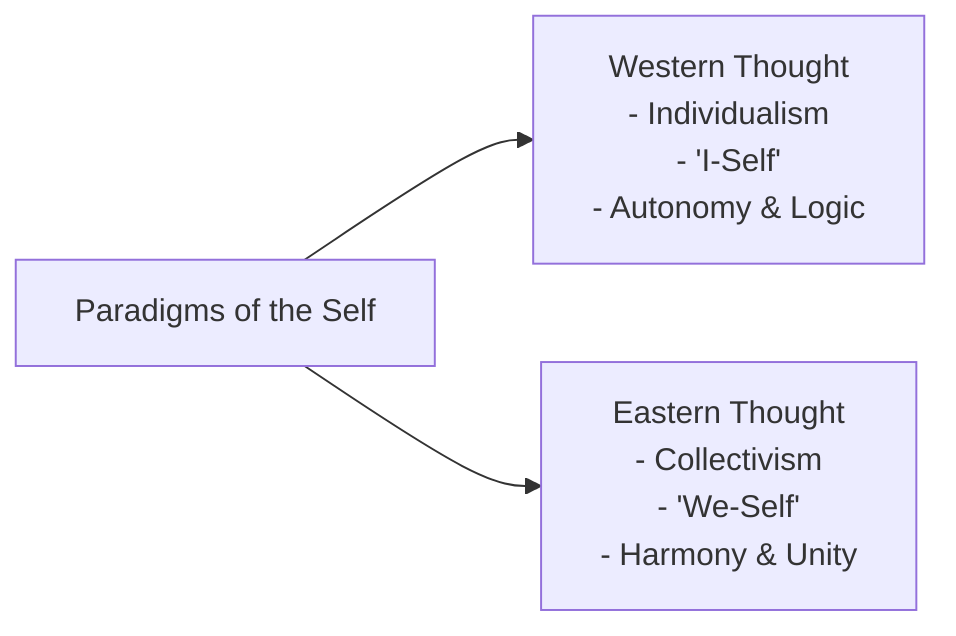
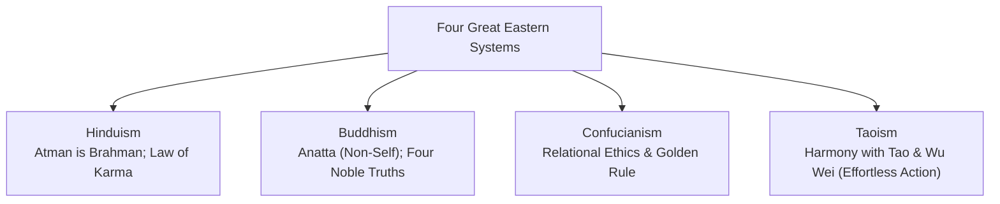

## Introduction

Conceptions of the self are deeply informed by philosophical, cultural, and historical traditions. Across civilizations, two predominant paradigms have emerged: **Western Thought** and **Eastern (Oriental) Thought**. Understanding these divergent orientations clarifies how individuals perceive their agency, relationships, social obligations, and existential purpose.

---

## Western Thought and the Individualistic Self

Western thought traces its intellectual genealogy to ancient **Greek philosophy**, **Roman jurisprudence**, and **Judeo-Christian religious tradition**.

### Defining Characteristics:

- **Individualism**: The individual is recognized as the primary unit of moral and political concern. Primacy is placed on personal autonomy, individual rights, self-fulfillment, and self-reliance.
- **The "I-Self"**: Identity is constructed around personal distinctiveness, unique talents, and individual accomplishments.
- **Rationalism and Scientific Inquiry**: Truth is sought through empirical observation, formal logic, and categorization.
- **Linear Progress**: Time is perceived as a linear timeline where human effort, enterprise, and innovation drive personal and societal advancement.
- **Meritocracy and Competition**: Social status is viewed as the result of personal industry and merit rather than fortune or communal inheritance.

---

## Eastern Thought and the Collectivistic Self

Eastern (Oriental) traditions originated across ancient Asian civilizations. Rather than viewing the individual as an isolated actor, Eastern traditions understand the human person as an interdependent thread woven into a vast communal and cosmic fabric.

### Defining Characteristics:

- **Collectivism**: Primacy is accorded to the group, family, community, and social whole over solitary desires.
- **The "We-Self"**: Self-concept is inseparable from communal obligations, relational roles, and social harmony.
- **Holism and Unity**: Reality is viewed as an interconnected, indivisible continuum rather than discrete fragments.
- **Cyclical Time**: Existence is perceived through cyclical rhythms (birth, death, rebirth, seasonal renewal).
- **Valuing Longevity and Seniority**: Wisdom is associated with age, ancestral respect, and enduring balance rather than aggressive youthfulness.

---

## The Four Great Eastern Systems of Thought

### 1. Hinduism

- **Brahman and Atman**: **Brahman** represents the absolute, ultimate, and all-encompassing universal reality. **Atman** is the immortal inner soul of the individual. In the *Vedanta* tradition, the core spiritual insight is that Atman and Brahman are fundamentally one.
- **Maya and Suffering**: Suffering arises when individuals succumb to *Maya* (the cosmic illusion) and mistakenly equate their true identity with the transient, material ego.
- **The Law of Karma**: The universal moral law of cause and effect. Every moral action produces reciprocal consequences across the cycle of rebirth (*samsara*).

### 2. Buddhism

- **Anatta (Non-Self)**: Founded by Siddhartha Gautama (the Buddha), Buddhism radically departs from Hinduism by denying the existence of an eternal, unchanging soul (*anatta* / *anatman*). The conventional "self" is an impermanent combination of five aggregates (*skandhas*): form, sensation, perception, mental formations, and consciousness.
- **The Four Noble Truths**:
  1. *Dukkha*: Life inherently involves suffering, dissatisfaction, and impermanence.
  2. *Samudaya*: The root cause of suffering is craving, grasping, and attachment (*tanha*).
  3. *Nirodha*: Suffering can be overcome through the cessation of craving.
  4. *Magga*: The path to overcome suffering is the **Noble Eightfold Path** (Right View, Right Resolve, Right Speech, Right Action, Right Livelihood, Right Effort, Right Mindfulness, and Right Concentration).

### 3. Confucianism

- **Relational Selfhood**: Founded by Confucius (Kong Fuzi), Confucianism treats the self not as an isolated ego, but as a relational being cultivated through moral duties and social hierarchies (ruler-subject, parent-child, husband-wife, elder sibling-younger sibling, friend-friend).
- **Core Virtues**:
  - *Ren* (Benevolence / Human-heartedness): Compassion and goodwill toward others.
  - *Li* (Propriety / Ritual): Respectful adherence to social etiquette, moral norms, and ancestral customs.
  - *Xiao* (Filial Piety): Deep reverence and devotion to parents and elders.
- **The Golden Rule**: *"Do not do to others what you would not want others to do to you."*

### 4. Taoism

- **The Tao (The Way)**: Founded by Lao Tzu, Taoism emphasizes living in spontaneous harmony with the **Tao**—the natural, eternal order that governs the cosmos.
- **Wu Wei (Effortless Action)**: The virtue of non-interference, naturalness, and simplicity. Action should flow like water without forced resistance.
- **Yin and Yang**: Complementary cosmic forces (light/dark, passive/active, soft/hard) that exist in dynamic balance. A person achieves peace by accepting reality as it is.

---

## Comparative Matrix: Western vs. Eastern Thought

| Dimension | Western Conception | Eastern Conception |
| :--- | :--- | :--- |
| **Cultural Focus** | Individualistic (*"I-Self"*) | Collectivistic (*"We-Self"*) |
| **Ultimate Aim** | Self-actualization, independence, and personal success | Social harmony, moral duty, and cosmic integration |
| **View of the Soul** | Discrete entity or psychological construct | Unified with cosmic principle (Hinduism) or an impermanent illusion (Buddhism) |
| **Mode of Thinking** | Analytical, linear, categorical, and logical | Holistic, relational, intuitive, and cyclical |
| **Drive for Wealth** | Enterprise, industry, and material acquisition | Equated with contentment, modest needs (*"less is more"*), and longevity |
| **Interpersonal Stance** | Direct communication, debate, and healthy competition | Diplomatic communication, deference to seniority, and conflict avoidance |

---

## The Filipino Dilemma: Synthesis of East and West

The contemporary Filipino identity is situated at the intersection of Western and Eastern paradigms:

- **Historical Layering**: Centuries of Spanish colonial Catholicism and American educational systems introduced Western concepts of legal individualism, democracy, consumerism, and institutional structures.
- **Indigenous Heritage**: Underlying these Western structures is an Eastern foundation characterized by close familial solidarity, relational sensitivity (*pakikipagkapwa-tao*), communal cooperation (*bayanihan*), and indirect communication.
- **Dynamic Synthesis**: Rather than seeing this as a contradiction, modern understanding views the Filipino self as capable of bridging both worldviews—combining professional ambition and technical competence with deep communal empathy and relational resilience.

---

## References

- Alata, E. J. P., et al. (2018). *Understanding the Self*. Manila: Rex Book Store.
- Macayan, J. V., Pinugu, J. N. J., & Castillo, J. C. D. (2018). *Understanding the Self: An Outcome-Based Modular Courseware*. Quezon City: C & E Publishing.
- Ule, A. (2016). *The Concept of Self in Buddhism and Brahmanism: Some Remarks*. Synthesis Philosophica, 31(1), 77–88.
