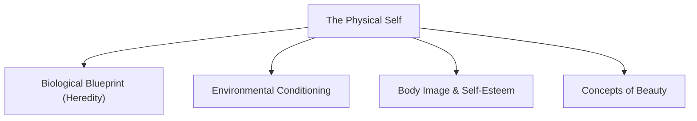
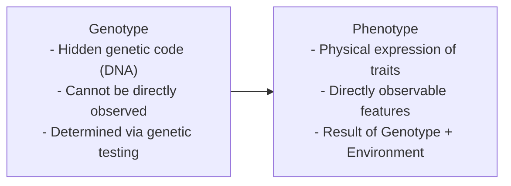
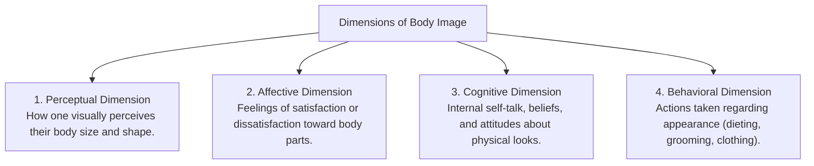
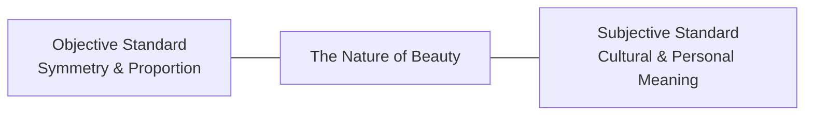

## What is the Physical Self?

The **Physical Self** represents the tangible, observable, and concrete dimension of an individual. It is the biological vessel through which a person perceives, navigates, and interacts with their physical environment and fellow human beings.

The physical self is defined by visible somatic traits, including sex, height, weight, skin complexion, facial features, and body proportions. While internal virtues (such as honesty, compassion, and intellect) define psychological character, the physical self constitutes the initial basis of visual perception and interpersonal encounter.

---

## The Biological Blueprint: Heredity and Maturation

Physical characteristics do not emerge at random; they are governed by biological systems:

### 1. Mechanisms of Heredity

- **Heredity**: The biological transmission of physical, physiological, and psychological traits from parents to offspring.
- **Genes**: The fundamental units of biological heredity. Strands of DNA (*deoxyribonucleic acid*) contain instructions for synthesizing proteins that direct bodily development.
- **Chromosomes**: Microscopic threadlike structures located in the cell nucleus that carry genetic data. Humans normally possess 46 chromosomes (23 pairs):
  - **22 pairs of Autosomes**: Control somatic physical traits.
  - **1 pair of Sex Chromosomes**: Determines biological sex ($XX$ for genetic females, $XY$ for genetic males).

- **Genotype**: The complete set of specific genetic information inherited from both biological parents.
- **Phenotype**: The observable physical, physiological, and biochemical traits exhibited by an individual (e.g., pointed nose, curly black hair, almond-shaped eyes). Not all genotypic instructions are expressed; dominant and recessive patterns determine phenotypic expression.

### 2. Developmental Trajectory and Maturation

The body undergoes continuous physiological changes throughout life:
- **Infancy and Childhood**: Rapid biological growth transitioning into steady physical development.
- **Adolescence (Puberty)**: Triggered by hypothalamic and pituitary hormones, secondary sexual characteristics develop, marking reproductive maturation.
- **Early Adulthood (Ages 20–30)**: Peak physical strength, sensory acuity, motor coordination, and physiological efficiency.
- **Middle to Late Adulthood**: Gradual reduction in metabolic rate, bone density, and muscle mass, accompanied by cellular senescence.

---

## Environmental Conditioning

While genetics establishes potential and boundaries, **environmental influences** significantly shape physical development:

- **Family and Nutrition**: Early nutritional patterns, health practices, and hygiene established at home dictate childhood growth and somatic well-being.
- **Physical Activity and Rest**: Exercise, sleep hygiene, and occupational demands condition muscular tone, cardiovascular capacity, and posture.
- **Socio-Cultural Environment**: Lifestyle factors, air quality, socioeconomic access to healthcare, and regional climates directly affect physical health.

---

## Body Image and Self-Esteem

**Body image** is an individual's multifaceted mental representation of their own physical body:

### The Impact of Media and Social Comparison

Contemporary media (television, advertisements, social media algorithms) frequently projects narrow and digitally edited standards of physical attractiveness:
- Muscular, low-fat physiques for men.
- Ultra-slender, fair, and hyper-proportioned silhouettes for women.

Constant exposure to unrealistic standards often triggers **upward social comparison**, generating body dissatisfaction, anxiety, and in severe cases, eating disorders or body dysmorphic disorder.

---

## Concepts of Physical Beauty: Objective vs. Subjective

Philosophical and cultural inquiries into beauty focus on two divergent perspectives:

| Perspective | Core Proposition | Key Arguments |
| :--- | :--- | :--- |
| **Objective Beauty** | Beauty resides in the physical properties of the object itself. | Classical Greek tradition: beauty is defined by symmetry, mathematical proportion (*Golden Ratio*), and harmonic balance. |
| **Subjective Beauty** | Beauty is in the perception of the observer (*"eye of the beholder"*). | Cultural variations demonstrate that standards of beauty are socially constructed and dynamic across epochs. |

### Cultural Diversity in Beauty Standards

Cross-cultural anthropology documents diverse expressions of human aesthetics:
- Historical Chinese foot-binding (*lotus feet*).
- Neck elongation brass coils among the Kayan Lahwi people of Myanmar.
- Elaborate body tattooing (*Pe'a*) among Polynesian cultures.
- Lip plates among the Mursi of Ethiopia.

---

## Cultivating a Healthy Physical Self

Developing a constructive relationship with one's physical body requires shifting focus from external validation to functional appreciation:

- **Recognize Body Diversity**: Acknowledge that healthy, functional bodies naturally occur across diverse heights, weights, bone structures, and complexions.
- **Prioritize Health Over Aesthetics**: Focus on vitality, strength, rest, and balanced nutrition rather than conforming to commercial beauty ideals.
- **Practice Mindful Self-Care**: Care for the body as the home of consciousness, remembering the classical principle: *"To keep the body in good health is a duty... otherwise, we shall not be able to keep our mind strong and clear."*

---

## References

- Alata, E. J. P., et al. (2018). *Understanding the Self*. Manila: Rex Book Store.
- Macayan, J. V., Pinugu, J. N. J., & Castillo, J. C. D. (2018). *Understanding the Self: An Outcome-Based Modular Courseware*. Quezon City: C & E Publishing.
- Robinson, J. (2002). *The Quest for Human Beauty: An Illustrated History*. Grange Books.
- Snell, W. E., & Papini, D. R. (1989). *The Sexuality Scale: An Instrument to Measure Sexual-Esteem, Sexual-Depression, and Sexual-Preoccupation*. Journal of Sex Research, 26(2), 256–263.
