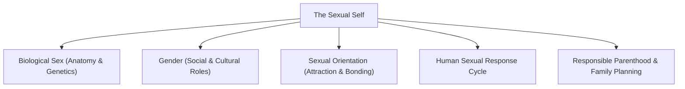
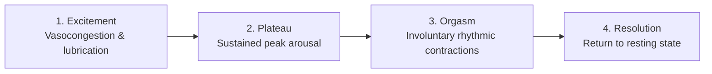
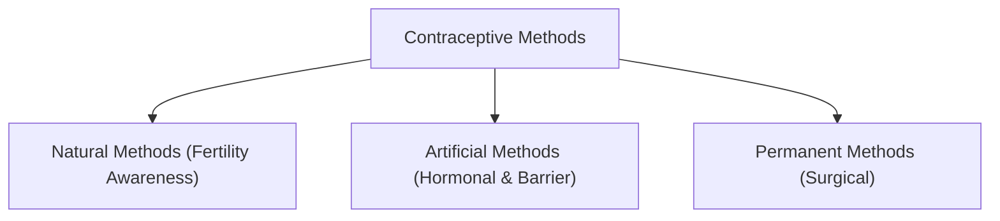

## What is the Sexual Self?

The **Sexual Self** encompasses the biological, psychological, and social dimensions of an individual as a sexual being. Human sexuality is an integral drive that influences emotional affectivity, bonding, reproductive capacity, and self-expression throughout the lifespan.

Despite its centrality to human well-being, discussions surrounding sexuality have historically been shrouded in social taboos. A comprehensive understanding of sexuality empowers individuals to navigate relationships with responsibility, respect, and emotional maturity.

---

## Differentiating Biological Sex, Gender, and Sexual Orientation

Precise conceptual distinctions are essential when examining the sexual self:

| Dimension | Definition | Determining Factors |
| :--- | :--- | :--- |
| **Biological Sex** | The biological and anatomical classification assigned at birth. | Chromosomes ($XX$, $XY$), hormones (estrogen, testosterone), internal and external genitalia. |
| **Gender** | The socially constructed roles, behaviors, personality traits, and expectations attributed to individuals in a given culture. | Social norms, cultural conditioning, gender identity (internal sense of being male, female, or non-binary), and gender expression. |
| **Sexual Orientation** | The enduring pattern of emotional, romantic, and sexual attraction toward individuals of specific sexes or genders. | Heterosexuality, homosexuality, bisexuality, asexuality, and related variations. |

---

## The Human Sexual Response Cycle

In their landmark physiological research, **William Masters and Virginia Johnson** identified four sequential phases that characterize the human sexual response:

1. **Excitement Phase**: Initial physiological arousal marked by **vasocongestion** (blood flow to genital tissues). In males, this produces penile erection; in females, vaginal lubrication and clitoral swelling occur.
2. **Plateau Phase**: Sustained, heightened arousal immediately preceding orgasm. Heart rate, blood pressure, and respiration reach elevated plateaus.
3. **Orgasm Phase**: The climax of the sexual response cycle, characterized by involuntary, rhythmic neuromuscular contractions and the release of sexual tension. In males, it typically coincides with ejaculation; in females, contractions occur in the outer third of the vagina and uterus.
4. **Resolution Phase**: The body gradually returns to its unaroused physiological baseline. 
   - Males enter a mandatory **refractory period** during which further erection and orgasm are temporarily impossible.
   - Females generally have a much shorter refractory potential and are capable of experiencing multiple consecutive orgasms.

---

## Consequences of Sexual Choices

Sexual activity involves serious health, psychological, and social consequences:

### 1. Adolescent and Unplanned Pregnancy

Engaging in unprotected penetrative intercourse carries a high risk of pregnancy. For adolescents, early pregnancy introduces substantial health risks (including gestational complications and maternal mortality), emotional stress, interrupted education, and economic burdens for both partners.

### 2. Sexually Transmitted Infections (STIs)

STIs are infectious pathogens transmitted through intimate sexual contact, exchange of bodily fluids, or direct skin-to-skin mucous membrane contact:

| Infection Type | Diseases | Symptoms | Treatment / Prognosis |
| :--- | :--- | :--- | :--- |
| **Bacterial** | Syphilis, Gonorrhea, Chlamydia | Burning urination, abnormal genital discharge, sores, abdominal pain. | Curable with appropriate antibiotic regimens if detected early. |
| **Viral** | Genital Herpes, HPV (Human Papillomavirus), Hepatitis B | Genital blisters, warts, chronic liver inflammation (Hepatitis B). | Non-curable; managed with antiviral therapy and preventative vaccines (e.g., HPV vaccine). |
| **HIV / AIDS** | Human Immunodeficiency Virus | Initial flu-like symptoms leading to progressive immune cell ($CD4^+$) destruction. | No cure; managed effectively with life-long **Antiretroviral Therapy (ART)** to maintain viral suppression. |

---

## Principles of Responsible Sexual Behavior

- **Respect for One's Body**: Protecting personal health, establishing boundaries, and avoiding situations that compromise self-worth.
- **Maturity in Thought and Action**: Making deliberate, rational decisions rather than acting impulsively based on momentary emotional arousal.
- **Guidance by Personal Core Values**: Aligning intimate decisions with enduring moral convictions, mutual consent, and self-respect.
- **Future-Oriented Decision Making**: Weighing immediate desires against long-term educational, professional, and familial aspirations.

---

## Family Planning and Reproductive Health

**Family planning** is the rational, voluntary, and informed process by which individuals and couples determine the timing, spacing, and number of children they wish to have.

In the Philippines, the **Responsible Parenthood and Reproductive Health Act of 2012 (Republic Act No. 10354)** guarantees universal access to medically safe, non-abortifacient modern contraceptives, maternal care, and age-appropriate reproductive health education.

### The Four Pillars of Family Planning:

1. **Responsible Parenthood**: The capacity of parents to meet the physical, psychological, educational, and spiritual needs of their children.
2. **Respect for Life**: The constitutional protection of life from conception; family planning seeks to eliminate abortion by preventing unplanned pregnancies.
3. **Birth Spacing**: Maintaining an interval of 3 to 5 years between pregnancies to allow the mother's body to recover and foster healthy infant development.
4. **Informed Choice**: Ensuring couples receive accurate, unbiased medical information to freely select methods compatible with their health, culture, and religious beliefs.

---

## Methods of Family Planning

### 1. Natural Family Planning Methods

- **Calendar / Rhythm Method**: Calculating fertile windows based on past menstrual cycle tracking; abstaining from intercourse during estimated ovulation days.
- **Basal Body Temperature (BBT)**: Tracking daily morning resting temperature to identify the slight thermal rise ($0.2^\circ\text{C} - 0.5^\circ\text{C}$) that follows ovulation.
- **Cervical Mucus (Billings) Method**: Monitoring changes in cervical secretions; fertile mucus becomes clear, slippery, and stretchy (resembling raw egg white).
- **Lactational Amenorrhea Method (LAM)**: Temporary postpartum infertility achieved through exclusive, frequent breastfeeding during the first six months after childbirth.
- **Coitus Interruptus (Withdrawal)**: Withdrawing the penis prior to ejaculation. (Highly unreliable, with approximately 20–25% typical failure rate due to pre-ejaculatory fluid containing active spermatozoa).

### 2. Artificial Family Planning Methods

| Category | Method | Mechanism of Action | Effectiveness |
| :--- | :--- | :--- | :--- |
| **Hormonal** | Combined Oral Contraceptive Pills | Estrogen and progestin suppress ovulation and thicken cervical mucus. | $>99\%$ with perfect use; $\approx 91\%$ typical use. |
| **Hormonal** | Progestin-Only Mini-Pill | Thickens cervical mucus and thins endometrial lining; ideal during lactation. | $>99\%$ perfect; $\approx 91\%$ typical. |
| **Hormonal** | Transdermal Patch | Weekly adhesive skin patch delivering estrogen and progestin transdermally. | $>99\%$ perfect; $\approx 91\%$ typical. |
| **Hormonal** | Subdermal Implants (e.g., Implanon) | Flexible rod placed under arm skin releasing progestin steadily for 3–5 years. | $>99\%$ (highest tier efficacy). |
| **Hormonal** | Injectable Contraceptive (DMPA) | Intramuscular injection administered every 3 months. | $>99\%$ perfect; $\approx 96\%$ typical. |
| **Intrauterine** | Copper IUD | T-shaped device inserted into uterus; copper ions act as spermicide for up to 10–12 years. | $>99\%$. |
| **Barrier** | Male & Female Condoms | Physical sheath preventing sperm and bodily fluid exchange. | $\approx 98\%$ perfect; $\approx 85\%$ typical. **(Only method offering STI protection).** |
| **Barrier** | Diaphragm & Cervical Cap | Silicone cup covering the cervix used alongside spermicidal gel. | $\approx 88\% - 94\%$. |

### 3. Permanent (Surgical) Methods

- **Vasectomy (Male Sterilization)**: A minor, safe outpatient procedure that severs and seals the *vas deferens*, preventing sperm from entering the ejaculatory fluid. Does not impair sexual drive or erectile function.
- **Bilateral Tubal Ligation (BTL / Female Sterilization)**: Surgical occlusion, cutting, or clamping of both fallopian tubes to prevent ova from encountering sperm.

---

## References

- Alata, E. J. P., et al. (2018). *Understanding the Self*. Manila: Rex Book Store.
- Macayan, J. V., Pinugu, J. N. J., & Castillo, J. C. D. (2018). *Understanding the Self: An Outcome-Based Modular Courseware*. Quezon City: C & E Publishing.
- Masters, W. H., & Johnson, V. E. (1966). *Human Sexual Response*. Boston: Little, Brown.
- Republic of the Philippines. (2012). *Republic Act No. 10354: The Responsible Parenthood and Reproductive Health Act of 2012*.
