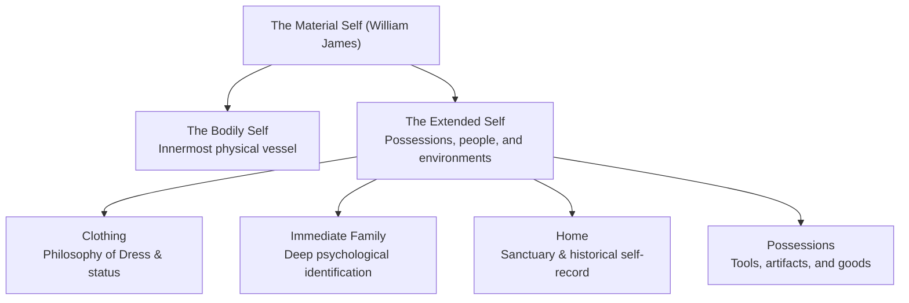
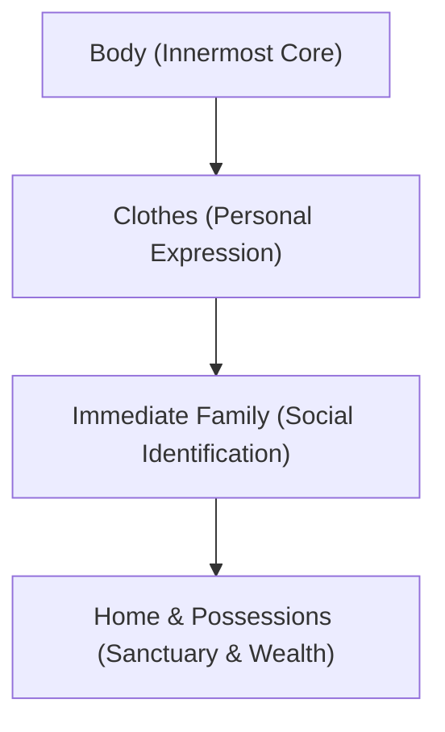
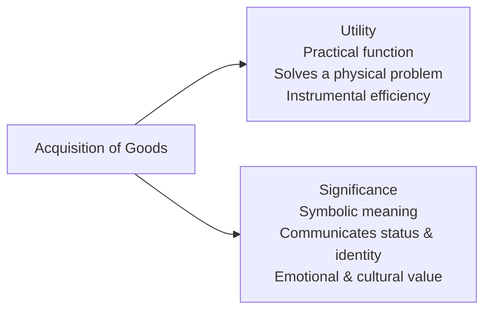
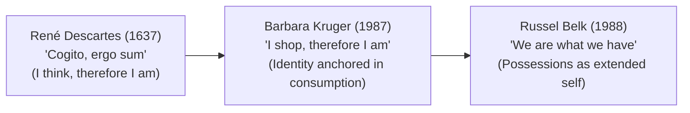

## What is the Material Self?

In *The Principles of Psychology* (1890), **William James** observed that an individual's sense of self extends far beyond their immediate physical boundaries:

> *"A man's self is the sum total of all that he CAN call his, not only his body and his psychic powers, but his clothes and his house, his wife and children, his ancestors and friends, his reputation and works, his lands and horses, and yacht and bank-account."*

The **Material Self** reflects the tangible investments an individual makes in the physical world. Material possessions serve not only utilitarian functions but also function as visible extensions of identity, social standing, and emotional attachment.

---

## The Hierarchy of the Material Self

James outlined a structured hierarchy of the material self, based on emotional attachment and personal investment:

### 1. The Body

The innermost component of the material self. Individuals invest enormous physical, psychological, and financial energy into nurturing, protecting, and maintaining their bodies. When bodily health is compromised, an individual's core sense of well-being is immediately affected.

### 2. Clothes

Clothing forms the second layer of the material self. Influenced by **Hermann Lotze's** *Philosophy of Dress* (in *Microcosmus*), James noted that when we wear an article of clothing, we absorb its contours and texture into our bodily consciousness. Clothing is a primary tool for self-expression, projecting social roles, professional status, and cultural affiliation.

### 3. Immediate Family

Parents, siblings, spouses, and children represent profound extensions of the self. Because of intense psychological identification, an individual experiences family successes with pride and feels shared pain or shame during family hardships. The impulse to protect family members functions like the instinct for self-preservation.

### 4. Home and Possessions

A home is the primary sanctuary and "nest" of personal selfhood. Domestic spaces contain physical artifacts, photographs, and furniture that record personal histories and emotional memories. Material possessions (such as vehicles, books, technology, and tools) similarly reflect personal labor, hobbies, and achievements.

---

## Utility vs. Significance

When individuals acquire material objects, two distinct dimensions influence their choices:

- **Utility**: The functional capacity of an object to perform practical tasks and satisfy biological or physical needs (e.g., a wristwatch tells the time; a jacket protects against the cold).
- **Significance**: The symbolic, social, or emotional meaning assigned to an object. It communicates personal taste, economic prestige, subcultural belonging, or sentimental value (e.g., a luxury timepiece worn as a symbol of status).

---

## Needs vs. Wants

Clear financial and psychological self-awareness requires distinguishing between basic survival requirements and discretionary desires:

| Category | Definition | Characteristics | Examples |
| :--- | :--- | :--- | :--- |
| **Needs** | Absolute essentials required for physical survival, basic health, and sustained functioning. | Universal, relatively constant, non-negotiable over the long term. | Wholesome food, clean water, adequate shelter, basic clothing, healthcare, education. |
| **Wants** | Discretionary desires that provide added comfort, pleasure, convenience, or social distinction. | Variable, culturally stimulated, heavily shaped by advertising, open-ended. | High-end designer clothes, latest smartphone upgrades, luxury sports cars, gourmet dining. |

Recognizing the distinction between needs and wants enables deliberate budgeting, minimizes debt accumulation, and protects individuals from confusing commercial consumption with genuine personal fulfillment.

---

## Consumer Culture and Identity

In modern market economies, consumption has evolved from a biological necessity into a cultural system of self-definition:

### 1. "I Shop, Therefore I Am"

In 1987, American conceptual artist **Barbara Kruger** created the iconic work *"I shop, therefore I am"*, subverting René Descartes' famous philosophical statement (*"Cogito, ergo sum"*). Kruger's critique illustrated how contemporary society equates human worth and existential validation with shopping habits, brand patronage, and material ownership.

### 2. Russel Belk and the Extended Self

Consumer researcher **Russel Belk (1988)** argued that:
- Possessions are regarded as central parts of ourselves: *"We are what we have and what we possess."*
- From early infancy, individuals distinguish between "me" and "mine," learning that possessing objects provides a sense of mastery and security.
- Major life transitions (such as graduation, loss of a job, or retirement) are frequently marked by acquiring or disposing of symbolic possessions.

### 3. Conspicuous Consumption

Sociologist **Thorstein Veblen** coined the term **conspicuous consumption** in *The Theory of the Leisure Class* (1899). It refers to the purchase and public display of expensive, non-essential goods primarily to showcase wealth, social status, and economic dominance.

---

## Conscious Consumption

Unchecked consumerism creates an endless cycle of dissatisfaction, where acquiring goods provides short-lived dopamine boosts followed by renewed feelings of inadequacy. 

**Conscious consumption** encourages individuals to exercise agency and mindful spending:
- **Practice Mindful Evaluation**: Pause before purchasing non-essential goods; assess whether an item fulfills a real need or serves as a temporary emotional distraction.
- **Resist Manipulative Marketing**: Recognize that advertisements are engineered to induce feelings of inadequacy to drive sales.
- **Cultivate Non-Material Sources of Joy**: Reclaim satisfaction through meaningful human relationships, intellectual pursuits, artistic creation, and spending time in nature.

---

## References

- Alata, E. J. P., et al. (2018). *Understanding the Self*. Manila: Rex Book Store.
- Belk, R. W. (1988). *Possessions and the Extended Self*. Journal of Consumer Research, 15(2), 139–168.
- James, W. (1890). *The Principles of Psychology*. New York: Henry Holt and Company.
- Macayan, J. V., Pinugu, J. N. J., & Castillo, J. C. D. (2018). *Understanding the Self: An Outcome-Based Modular Courseware*. Quezon City: C & E Publishing.
- Veblen, T. (1899). *The Theory of the Leisure Class*. New York: Macmillan.
